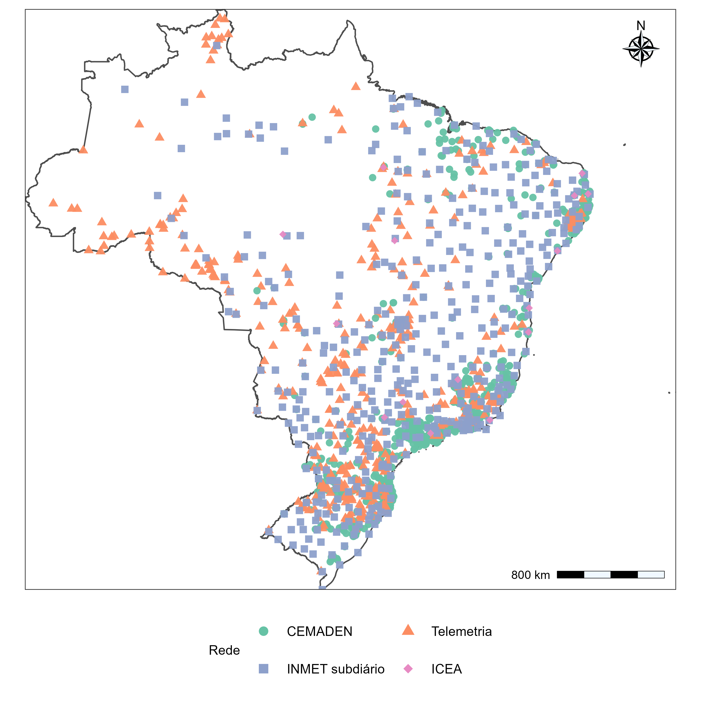
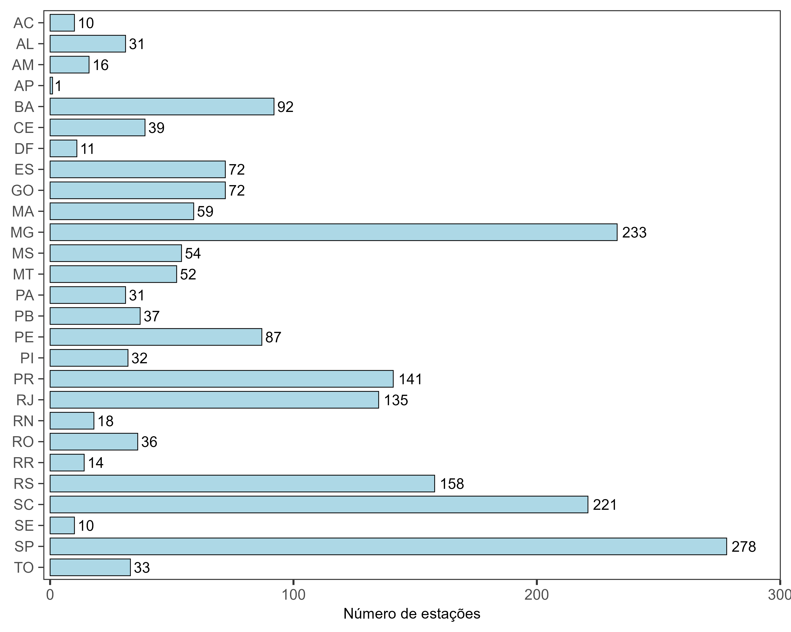

## Metodologia

O controle de qualidade (QC) foi aplicado aos registros subdiários de precipitação da base UNIPLU-BR, abrangendo diferentes redes de monitoramento e resoluções temporais conforme os dados descritos na meta 3. Inicialmente, as estações foram avaliadas quanto à consistência dos metadados, à identificação da rede, à resolução temporal, à disponibilidade dos registros e à definição do mês inicial do ano hidrológico. Foram consideradas estações com resoluções inferiores a 24 horas, sendo excluídas do processamento automático aquelas com inconsistências cadastrais ou alterações de resolução não resolvidas. Posteriormente, os registros foram submetidos a verificações de integridade temporal e consistência pluviométrica, distinguindo observações inválidas de valores potencialmente extremos que exigiam avaliação adicional.

### Verificações de consistência das observações

As precipitações foram interpretadas como lâminas incrementais, em milímetros por intervalo de aquisição, associadas a registros temporais em UTC. O procedimento distinguiu duas classes de sinalização: **FAIL**, para registros que não atendiam a requisitos mínimos de utilização, e **SUSPECT**, para observações potencialmente inconsistentes que não deveriam ser descartadas sem consideração de seu contexto. Uma observação pôde apresentar mais de uma sinalização.

Foram consideradas falhas impeditivas datas inválidas ou posteriores à referência temporal do processamento, precipitações ausentes, não finitas ou negativas, identificação inconsistente da estação, reprovação informada pela fonte, desalinhamento em relação à grade de aquisição e duplicidades conflitantes. No caso de registros repetidos com valores idênticos, preservou-se uma única ocorrência; havendo valores distintos para o mesmo instante, o horário foi invalidado. Essas verificações buscaram impedir a incorporação de erros evidentes ou ambiguidades temporais aos acumulados de precipitação.

As observações suspeitas foram identificadas por critérios complementares que incluíram valores elevados frente a limites de revisão específicos da rede, persistência de precipitação positiva constante, sequências prolongadas de registros nulos, alternância sistemática entre zero e precipitação positiva, predominância excepcional de zeros e sinalizações de qualidade provenientes da fonte. Também foi realizada uma avaliação de valores atípicos positivos separadamente para cada mês do calendário, de modo a considerar diferenças sazonais na distribuição da precipitação.

Nesse último procedimento, para as observações positivas de um mesmo mês, o limite superior de sinalização foi calculado pela @eq-limiar-iqr-mensal:

$$
u_{j,m}=Q_{3,j,m}+3\left(Q_{3,j,m}-Q_{1,j,m}\right).
$$ {#eq-limiar-iqr-mensal}

em que $Q_{1,j,m}$ e $Q_{3,j,m}$ são os quartis das precipitações registradas por intervalo na estação $j$ e mês $m$. A avaliação foi aplicada quando havia pelo menos 50 observações positivas e intervalo interquartil estritamente positivo. As observações que excederam $u_{j,m}$ receberam uma sinalização de suspeita, não uma classificação automática de erro. Essa distinção é especialmente relevante na análise de extremos, na qual valores incomuns podem representar precisamente os eventos hidrológicos de maior interesse.

Para o tratamento das observações, foi adotado o critério de exclusão dos registros inválidos (**FAIL**) e daqueles classificados como suspeitos (**SUSPECT**), exceto quando a única sinalização decorria do critério interquartil mensal. Essa exceção buscou preservar eventos extremos potencialmente legítimos, evitando sua exclusão apenas por apresentarem magnitudes elevadas em relação à distribuição mensal das precipitações.

### Agregação, completude anual e seleção das máximas

Após o QC, os registros foram organizados segundo o mês inicial do ano hidrológico atribuído a cada estação. Para cada duração compatível com sua resolução nativa, foram obtidos acumulados móveis a partir de uma grade temporal regular. Os máximos anuais dos acumulados foram convertidos em intensidade média, em mm/h, dividindo-se a lâmina precipitada pela duração expressa em horas.

O critério principal de aprovação anual exigiu a existência de pelo menos uma janela utilizável e proporção de falhas na grade nativa não superior a 20%. Na seleção consolidada destinada às análises de sensibilidade, aplicou-se o filtro de falhas menor que 20%, juntamente com a exigência de pelo menos oito máximos anuais válidos por combinação estação–duração. Esses critérios permitiram identificar a disponibilidade de informação para cada duração separadamente, sem impor que todas as estações apresentassem o mesmo conjunto de durações ou o mesmo comprimento de série.

### Abrangência do processamento e seleção final

O catálogo UNIPLU-BR reuniu 21.395 estações, das quais 8.687 foram identificadas como candidatas à análise subdiária. Desse conjunto, 694 apresentaram impedimentos relacionados à consistência dos metadados, incluindo 435 por alterações de resolução temporal, 248 por inconsistências cadasis, oito por resolução inválida e três por associação a mais de uma unidade federativa. Outras 14 estações não apresentaram registros temporais válidos, resultando em 7.979 estações com processamento concluído.

A análise de sensibilidade dos critérios de completude e extensão das séries evidenciou diferenças na quantidade de estações elegíveis (@fig-sensibilidade-qc). Com tolerância de 10% de falhas, o número de estações diminuiu de 1.687 para 1.302 ao aumentar a exigência de sete para oito anos válidos. Com tolerância de 20%, foram identificadas 1.978 estações com pelo menos sete anos e 1.973 com pelo menos oito anos. O aumento da tolerância para 30% e 40% não ampliou o número de estações com pelo menos oito anos, embora tenha aumentado a quantidade de postos elegíveis para exigências de nove e dez anos. Dessa forma, a combinação de no máximo 20% de falhas anuais e pelo menos oito anos válidos foi adotada para preservar a cobertura espacial sem flexibilizar excessivamente o critério de completude.

{#fig-sensibilidade-qc width="95%" fig-align="center"}

Após a aplicação dos critérios de controle de qualidade e seleção temporal, foram aprovadas 1.973 estações pluviométricas subdiárias, distribuídas entre as redes CEMADEN (1.076), Telemetria (461), INMET subdiário (421) e ICEA (15). A distribuição espacial das estações (@fig-mapa-estacoes-qc) mostrou maior concentração no Sul, Sudeste e em áreas do Nordeste, enquanto as regiões Norte e Centro-Oeste apresentaram uma rede mais dispersa. Observam-se também diferenças na distribuição das redes de monitoramento, com maior presença de estações CEMADEN em áreas próximas ao litoral e em regiões de maior concentração de postos, enquanto as estações de Telemetria e INMET subdiário apresentam distribuição mais ampla pelo território nacional.

{#fig-mapa-estacoes-qc width="95%" fig-align="center"}

A distribuição por unidade federativa (@fig-estacoes-uf-qc) evidenciou maior número de estações aprovadas em São Paulo (278), Minas Gerais (233), Santa Catarina (221), Rio Grande do Sul (158), Paraná (141) e Rio de Janeiro (135). Em contrapartida, estados como Amapá, Acre, Roraima e Amazonas apresentaram menor disponibilidade de estações que atenderam aos critérios estabelecidos. Essa desigualdade espacial reflete a distribuição das redes observacionais e a disponibilidade de séries com completude suficiente, constituindo uma limitação importante para a abrangência territorial das análises subsequentes.

{#fig-estacoes-uf-qc width="95%" fig-align="center"}

