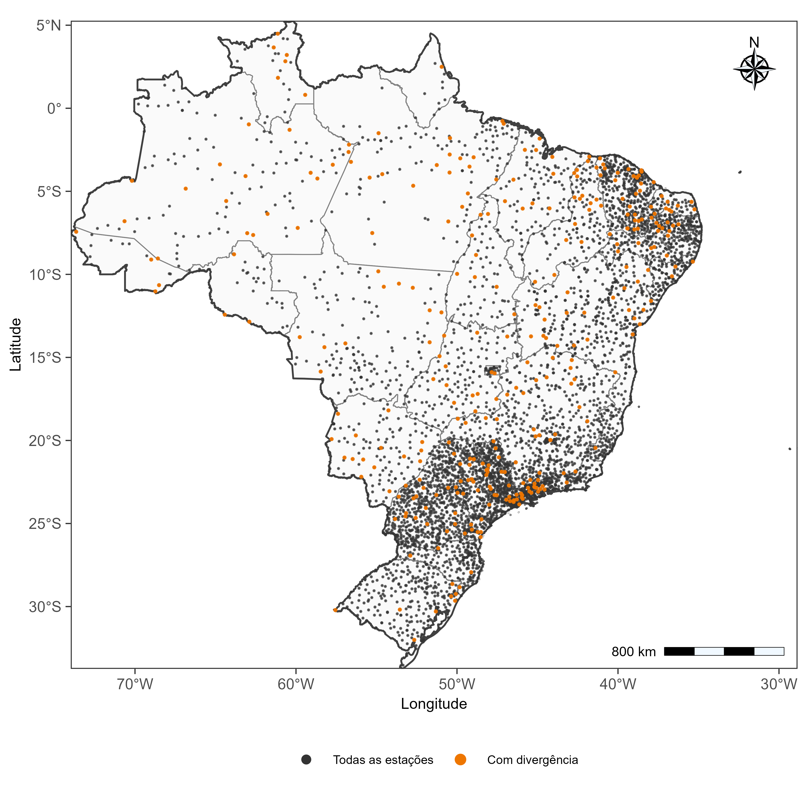
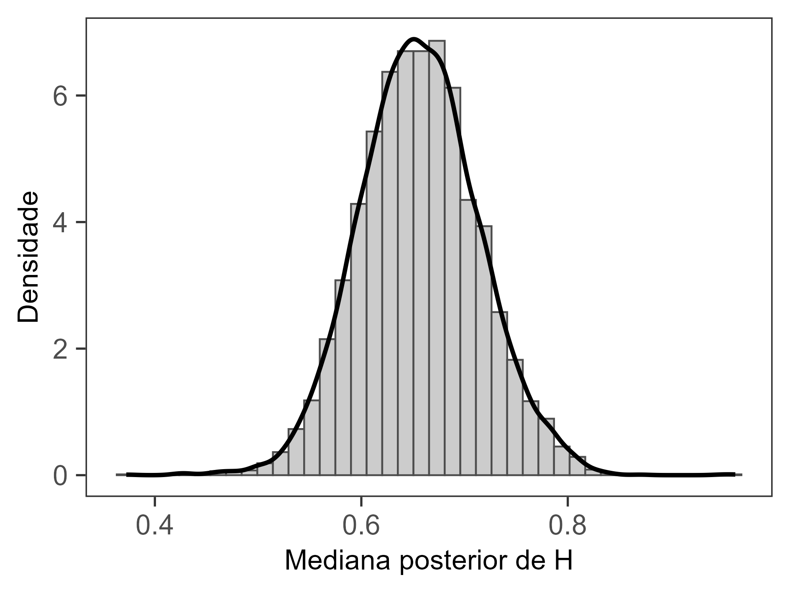
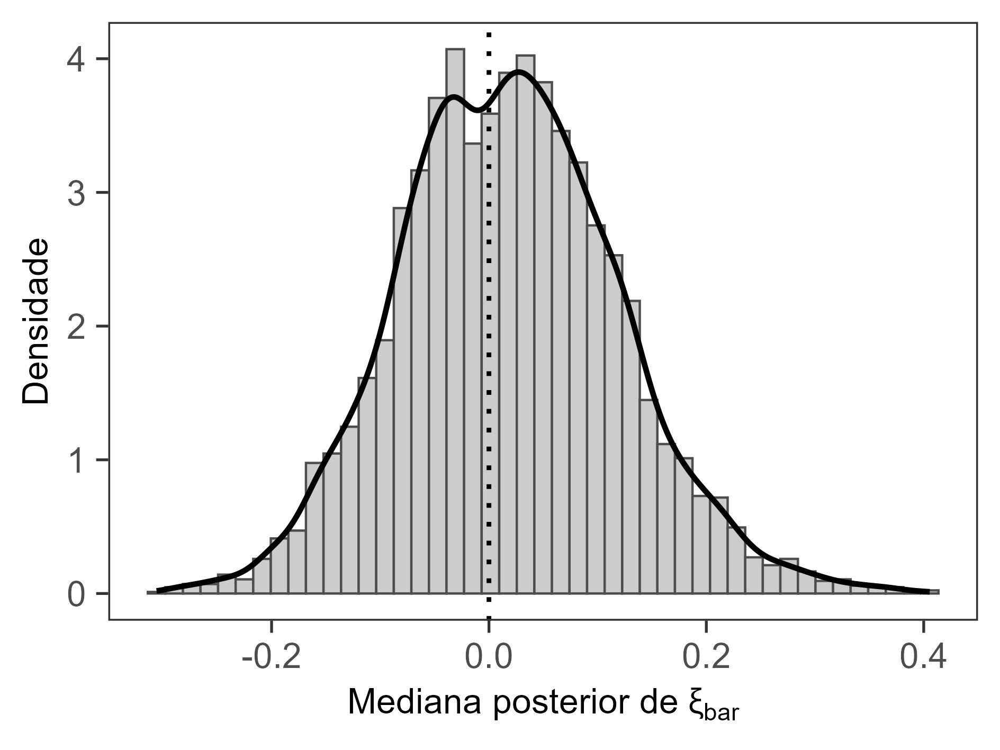
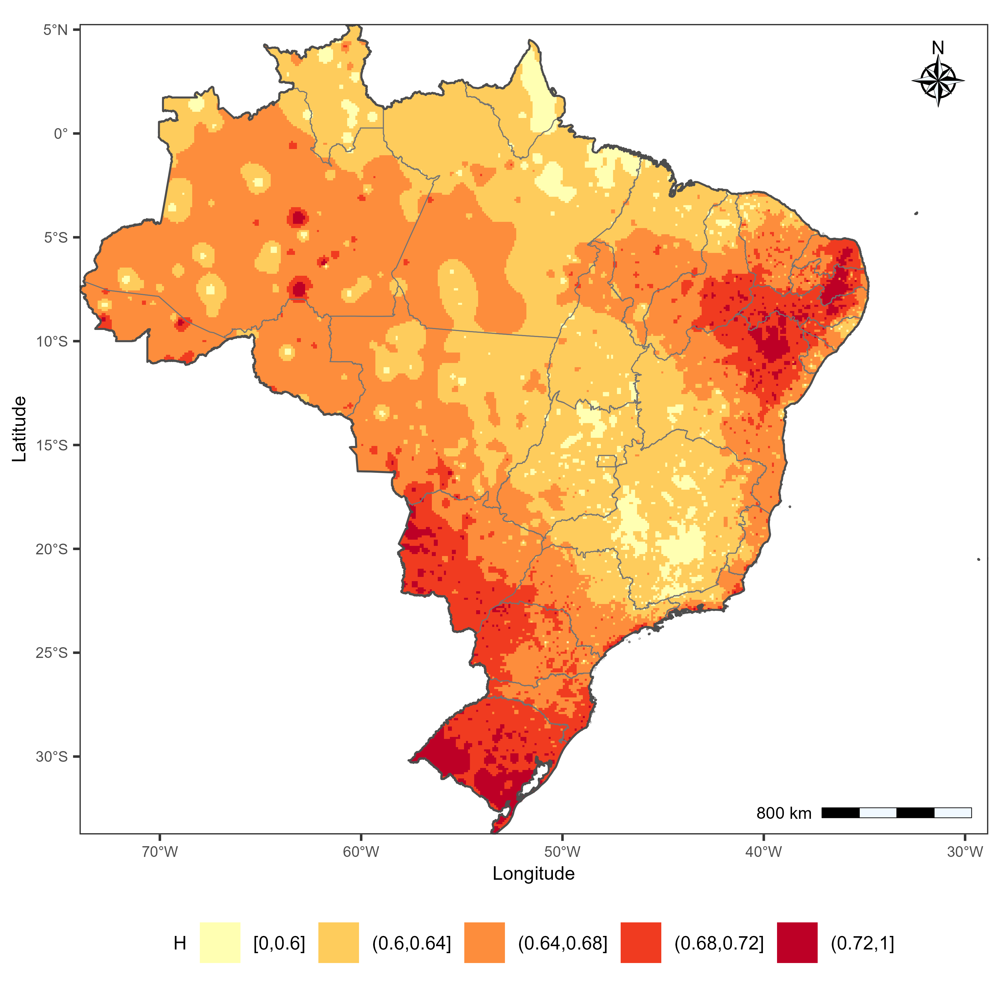
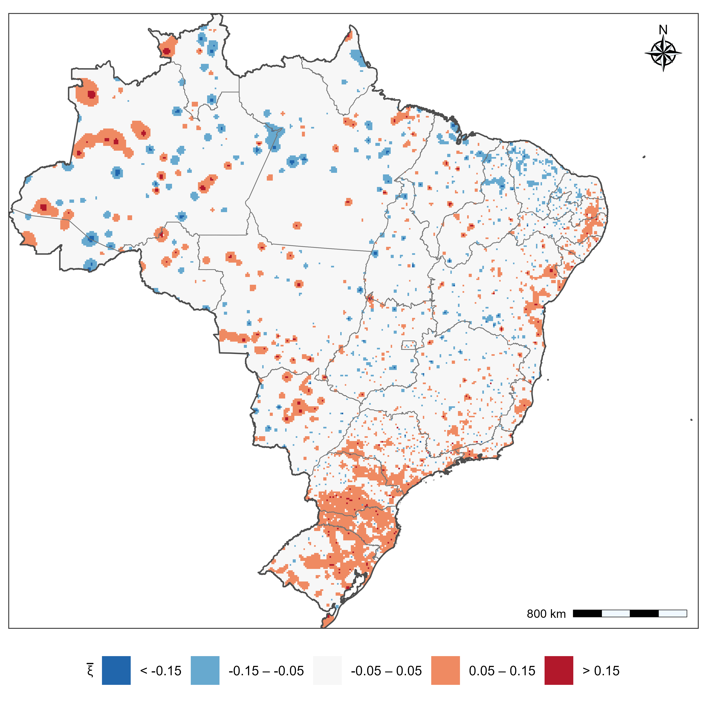

## Aplicação do modelo bayesiano às séries diárias

A análise das precipitações extremas em escala diária foi realizada por meio do modelo hierárquico bayesiano local (*non-pooled*), cuja formulação probabilística, relações de invariância de escala e distribuições a priori foram apresentadas anteriormente na análise subdiária do Rio Grande do Sul. Nesta etapa, a mesma estrutura foi aplicada individualmente às estações pluviométricas distribuídas pelo território brasileiro, mantendo o compartilhamento hierárquico de informações entre durações de uma mesma estação, sem compartilhamento espacial dos parâmetros.

Foram consideradas oito durações de precipitação: 1, 2, 3, 4, 5, 6, 7 e 10 dias, correspondentes a 24, 48, 72, 96, 120, 144, 168 e 240 horas, respectivamente. Foram incluídas apenas estações com pelo menos 30 anos válidos de observações, considerando as séries de máximos anuais organizadas segundo o mês inicial do ano hidrológico definido individualmente para cada estação.

Diferentemente da análise comparativa realizada no Rio Grande do Sul, na qual os máximos anuais foram delimitados pelo ano civil, a presente aplicação utilizou anos hidrológicos específicos por estação. Essa organização buscou considerar as diferenças regionais na sazonalidade das precipitações extremas, evitando a adoção de um mesmo limite anual para todo o território nacional.

Os parâmetros de localização ($\mu$), escala ($\sigma$) e forma ($\xi$) da distribuição GEV foram estimados para cada duração. A estrutura de invariância de escala manteve a duração de referência $d_0=24$ h, com os parâmetros estruturais $\alpha$, $\beta$, $H$ e $\theta$ estimados individualmente para cada estação. O parâmetro de forma também foi mantido específico por duração, com regularização hierárquica em torno de um parâmetro central local, $\bar{\xi}$.

A inferência foi realizada por amostragem MCMC utilizando Stan, com cinco cadeias independentes de 20.000 iterações, das quais 10.000 foram destinadas ao aquecimento. Foi aplicado um fator de espaçamento (*thinning*) de 50, resultando em 1.000 amostras posteriores retidas por estação. Os parâmetros de controle do amostrador foram definidos como `adapt_delta = 0.999` e `max_treedepth = 17`.

As distribuições posteriores dos parâmetros GEV foram utilizadas para estimar os quantis associados aos períodos de retorno analisados, conforme as equações apresentadas anteriormente.

### Resultados da aplicação nacional

#### Diagnósticos de convergência

Foram realizados 5.258 ajustes individuais do modelo bayesiano, correspondentes às estações pluviométricas selecionadas para a análise diária. Nenhuma estação apresentou valor máximo de $\widehat{R}$ superior a 1,05. Entretanto, foram identificadas divergências na amostragem de 333 estações (6,33% do total), enquanto as demais 4.925 estações (93,67%) não apresentaram divergências.

A distribuição espacial desses diagnósticos (@fig-diagnostico-bayesiano) mostrou que as estações com divergências se encontram distribuídas por diferentes regiões do território brasileiro, sem concentração exclusiva em uma região específica. Embora os valores de $\widehat{R}$ não tenham ultrapassado o limite adotado, as divergências indicam a necessidade de cautela na interpretação dos resultados das estações afetadas.

{#fig-diagnostico-bayesiano width="95%" fig-align="center"}

#### Parâmetros estruturais do modelo

A análise dos parâmetros estruturais considerou as medianas das distribuições posteriores estimadas individualmente nas 5.258 estações. A síntese nacional foi realizada a partir da distribuição dessas medianas entre estações, permitindo caracterizar a variabilidade espacial dos parâmetros sem pressupor uma distribuição posterior nacional conjunta.

O expoente de escala $H$ apresentou mediana nacional de 0,656, com intervalo interquartil entre 0,618 e 0,694. Os percentis de 5% e 95% corresponderam a 0,564 e 0,752, respectivamente, enquanto os valores extremos variaram de 0,372 a 0,962. A concentração das estimativas em torno de 0,65 indica relativa regularidade na relação de escala entre a duração e os parâmetros de localização e escala da distribuição GEV (@fig-distribuicao-parametros). Valores mais elevados de $H$ correspondem a reduções proporcionais mais acentuadas desses parâmetros com o aumento da duração, mantidos constantes os demais componentes do modelo.

O parâmetro central de forma, $\bar{\xi}$, apresentou maior dispersão entre estações, com mediana nacional de 0,017 e intervalo interquartil entre −0,050 e 0,084. Os percentis de 5% e 95% foram −0,144 e 0,190, respectivamente. A coexistência de estimativas positivas e negativas indica heterogeneidade no comportamento central das caudas das distribuições GEV entre as estações brasileiras. Valores positivos estão associados a caudas superiores pesadas, enquanto valores negativos correspondem a distribuições com limite superior finito.

::: {#fig-distribuicao-parametros layout-ncol="2"}

Distribuição das medianas posteriores dos parâmetros estruturais $H$ e $\bar{\xi}$ nas 5.258 estações pluviométricas brasileiras.
:::

A distribuição espacial de $H$ (@fig-mapa-h) apresentou diferenças regionais, com valores interpolados superiores a 0,72 em áreas do extremo Sul do Brasil. Estimativas intermediárias, sobretudo entre 0,60 e 0,68, abrangeram extensas áreas do território nacional, indicando variações espaciais na taxa de redução dos parâmetros GEV com a duração.

{#fig-mapa-h width="95%" fig-align="center"}

O parâmetro central de forma $\bar{\xi}$ também apresentou heterogeneidade espacial (@fig-mapa-xi), com estimativas positivas, negativas e próximas de zero distribuídas por diferentes regiões do país. Valores positivos entre aproximadamente 0,05 e 0,15 foram identificados em porções do Sul, Sudeste e Nordeste, enquanto estimativas negativas ocorreram de maneira descontínua no território nacional.

{#fig-mapa-xi width="95%" fig-align="center"}

Os padrões espaciais apresentados foram obtidos por interpolação das medianas posteriores individuais, utilizando ponderação pelo inverso da distância (IDW). Portanto, constituem representações exploratórias da variabilidade espacial dos parâmetros, sem incorporar explicitamente a incerteza posterior ou a dependência espacial entre as estações.

Os demais parâmetros estruturais apresentaram medianas nacionais de 1,06 para $\alpha$ e −0,199 para $\beta$. As variâncias hierárquicas tiveram medianas de 0,00553 para $\tau_{\mu}^{2}$, 0,00978 para $\tau_{\sigma}^{2}$ e 0,00924 para $\tau_{\xi}^{2}$, caracterizando a dispersão dos parâmetros específicos das diferentes durações em torno das relações hierárquicas estabelecidas.

#### Parâmetros da distribuição GEV

Os parâmetros da distribuição GEV foram analisados para as oito durações consideradas, a partir das medianas posteriores estimadas nas 5.258 estações. A @fig-gev-duracao apresenta a variação dos parâmetros de localização ($\mu$), escala ($\sigma$) e forma ($\xi$) com a duração, incluindo medidas da dispersão espacial entre estações.

O parâmetro de localização $\mu$ apresentou redução sistemática com o aumento da duração. Sua mediana nacional diminuiu de 2,94 mm/h em 1 dia para 1,94 mm/h em 2 dias, 1,51 mm/h em 3 dias e 0,734 mm/h em 10 dias. O intervalo interquartil também apresentou redução em termos absolutos, passando de 2,66–3,24 mm/h para 0,655–0,822 mm/h entre as durações de 1 e 10 dias.

Comportamento semelhante foi observado para o parâmetro de escala $\sigma$, cuja mediana nacional diminuiu de 0,831 mm/h em 1 dia para 0,546 mm/h em 2 dias e 0,202 mm/h em 10 dias. O intervalo interquartil passou de 0,737–0,950 mm/h para 0,179–0,233 mm/h entre as durações extremas. A redução simultânea de $\mu$ e $\sigma$ é coerente com a estrutura de invariância de escala adotada, indicando menores intensidades características e menor escala de dispersão dos máximos anuais nas durações mais longas.

Em contraste, o parâmetro de forma $\xi$ apresentou variações relativamente pequenas em sua tendência central ao longo das durações. As medianas nacionais permaneceram próximas de zero, variando de 0,0218 em 1 dia a 0,00496 em 10 dias. Entretanto, os intervalos interquartis abrangeram valores positivos e negativos em todas as durações, sendo de −0,0487 a 0,0930 para 1 dia, evidenciando heterogeneidade entre estações.

{#fig-gev-duracao width="95%" fig-align="center"}

A relativa estabilidade das medianas nacionais de $\xi$ merece destaque, pois a formulação local (*non-pooled*) permite que o parâmetro de forma varie entre durações. Esse comportamento é compatível com a hipótese de invariância aproximada de $\xi$, examinada anteriormente na comparação dos modelos do Rio Grande do Sul, na qual a estrutura com parâmetro de forma específico por estação apresentou o melhor desempenho preditivo.

Entretanto, a estabilidade observada na síntese nacional não demonstra necessariamente a constância de $\xi$ em cada estação, uma vez que a regularização hierárquica também contribui para aproximar as estimativas entre durações. Além disso, os intervalos apresentados representam a dispersão espacial das medianas posteriores, e não intervalos de credibilidade das diferenças entre parâmetros de uma mesma estação. Assim, os resultados fornecem uma indicação descritiva favorável à investigação dessa hipótese, sem constituir sua confirmação estatística.

### Curvas intensidade–duração–frequência (IDF)

As curvas intensidade–duração–frequência (IDF) estimadas pelo modelo bayesiano local (*non-pooled*) foram examinadas em seis estações pluviométricas selecionadas para ilustrar diferentes comportamentos do parâmetro de forma da distribuição GEV: Ceará (739006), Minas Gerais (1842004), Pernambuco (735041), Paraná (2549006), Rio Grande do Norte (535011) e Santa Catarina (2849002). As estações apresentam séries de máximos anuais com comprimentos entre 77 e 124 anos, incluindo registros relativamente longos e diferentes características das caudas estimadas. A seleção contempla estações com parâmetros de forma predominantemente negativos (CE e MG), positivos (PE, RN e SC) e próximos de zero (PR), permitindo examinar comportamentos distintos das relações IDF sem pressupor representatividade estatística do conjunto nacional de estações.

As relações obtidas apresentaram redução das intensidades com o aumento da duração, entre 1 e 10 dias, e elevação dos quantis com o período de retorno. As diferenças entre as curvas foram particularmente evidentes nas estações de Pernambuco e Rio Grande do Norte, cujas medianas das estimativas de $\xi_d$ entre durações foram de 0,369 e 0,180, respectivamente. Nessas estações, os quantis associados aos maiores períodos de retorno apresentaram maior afastamento, compatível com a influência de parâmetros de forma positivos sobre a cauda superior da distribuição GEV. Em contrapartida, Ceará e Minas Gerais, com medianas de $\xi_d$ de −0,230 e −0,252, apresentaram menor separação relativa entre as curvas. No Paraná, as estimativas permaneceram próximas de zero, enquanto Santa Catarina apresentou valores positivos moderados.

Embora tenham sido observadas diferenças expressivas de $\xi_d$ entre as estações, suas estimativas apresentaram relativa estabilidade ao longo das durações analisadas. Em cinco dos seis postos, as medianas posteriores mantiveram o mesmo sinal, enquanto no Paraná oscilaram próximas de zero. Esse comportamento é compatível com a regularização hierárquica adotada, embora não constitua, isoladamente, evidência de constância do parâmetro de forma entre durações.

A análise da incerteza posterior para os períodos de retorno de 5, 25 e 200 anos (@fig-idf-diaria-ic-1) mostrou ampliação dos intervalos de credibilidade de 95% à medida que aumentou o período de retorno. Esse comportamento foi especialmente evidente nas estações de Pernambuco e Rio Grande do Norte, nas quais os quantis de 200 anos apresentaram maior dispersão posterior. Nas estações com parâmetros centrais de forma negativos, os intervalos permaneceram relativamente mais estreitos, acompanhando a menor separação entre as estimativas centrais dos quantis elevados.

{#fig-idf-diaria-ic-1 width="95%" fig-align="center"}

Resultados semelhantes foram observados para os períodos de retorno de 10, 50 e 100 anos (@fig-idf-diaria-ic-2). As estimativas centrais mantiveram o comportamento decrescente com a duração, enquanto os intervalos de credibilidade evidenciaram diferenças entre as estações quanto à incerteza dos quantis. A estação de Pernambuco apresentou uma das maiores separações entre as curvas e faixas de incerteza mais amplas, ao passo que Ceará, Minas Gerais e Paraná apresentaram menor dispersão relativa dos quantis para os períodos de retorno considerados.

{#fig-idf-diaria-ic-2 width="95%" fig-align="center"}

Em conjunto, os resultados demonstram que o modelo bayesiano local (*non-pooled*) permitiu representar diferentes comportamentos das relações IDF entre as estações analisadas, incluindo diferenças na intensidade dos extremos e na sensibilidade dos quantis aos períodos de retorno. A variabilidade das estimativas está associada às características locais dos parâmetros GEV, particularmente ao parâmetro de forma, cuja influência se torna mais relevante para períodos de retorno elevados. Contudo, as estimativas de eventos raros, especialmente para 200 anos, devem ser interpretadas com cautela, uma vez que envolvem extrapolações consideráveis em relação à extensão das séries observacionais.

