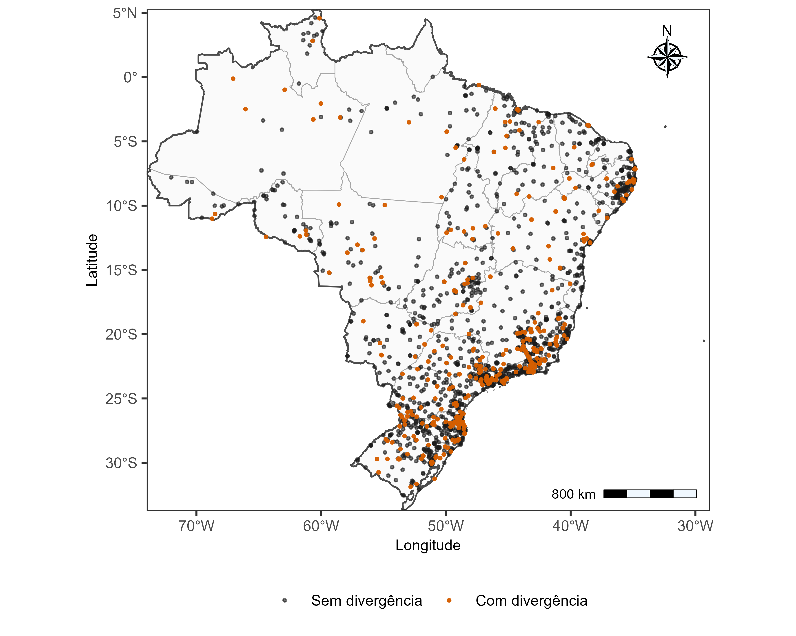
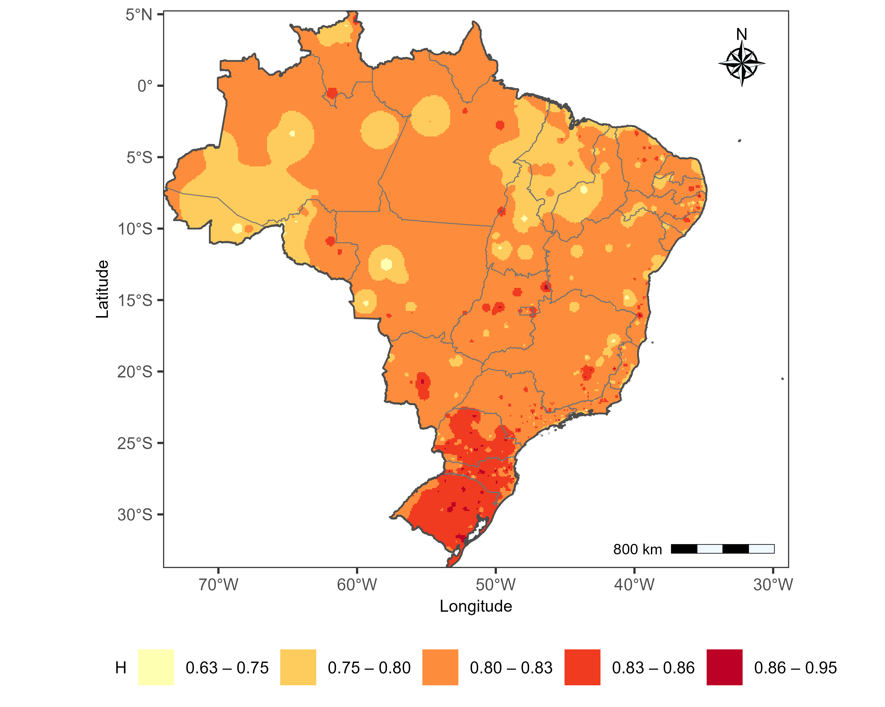
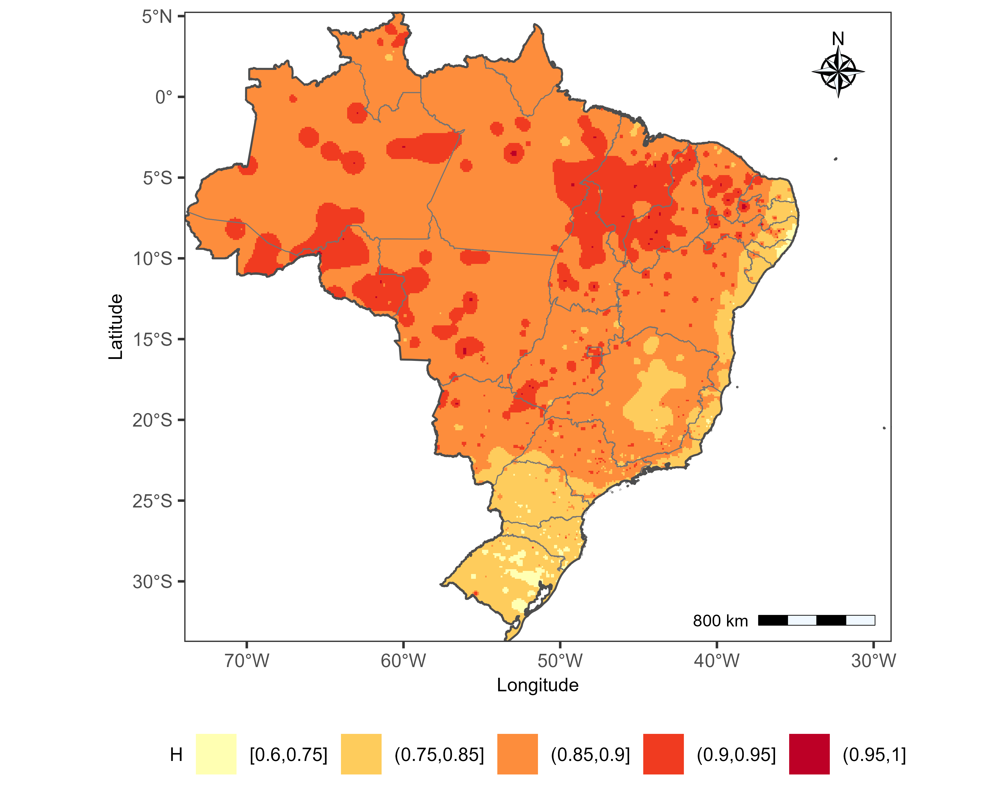
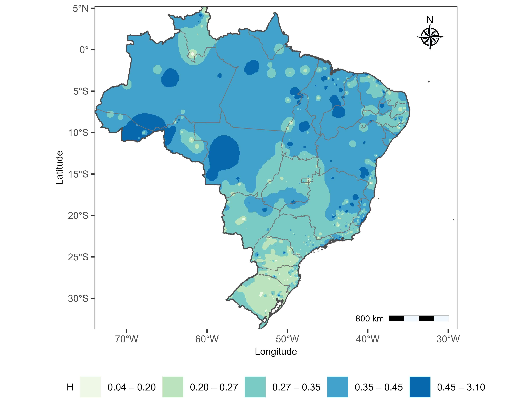
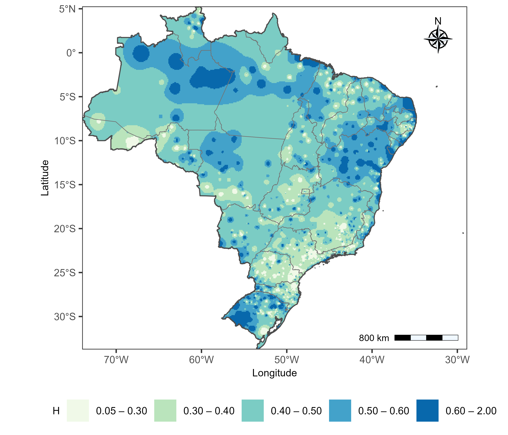
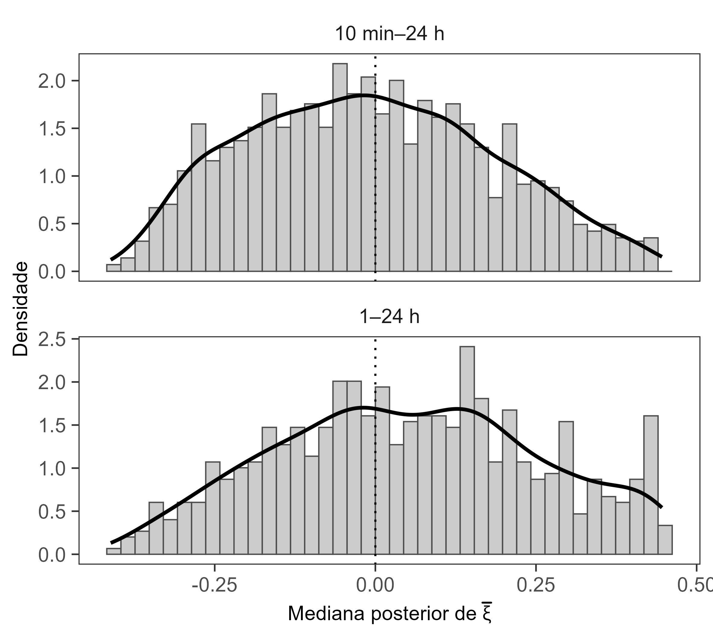

### Aplicação nacional do modelo bayesiano às séries subdiárias

A modelagem das precipitações extremas em escala subdiária foi realizada por meio da abordagem hierárquica bayesiana local (*non-pooled*), apresentada anteriormente no estudo de caso do Rio Grande do Sul. A formulação manteve a distribuição GEV, as distribuições a priori e a regularização hierárquica dos parâmetros entre durações de uma mesma estação, sem compartilhamento espacial de informações. Nesta etapa, entretanto, a relação de invariância de escala foi adaptada para representar separadamente o comportamento das precipitações em durações sub-horárias e horárias.

Foram utilizadas as séries de máximos anuais provenientes da base UNIPLU, após os procedimentos de controle de qualidade e definição do ano hidrológico descritos nas seções anteriores. A seleção considerou estações com pelo menos oito anos válidos em todas as 24 durações horárias, de 1 a 24 horas, e em pelo menos duas durações sub-horárias entre 10, 15, 20, 30, 40, 45 e 50 minutos.

Para representar as diferenças entre as escalas temporais, foi adotada uma relação de invariância de escala por partes, estabelecendo-se uma duração de transição de 1 hora ($d_b=1$ h) e mantendo-se a duração de referência de 24 horas ($d_0=24$ h). A função de escala foi definida conforme a @eq-escala-partes-br:

$$
\eta_j(d)=
\begin{cases}
-H_{L,j}\log\left(\dfrac{d+\theta_{L,j}}{d_0+\theta_{L,j}}\right),
& d\geq d_b,\\[10pt]
\eta_j(d_b)-H_{C,j}\log\left(\dfrac{d+\theta_{C,j}}{d_b+\theta_{C,j}}\right),
& d<d_b,
\end{cases}
$$ {#eq-escala-partes-br}

em que $j$ identifica a estação pluviométrica e $d$ representa a duração da precipitação. Os parâmetros $H_{L,j}$ e $\theta_{L,j}$ correspondem, respectivamente, ao expoente de escala e ao deslocamento temporal das durações iguais ou superiores a 1 hora, enquanto $H_{C,j}$ e $\theta_{C,j}$ representam os parâmetros das durações sub-horárias. O termo $\eta_j(d_b)$ é calculado a partir do ramo horário, assegurando a continuidade da função no ponto de transição. Todas as durações e os parâmetros de deslocamento temporal foram expressos em horas.

As médias das distribuições hierárquicas dos logaritmos dos parâmetros de localização e escala da GEV passaram a ser definidas por $\alpha_j+\eta_j(d)$ e $\beta_j+\eta_j(d)$, respectivamente, preservando as variâncias hierárquicas $\tau_{\mu,j}^{2}$ e $\tau_{\sigma,j}^{2}$. Assim, ambos os parâmetros permanecem relacionados à duração por uma função comum, mas com flexibilidade para apresentar diferentes taxas de variação nos intervalos sub-horário e horário.

Os novos parâmetros estruturais receberam as mesmas famílias de distribuições a priori utilizadas anteriormente, com $H_{L,j},H_{C,j}\sim\operatorname{Beta}(1,1)$ e $\theta_{L,j},\theta_{C,j}\sim\operatorname{Uniforme}(0,10)$. O parâmetro de forma $\xi_{j,d}$ permaneceu específico por duração, com suporte entre −0,5 e 0,5 e regularização em torno de um parâmetro central $\bar{\xi}_j$, mantendo-se as demais distribuições a priori e hiperpriori da formulação original.

A inferência foi realizada individualmente por estação, utilizando o algoritmo NUTS implementado em Stan. Foram executadas cinco cadeias de 20.000 iterações, com 10.000 destinadas ao aquecimento e fator de espaçamento (*thinning*) de 50, totalizando nominalmente 1.000 amostras posteriores retidas por estação. Os parâmetros de controle do amostrador foram definidos como `adapt_delta = 0.999` e `max_treedepth = 17`.

A formulação por partes preservou a estrutura probabilística utilizada nas análises anteriores, introduzindo maior flexibilidade na representação da relação entre intensidade e duração. Essa adaptação permitiu considerar diferentes comportamentos de escala abaixo e acima de 1 hora, mantendo a continuidade da função e a estimação conjunta dos parâmetros GEV para todas as durações disponíveis em cada estação.

#### Aplicação nacional do modelo bayesiano às séries subdiárias

##### Diagnósticos de convergência

##### Diagnósticos de convergência

A aplicação nacional do modelo hierárquico bayesiano às séries subdiárias compreendeu 1.973 estações pluviométricas. Os diagnósticos de convergência apresentaram valores satisfatórios de $\widehat R$, com mediana de 1,01, percentil de 95% também de 1,01 e valor máximo de 1,02. Nenhuma estação apresentou $\widehat R_{\max}>1{,}05$.

Quanto às transições divergentes durante a amostragem MCMC, 1.586 estações (80,4%) não apresentaram ocorrências, enquanto 387 (19,6%) registraram pelo menos uma divergência. A distribuição espacial desses resultados (@fig-diagnostico-subdiario) mostrou ocorrências em diferentes regiões do território brasileiro, com maior concentração de estações com divergências nas regiões Sul e Sudeste, especialmente em áreas com maior densidade de postos de monitoramento.

{#fig-diagnostico-subdiario width="95%" fig-align="center"}

Embora os valores de $\widehat R$ indiquem concordância entre as cadeias, a presença de divergências em 19,6% das estações aponta possíveis dificuldades na exploração de determinadas regiões das distribuições posteriores.

##### Parâmetros estruturais e comportamento da invariância de escala

A aplicação nacional do modelo hierárquico bayesiano permitiu estimar os parâmetros estruturais das relações de escala considerando separadamente as durações sub-horárias ($d<1$ h) e as durações iguais ou superiores a 1 hora ($d\geq1$ h). Os parâmetros do intervalo horário foram estimados em 1.973 estações, enquanto os parâmetros sub-horários estavam disponíveis para 1.294 estações. A distribuição das medianas posteriores dos expoentes de escala $H$ evidenciou diferenças entre os dois intervalos temporais (@fig-distribuicao-h-subdiario). Para as durações horárias, $H_L$ apresentou mediana de 0,857, enquanto nas durações sub-horárias $H_C$ apresentou mediana de 0,818.

{#fig-distribuicao-h-subdiario width="95%" fig-align="center"}

As distribuições indicaram maior dispersão das estimativas de $H_L$ entre estações, enquanto os valores de $H_C$ apresentaram maior concentração em torno da mediana. Esse comportamento sugere maior heterogeneidade dos expoentes de escala no intervalo horário. Entretanto, como os conjuntos apresentam diferentes números de estações, a comparação das distribuições nacionais deve ser interpretada com cautela, pois parte das diferenças pode estar associada à composição das amostras.

O parâmetro de deslocamento temporal $\theta$ também apresentou diferenças entre os intervalos temporais (@fig-distribuicao-theta-subdiario). Para as durações horárias, $\theta_L$ apresentou mediana de 0,367 h, enquanto nas durações sub-horárias $\theta_C$ apresentou mediana de 0,296 h. As distribuições mostraram maior dispersão dos valores de $\theta_L$, incluindo uma cauda superior mais extensa, enquanto as estimativas de $\theta_C$ permaneceram relativamente mais concentradas. Em conjunto, as distribuições de $H$ e $\theta$ evidenciaram diferenças no comportamento dos parâmetros estruturais entre os dois intervalos temporais.

{#fig-distribuicao-theta-subdiario width="95%" fig-align="center"}

##### Distribuição espacial dos parâmetros estruturais

A distribuição espacial das medianas posteriores dos expoentes de escala apresentou diferenças entre os dois intervalos temporais (@fig-mapa-h-curto e @fig-mapa-h-longo). Para as durações sub-horárias, predominaram valores de $H$ entre aproximadamente 0,75 e 0,86 em grande parte do território nacional. Estimativas relativamente mais elevadas concentraram-se na Região Sul e em áreas localizadas do Sudeste, enquanto valores menores foram identificados em porções da Região Norte e em alguns setores do Nordeste e do Centro-Oeste.

{#fig-mapa-h-curto width="95%" fig-align="center"}

Para as durações iguais ou superiores a 1 hora, os valores de $H$ apresentaram distribuição espacial distinta (@fig-mapa-h-longo), com estimativas relativamente elevadas em extensas áreas das regiões Norte e Centro-Oeste e em setores do Nordeste. Em contrapartida, valores menores ocorreram em grande parte da Região Sul, além de áreas do Sudeste e do litoral oriental do país. Dessa forma, a diferença mais evidente entre os mapas está na mudança da configuração espacial dos expoentes estimados, especialmente nas regiões meridionais, que apresentaram valores relativamente elevados no intervalo sub-horário e menores no intervalo horário.

{#fig-mapa-h-longo width="95%" fig-align="center"}

Essas diferenças indicam que a relação entre os parâmetros GEV e a duração não apresenta necessariamente o mesmo comportamento nos intervalos sub-horário e horário em todas as regiões brasileiras. Entretanto, os mapas representam uma interpolação exploratória das medianas posteriores estimadas nas estações, não incorporando diretamente a incerteza dessas estimativas nem uma estrutura de dependência espacial probabilística. Assim, os padrões identificados são uma caracterização regional das estimativas obtidas.

A distribuição espacial do parâmetro de deslocamento temporal $\theta$ também apresentou heterogeneidade regional (@fig-mapa-theta-curto e @fig-mapa-theta-longo). Para as durações sub-horárias, predominaram valores intermediários em grande parte do país, com estimativas relativamente mais elevadas em setores das regiões Norte e Centro-Oeste. Valores menores foram observados em áreas da Região Sul, do Sudeste e em porções do Nordeste, embora tenham ocorrido variações locais.

{#fig-mapa-theta-curto width="95%" fig-align="center"}

Nas durações iguais ou superiores a 1 hora, a distribuição de $\theta$ apresentou maior heterogeneidade espacial, com áreas de valores relativamente elevados nas regiões Norte e Nordeste e em setores localizados do Centro-Oeste e do Sul (@fig-mapa-theta-longo). Em comparação com o intervalo sub-horário, observou-se maior alternância entre classes de valores, especialmente em áreas com elevada variabilidade local das estimativas. Esse comportamento é compatível com a maior dispersão identificada na distribuição nacional das medianas posteriores de $\theta$ para o intervalo horário.

{#fig-mapa-theta-longo width="95%" fig-align="center"}

#### Parâmetro de forma da distribuição GEV

A distribuição das medianas posteriores do parâmetro central de forma $\bar{\xi}$ apresentou estimativas positivas e negativas, com concentração predominante em torno de zero (@fig-distribuicao-xi-bar-subdiario). Entre as 1.973 estações analisadas, 788 (39,9%) apresentaram medianas inferiores a −0,05, 828 (42,0%) superiores a 0,05 e 357 (18,1%) foram classificadas como próximas de zero, considerando o intervalo de −0,05 a 0,05. As distribuições dos conjuntos identificados como 10 min–24 h e 1–24 h apresentaram ampla dispersão, evidenciando heterogeneidade nas estimativas do parâmetro central de forma entre as estações.

{#fig-distribuicao-xi-bar-subdiario width="95%" fig-align="center"}

A análise dos intervalos de credibilidade de 95% reforçou essa heterogeneidade. Em 1.190 estações (60,3%), os intervalos não incluíram zero, sendo inteiramente negativos em 568 postos (28,8%) e inteiramente positivos em 622 (31,5%). Nas demais 783 estações (39,7%), os intervalos abrangeram zero, indicando maior incerteza quanto ao sinal do parâmetro central de forma. Esses resultados mostram que a alternância entre estimativas positivas e negativas não decorre exclusivamente de pequenas oscilações das medianas em torno de zero, uma vez que uma parcela expressiva das distribuições posteriores apresentou intervalos de credibilidade inteiramente situados em um dos lados desse valor.

A distribuição espacial das estimativas de $\bar{\xi}$ também evidenciou heterogeneidade regional (@fig-mapa-xi-bar-subdiario). Valores próximos de zero predominaram em extensas áreas do território brasileiro, enquanto estimativas positivas e negativas ocorreram de maneira descontínua. Valores positivos relativamente elevados foram identificados em setores da Região Norte e em localidades dispersas das regiões Nordeste e Centro-Oeste, ao passo que estimativas negativas foram observadas em diferentes porções do país. Diferentemente dos padrões mais amplos identificados para os parâmetros estruturais, a distribuição de $\bar{\xi}$ apresentou maior fragmentação espacial, com alternância de sinais entre localidades relativamente próximas.

{#fig-mapa-xi-bar-subdiario width="95%" fig-align="center"}

A heterogeneidade de $\bar{\xi}$ é relevante para a estimação dos quantis associados a períodos de retorno elevados, uma vez que o parâmetro de forma influencia o comportamento da cauda superior da distribuição GEV. Entretanto, $\bar{\xi}$ representa o parâmetro central da regularização hierárquica, enquanto os quantis de retorno são calculados a partir dos parâmetros específicos de cada duração, $\xi_{j,d}$. Além disso, os padrões espaciais apresentados resultam da interpolação das medianas posteriores, sem incorporar explicitamente suas incertezas ou a dependência espacial entre estações. Dessa forma, os resultados evidenciam heterogeneidade nas estimativas do comportamento das caudas, mas não demonstram, isoladamente, diferenças estatisticamente sustentadas entre regiões.

##### Comportamento dos parâmetros GEV em estações selecionadas

A variação dos parâmetros de localização ($\mu$), escala ($\sigma$) e forma ($\xi$) da distribuição GEV em função da duração foi examinada em seis estações das regiões Nordeste, Sudeste e Sul do Brasil: SBAR (SE), SBCF (MG), SBRP (SP), 420800501A (SC), 293330704A (BA) e 314610703A (MG). Em todas as estações, os parâmetros $\mu$ e $\sigma$ apresentaram redução com o aumento da duração, com valores mais elevados nas menores durações e diminuição progressiva em direção a 24 horas (@fig-parametros-gev-subdiario). As magnitudes e as taxas de redução variaram entre os postos, destacando-se valores relativamente elevados na estação de Santa Catarina e diferenças na intensidade da redução entre as demais estações.

{#fig-parametros-gev-subdiario width="95%" fig-align="center"}

O parâmetro de forma $\xi$ apresentou comportamentos distintos entre as estações. Na estação SBCF (MG), as medianas posteriores permaneceram positivas e apresentaram aumento discreto com a duração, enquanto na estação SBAR (SE) também predominaram valores positivos, com pequenas oscilações. Em contrapartida, as estações SBRP (SP) e 293330704A (BA) apresentaram estimativas negativas, com redução mais acentuada de $\xi$ nas durações iniciais e aproximação de valores menos negativos nas durações mais longas, especialmente na estação da Bahia. Na estação 420800501A (SC), as estimativas permaneceram próximas de zero ao longo das durações, enquanto na estação 314610703A (MG) predominaram valores positivos, com aumento nas durações mais elevadas.

Os intervalos de credibilidade de 95% também evidenciaram diferenças entre os postos. Nas estações SBCF (MG) e SBRP (SP), os intervalos permaneceram, respectivamente, acima e abaixo de zero, indicando maior sustentação posterior para os sinais estimados do parâmetro de forma. Nas estações SBAR (SE), 420800501A (SC) e 314610703A (MG), os intervalos abrangeram zero em diferentes durações, evidenciando maior incerteza quanto ao sinal de $\xi$. Assim, embora a regularização hierárquica tenha permitido relacionar as estimativas entre durações de uma mesma estação, os resultados mostram que o comportamento do parâmetro de forma não foi uniforme entre os postos, tanto em suas estimativas centrais quanto na incerteza posterior associada.

##### Curvas intensidade–duração–frequência (IDF)

As curvas intensidade–duração–frequência (IDF) estimadas pelo modelo hierárquico bayesiano nacional foram examinadas em seis estações brasileiras: SBAR (SE), SBCF (MG), SBRP (SP), 420800501A (SC), 293330704A (BA) e 314610703A (MG). As estações apresentam séries de máximos anuais com comprimentos entre 11 e 42 anos e diferentes características dos parâmetros estruturais e de forma da distribuição GEV. Nas estações SBAR (SE), SBCF (MG) e SBRP (SP), as curvas apresentadas compreendem durações de 1 a 24 horas, enquanto nas demais incluem durações sub-horárias, permitindo observar a transição entre as duas relações de escala adotadas na modelagem.

A análise das curvas para os períodos de retorno de 2, 10, 50 e 200 anos (@fig-idf-subdiarias-ic-2-10-50-200) mostrou redução das intensidades estimadas com o aumento da duração e elevação dos quantis com o período de retorno, conforme o comportamento esperado das relações IDF. Nas estações com registros sub-horários, as curvas apresentaram continuidade na duração de transição de 1 hora, embora com diferenças de inclinação entre os dois intervalos temporais. Essas diferenças foram particularmente evidentes nas estações 420800501A (SC) e 314610703A (MG), nas quais os expoentes de escala estimados para durações sub-horárias foram superiores aos correspondentes ao intervalo horário. Em contrapartida, na estação 293330704A (BA), o expoente horário foi ligeiramente superior ao sub-horário.

{#fig-idf-subdiarias-ic-2-10-50-200 width="95%" fig-align="center"}

As magnitudes das intensidades apresentaram diferenças entre as estações, com valores relativamente elevados nas menores durações das estações 420800501A (SC) e 314610703A (MG). A separação entre as curvas associadas aos diferentes períodos de retorno também variou entre os postos. Nas estações SBAR (SE), SBCF (MG) e 314610703A (MG), com estimativas positivas de $\xi$ para 24 horas, observou-se maior afastamento entre os quantis dos períodos de retorno elevados. Em contrapartida, na estação SBRP (SP), caracterizada por estimativa negativa de $\xi$, as curvas apresentaram menor separação relativa nas durações mais longas, compatível com o comportamento de uma cauda superior limitada na distribuição GEV. Nas estações 420800501A (SC) e 293330704A (BA), as estimativas de $\xi$ para 24 horas foram, respectivamente, próximas de zero e negativas, acompanhadas de diferenças menos acentuadas entre os quantis elevados.

Os intervalos de credibilidade de 95% evidenciaram diferenças na incerteza posterior entre as estações. As faixas apresentaram maior amplitude absoluta para os períodos de retorno mais elevados, especialmente nas menores durações. Nas estações com apenas 11 anos válidos, observaram-se faixas relativamente amplas em algumas combinações de duração e período de retorno, particularmente na estação 420800501A (SC). Entretanto, a incerteza não apresentou comportamento uniforme entre os postos, indicando que sua magnitude está associada não apenas ao comprimento das séries, mas também às características das distribuições posteriores dos parâmetros GEV.

Para os períodos de retorno de 5, 25 e 100 anos (@fig-idf-subdiarias-ic-5-25-100), observou-se comportamento semelhante, com redução das intensidades ao longo das durações e maior separação entre as curvas nas estações com estimativas positivas do parâmetro de forma. Nas estações SBAR (SE) e SBCF (MG), as relações apresentaram redução contínua das intensidades entre 1 e 24 horas, enquanto nas estações com durações sub-horárias foi possível observar a mudança de inclinação em torno de 1 hora, sem descontinuidade aparente nos quantis estimados.

{#fig-idf-subdiarias-ic-5-25-100 width="95%" fig-align="center"}

A comparação entre as estações também evidencia a importância do comprimento das séries na interpretação das estimativas de eventos raros. Enquanto SBAR (SE), SBCF (MG) e SBRP (SP) apresentaram, respectivamente, 42, 39 e 37 anos válidos, as estações 420800501A (SC), 293330704A (BA) e 314610703A (MG) contaram com apenas 11 anos. Dessa forma, os quantis associados a períodos de retorno de 100 e 200 anos envolvem extrapolações consideravelmente superiores à extensão das séries observacionais, sobretudo nas estações mais curtas. Embora os intervalos de credibilidade representem a incerteza posterior dos quantis sob o modelo ajustado, eles não eliminam as limitações associadas à extrapolação nem contemplam necessariamente a incerteza decorrente da escolha da estrutura probabilística.

Em conjunto, os resultados mostram que a formulação bayesiana por partes permitiu representar relações IDF contínuas entre durações sub-horárias e horárias nas estações com ambas as escalas disponíveis, preservando diferenças locais nos expoentes de escala e nos parâmetros da distribuição GEV. A heterogeneidade observada na separação entre as curvas e na amplitude de seus intervalos de credibilidade evidencia a influência conjunta das características das séries e da parametrização das caudas sobre as estimativas de precipitações extremas. Esses resultados reforçam a importância de considerar a incerteza posterior e o comprimento das séries na interpretação dos quantis associados a períodos de retorno elevados, especialmente em aplicações hidrológicas que dependem da extrapolação para eventos raros.

