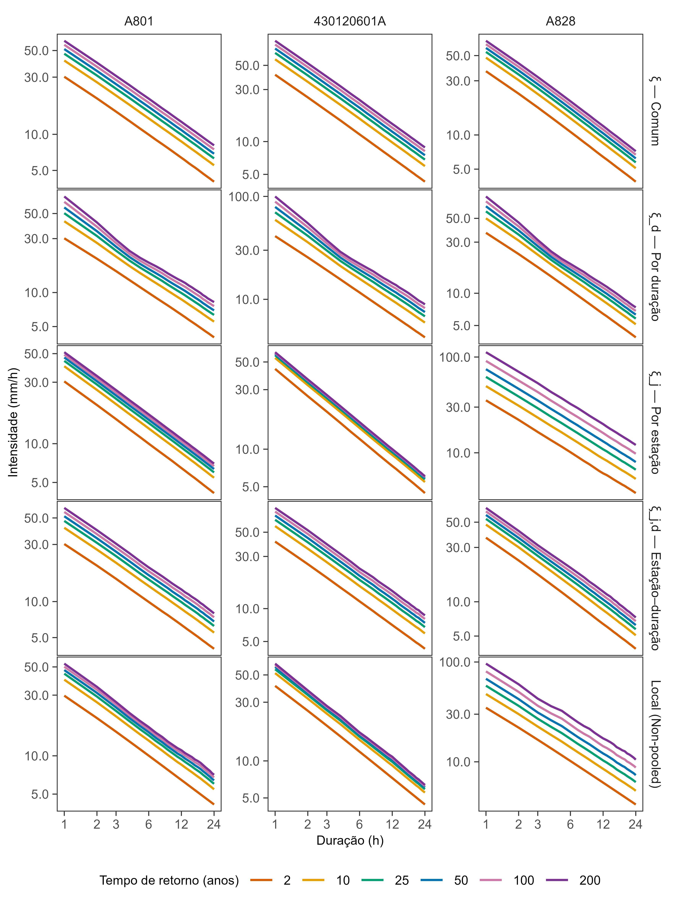
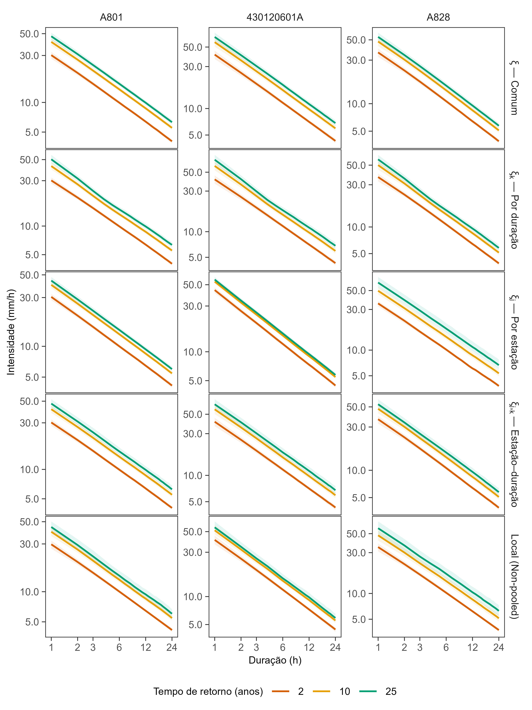
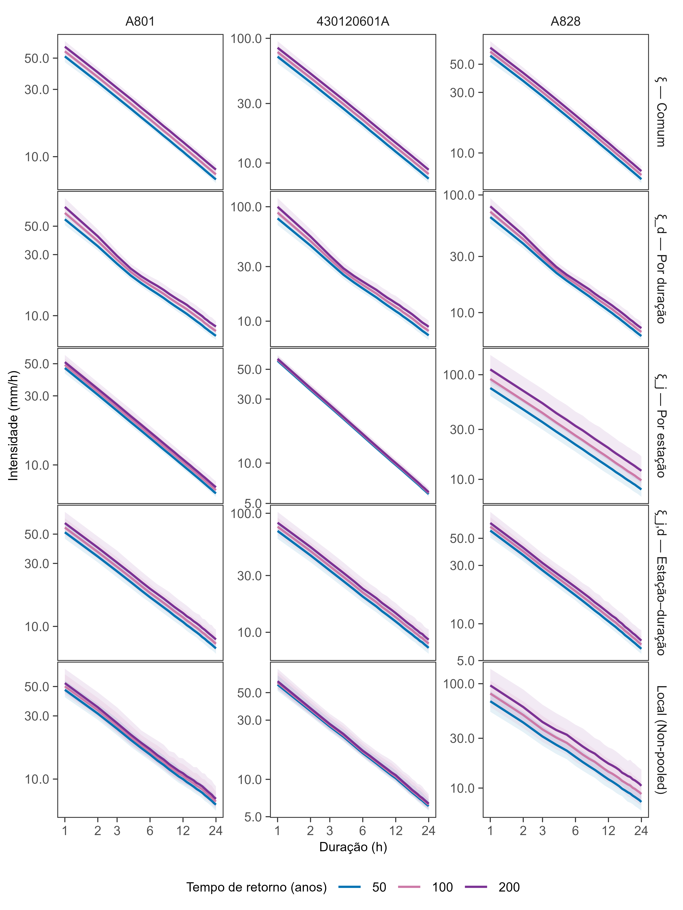

# Metodologia para a análise subdiária de precipitações extremas

Esta etapa teve como objetivo estimar relações intensidade–duração–frequência (IDF) a partir das séries subdiárias selecionadas e submetidas ao controle de qualidade na Meta 3. A análise combinou máximos anuais, a distribuição Generalizada de Valores Extremos (GEV) e inferência bayesiana com estrutura hierárquica entre durações, fundamentada nas relações de invariância de escala proposta por @koutsoyiannis1998. Foram consideradas duas aplicações: uma abordagem local (*non-pooled*) entre estações, para o processamento nacional, e um estudo comparativo de estruturas alternativas de compartilhamento de informação no Rio Grande do Sul (RS).

<!-- Consolidar toda uma descrição dos modelos aplicados no RS e as premissas adotadas pelos modelos -->

## Seleção das séries subdiárias

Foram utilizadas séries subdiárias de precipitação provenientes da base UNIPLU, selecionadas após os procedimentos de consistência e controle de qualidade descritos <!-- Verificar onde será colocado o novo controle de qualidade dos dados subdiários -->. A seleção foi realizada por combinação estação–duração–ano, de modo que os máximos anuais fossem obtidos a partir de períodos com cobertura observacional suficiente. O processamento adotou como referência um limite de 20% de falhas na resolução temporal nativa e um mínimo de oito anos aprovados por estação e duração.

A análise foi organizada em duas etapas. Inicialmente, são apresentados os modelos avaliados para o Rio Grande do Sul (RS), com o objetivo de investigar diferentes hipóteses de compartilhamento de informação entre estações e durações. Essa análise foi desenvolvida anteriormente à definição individualizada do ano hidrológico e, portanto, utilizou séries de máximos anuais obtidas por agregação segundo o ano civil, compreendido entre janeiro e dezembro.

Posteriormente, é apresentada a aplicação dos modelos em escala nacional, utilizando séries de máximos anuais organizadas de acordo com o mês inicial do ano hidrológico atribuído a cada estação. Dessa forma, as duas etapas compartilham a fundamentação probabilística e as relações de invariância de escala, mas diferem tanto nas hipóteses de compartilhamento dos parâmetros quanto na delimitação temporal dos blocos anuais.

## Agregação temporal e construção das séries AMAX

A precipitação incremental foi agregada em janelas móveis, respeitando a resolução nativa de cada estação. Para uma duração $d$ expressa em minutos, o acumulado móvel $A_{j,d}(t)$ corresponde à soma dos incrementos observados na janela com término em $t$. A intensidade máxima anual foi definida por:

$$
y_{j,d,a}=\frac{60}{d}\max_{t\in\mathcal T_{j,d,a}} A_{j,d}(t),
$$ {#eq-amax-subdiario}

em que $j$ identifica a estação, $a$ o ano de referência e $\mathcal T_{j,d,a}$ o conjunto de janelas admissíveis. A conversão da lâmina acumulada em intensidade foi realizada antes do ajuste da GEV, de modo que $y_{j,d,a}$ já está expresso em mm/h. A agregação móvel permite identificar máximos que não coincidem com os horários fixos de observação [@coles2001].

## Invariância de escala

A base física e estatística do modelo é a relação entre intensidade, duração e período de retorno $T$, na qual a variação temporal pode ser descrita por uma função de escala [@koutsoyiannis1998; @lima2018]:

$$
i(d,T)=\frac{a(T)}{(d+\theta)^H},\qquad 0<H\leq1,\ \theta\geq0.
$$ {#eq-idf-invariancia-subdiario}

A função $a(T)$ representa a dependência com a frequência, enquanto $(d+\theta)^{-H}$ representa a variação com a duração.

### Modelos Hierarquicos Bayesianos

Seguindo a formulação hierárquica de @lima2018, a distribuição GEV foi associada a relações de invariância de escala para os parâmetros de localização e escala, enquanto o parâmetro de forma foi regularizado em torno de um valor central. Para cada estação $j$, duração $d_k$ e ano $a$, o modelo foi especificado pelas @eq-gev-hierarquica-subdiario, @eq-mu-hierarquica-subdiario, @eq-sigma-hierarquica-subdiario e @eq-xi-hierarquica-subdiario.

$$
Y_{j,k,a}\sim\operatorname{GEV}
(\mu_{j,k},\sigma_{j,k},\xi_{j,k}).
$$ {#eq-gev-hierarquica-subdiario}

$$
\log\mu_{j,k}\sim\mathcal N\left(
\alpha_j-H_j\log\left(
\frac{d_k+\theta_j}{d_0+\theta_j}
\right),
\tau_{\mu,j}^{2}
\right).
$$ {#eq-mu-hierarquica-subdiario}

$$
\log\sigma_{j,k}\sim\mathcal N\left(
\beta_j-H_j\log\left(
\frac{d_k+\theta_j}{d_0+\theta_j}
\right),
\tau_{\sigma,j}^{2}
\right).
$$ {#eq-sigma-hierarquica-subdiario}

$$
\xi_{j,k}\mid\bar\xi_j,\tau_{\xi,j}^{2}
\propto\mathcal N\left(
\bar\xi_j,\tau_{\xi,j}^{2}
\right),
\qquad -0{,}5<\xi_{j,k}<0{,}5.
$$ {#eq-xi-hierarquica-subdiario}

Nessa formulação, $d_k$ representa a duração analisada e $d_0=24$ h corresponde à duração de referência. Os parâmetros $\alpha_j$ e $\beta_j$ definem os níveis centrais de localização e escala na referência, enquanto $H_j$ e $\theta_j$ controlam a relação de escala com a duração. As variâncias $\tau_{\mu,j}^{2}$ e $\tau_{\sigma,j}^{2}$ permitem desvios das respectivas tendências, e $\tau_{\xi,j}^{2}$ regula a dispersão dos parâmetros de forma em torno de $\bar\xi_j$. Todas as durações nas relações de escala foram expressas em horas, incluindo $\theta_j$.

A estrutura hierárquica permite compartilhar informação entre durações de uma mesma estação, sem impor igualdade entre seus parâmetros GEV. A restrição do parâmetro de forma corresponde ao suporte adotado na implementação, sendo a expressão proporcional à densidade normal utilizada no modelo.

### Distribuições a priori e hiperpriori

Em todas as aplicações do modelo hierárquico bayesiano, as distribuições a priori e hiperpriori foram especificadas seguindo as famílias e os valores de hiperparâmetros usados na formulação de @lima2018, adotaram-se:

$$
\alpha_j,\beta_j\sim\mathcal N(0,10^6),
$$ {#eq-priori-alpha-beta-subdiario}

$$
H_j\sim\operatorname{Beta}(1,1),\qquad 0<H_j<1,
$$ {#eq-priori-h-subdiario}

$$
\theta_j\sim\operatorname{Uniforme}(0,10),
$$ {#eq-priori-theta-subdiario}

$$
\bar\xi_j\sim\mathcal B(9,6,-0{,}5,0{,}5),
$$ {#eq-priori-xi-subdiario}

$$
\tau_{\mu,j}^{2},\tau_{\sigma,j}^{2},\tau_{\xi,j}^{2}
\sim\operatorname{InvGamma}(0{,}01,0{,}01).
$$ {#eq-hiperprioris-subdiario}

A notação $\mathcal B(a,b,l,u)$ corresponde à distribuição Beta reescalada para o intervalo $(l,u)$. Para $\bar\xi_j$, a média a priori é $-0{,}5+9/(9+6)=0{,}1$. Essa escolha segue a regularização de parâmetros de forma em análises de extremos hidrológicos, relacionada à proposta de @martins2000 e à convenção de sinal da GEV adotada por @lima2018. A distribuição $\operatorname{Beta}(1,1)$ é uniforme em $(0,1)$, e as normais para $\alpha_j$ e $\beta_j$ são amplamente dispersas na escala logarítmica. As inversas-gama incidem sobre **variâncias**, não desvios-padrão; sua escolha não deve ser interpretada como necessariamente não informativa [@gelman2006].

A especificação numérica segue o arcabouço de Lima et al. (2018), mas a **estrutura de compartilhamento regional é diferente**: na etapa nacional deste estudo, os hiperparâmetros $\bar\xi_j$, $\tau_{\mu,j}^2$, $\tau_{\sigma,j}^2$ e $\tau_{\xi,j}^2$ também são específicos por estação. Portanto, não houve *pooling* espacial, onde o compartilhamento ocorreu apenas entre durações do mesmo posto.

### Inferência posterior e diagnósticos

<!-- Talvez melhor falar disso nos resultados -->

A distribuição posterior de cada estação foi definida, proporcionalmente, pelo produto da verossimilhança GEV e das distribuições a priori e hierárquicas acima. A implementação foi desenvolvida em R com o pacote `rstan` e código probabilístico em Stan. Os parâmetros foram estimados por amostragem MCMC com o amostrador Hamiltoniano adaptativo de Stan (NUTS).

Foram executadas **cinco cadeias independentes**, com **20.000 iterações por cadeia**, descartando-se as **10.000 iniciais para aquecimento/adaptação**. Aplicou-se *thinning* de 50, mantendo-se nominalmente 200 amostras por cadeia e 1.000 sorteios posteriores por estação. Os controles do amostrador foram estabelecidos em `adapt_delta = 0.999` e `max_treedepth = 17`. Os valores iniciais de $H$, $\theta$, $\alpha$, $\beta$, $\bar\xi$, $\xi_k$ e das variâncias hierárquicas foram definidos por sorteios aleatórios próximos de valores de referência baseados nas estatísticas das séries ou em intervalos preestabelecidos.

A confiabilidade das inferências deve ser examinada por indicadores de mistura e exploração da distribuição posterior. Recomenda-se computar o diagnóstico de convergência $\widehat R$ por parâmetro, os tamanhos efetivos amostrais das regiões central e caudal (*bulk-ESS* e *tail-ESS*), as transições divergentes, os atingimentos da profundidade máxima de árvore e, quando aplicável, a eficiência energética do amostrador (*E-BFMI*). O diagnóstico $\widehat R$ compara variações entre e dentro das cadeias, enquanto os ESS sintetizam a informação efetiva disponível após considerar autocorrelação [@vehtari2021; @standiagnostics]. Adota-se como referência operacional conservadora $\widehat R<1{,}05$, além da inspeção de ESS e da ausência de divergências.

## Estudo de caso no Rio Grande do Sul (Bayesiano)

O RS foi utilizado para investigar estruturas alternativas para o parâmetro de forma da GEV, com o objetivo de examinar efeitos de restrições de homogeneidade e de compartilhamento espacial sobre a estimação de quantis extremos. Esta comparação utilizou máximos anuais organizados por ano civil, por ter sido conduzida antes da atribuição dos meses iniciais individuais do ano hidrológico.

### Estruturas alternativas de $\xi$

As hipóteses de comparação podem ser expressas pelas seguintes restrições ou relações, que diferenciam os níveis de compartilhamento de informação:

| Estrutura | Representação | Compartilhamento |
|:-----------------------|:-----------------------|:-----------------------|
| Local (*non-pooled*) | $\xi_{j,k}$ regularizado em torno de $\bar\xi_j$ | Entre durações da mesma estação |
| Constante entre durações | $\xi_{j,k}=\xi_j$ | Igualdade entre durações em cada estação |
| Comum entre estações para cada duração | $\xi_{j,k}=\xi_k$ | Igualdade entre estações para uma duração |
| Globalmente comum | $\xi_{j,k}=\xi$ | Igualdade entre estações e durações |
| *Partial pooling* espacial | $\xi_j$ associado a parâmetros regionais | Regularização entre estações, sem igualdade obrigatória |

Os modelos avaliados no Rio Grande do Sul mantiveram a mesma estrutura hierárquica de invariância de escala para os parâmetros de localização e escala da distribuição GEV, fundamentada em Lima et al. (2018). Os parâmetros $\alpha_j$, $\beta_j$, $H_j$ e $\theta_j$ foram estimados individualmente para cada estação, sem compartilhamento espacial. As diferentes especificações distinguiram-se exclusivamente pela estrutura atribuída ao parâmetro de forma $\xi$, permitindo avaliar as consequências de diferentes hipóteses de constância, heterogeneidade e compartilhamento de informação sobre o comportamento das caudas da distribuição e as estimativas de precipitações extremas.

## Quantis de retorno, incerteza e curvas IDF

Após a estimação dos parâmetros GEV, os quantis correspondentes ao período de retorno $T$ foram obtidos para cada sorteio posterior $s$. Para $\xi_{j,k}^{(s)}\ne0$, utilizou-se a @eq-quantil-gev-subdiario:

$$
q_{T,j,k}^{(s)}=\mu_{j,k}^{(s)}+
\frac{\sigma_{j,k}^{(s)}}{\xi_{j,k}^{(s)}}
\left\{\left[-\log\left(1-\frac1T\right)\right]^{-\xi_{j,k}^{(s)}}-1\right\}.
$$ {#eq-quantil-gev-subdiario}

No limite de Gumbel, aplicou-se a @eq-quantil-gumbel-subdiario:

$$
q_{T,j,k}^{(s)}=\mu_{j,k}^{(s)}-
\sigma_{j,k}^{(s)}\log\left[-\log\left(1-\frac1T\right)\right].
$$ {#eq-quantil-gumbel-subdiario}

Os quantis de retorno foram considerados para $T=2$, 5, 10, 25, 50, 100 e 200 anos, conforme a análise proposta. A mediana dos valores $q_{T,j,k}^{(s)}$ representa a estimativa central, e os percentis de 2,5% e 97,5% caracterizam o intervalo de credibilidade pontual de 95%. Os quantis resultantes constituem diretamente as ordenadas das curvas IDF. Períodos de retorno longos relativamente ao comprimento das séries exigem cautela na interpretação da extrapolação [@coles2001].

## Resultados Rio Grande do Sul

Os diagnósticos de amostragem indicaram comportamento geral satisfatório dos cinco modelos bayesianos ajustados às 52 estações do Rio Grande do Sul. Os valores máximos de $\widehat{R}$ variaram entre 1,014 e 1,019, permanecendo inferiores ao limite de 1,05 adotado na avaliação. Quanto às divergências, os modelos com $\xi$ comum, específico por duração e por estação–duração não apresentaram ocorrências, enquanto o modelo com $\xi$ específico por estação registrou duas divergências e o modelo *non-pooled*, 31 distribuídas em 14 estações.

Na avaliação do PSIS-LOO, os modelos regionais apresentaram proporções reduzidas de observações com valores de Pareto-$k$ superiores a 0,7, entre 0,008% e 0,073%. O modelo *non-pooled* apresentou maior frequência de valores elevados, com 118 observações (0,96%) acima desse limite, incluindo três com Pareto-$k>1$. Esses resultados indicam maior necessidade de cautela na interpretação das estimativas preditivas desse modelo, particularmente para as observações mais influentes.

A comparação preditiva dos cinco modelos bayesianos foi realizada por meio do critério PSIS-LOO, considerando as 12.288 observações utilizadas nos ajustes. O modelo com parâmetro de forma específico por estação ($\xi_j$) apresentou o melhor desempenho, com ELPD-LOO de −26.365,1 (@tbl-comparacao-loo). Em relação a esse modelo, as demais estruturas apresentaram diferenças de ELPD-LOO entre −320,1 e −402,5, indicando menor capacidade preditiva sob o critério adotado.

| Modelo                        |      ELPD-LOO | $\Delta$ELPD (± EP) |
|:------------------------------|--------------:|--------------------:|
| $\xi_j$ — Por estação         | **−26.365,1** |             **0,0** |
| $\xi_k$ — Por duração         |     −26.685,2 |       −320,1 ± 22,2 |
| $\xi$ — Comum                 |     −26.687,1 |       −322,0 ± 21,0 |
| $\xi_{j,k}$ — Estação–duração |     −26.687,1 |       −322,0 ± 20,7 |
| Local (*Non-pooled*)          |     −26.767,5 |       −402,5 ± 12,1 |

: Comparação preditiva dos cinco modelos bayesianos no Rio Grande do Sul.

: Valores de $\Delta$ELPD calculados em relação ao modelo com maior ELPD-LOO; EP corresponde ao erro-padrão da diferença. Valores mais elevados de ELPD-LOO indicam melhor desempenho preditivo. {#tbl-comparacao-loo}

Os resultados favoreceram a representação de $\xi$ variável entre estações, mas constante entre durações dentro de cada estação, com compartilhamento hierárquico regional. A maior flexibilidade do parâmetro de forma entre durações não proporcionou melhoria preditiva, enquanto o modelo *non-pooled* apresentou o desempenho menos favorável. Esses resultados referem-se às séries de máximos anuais organizadas segundo o ano civil e à avaliação preditiva pontual adotada.

### Parâmetros estruturais e parâmetros da distribuição GEV

A análise dos parâmetros estruturais revelou comportamento relativamente semelhante do expoente de escala $H$ entre os cinco modelos bayesianos. As medianas espaciais variaram de 0,711, no modelo com parâmetro de forma específico por estação ($\xi_j$), a 0,735, no modelo com parâmetro de forma específico por duração ($\xi_k$). As amplitudes interquartílicas permaneceram entre 0,059 e 0,068, indicando dispersões espaciais comparáveis entre as diferentes especificações. Para o modelo $\xi_j$, que apresentou o melhor desempenho preditivo, a mediana espacial de $H$ foi de 0,711, com valores entre 0,610 e 0,909 nas estações analisadas.

A distribuição das medianas posteriores de $H$ nas 52 estações apresentou comportamento semelhante entre os cinco modelos (@fig-distribuicao-h-rs), com maior concentração de valores entre aproximadamente 0,68 e 0,77. Embora o modelo com $\xi_j$ específico por estação tenha apresentado mediana espacial ligeiramente inferior, as distribuições mostraram ampla sobreposição, indicando que as diferentes estruturas de compartilhamento do parâmetro de forma produziram padrões semelhantes para o expoente de escala.

{#fig-distribuicao-h-rs width="95%" fig-align="center"}

A distribuição espacial de $H$ também apresentou padrões consistentes entre os modelos (@fig-mapa-h-rs). Os maiores valores concentraram-se principalmente no oeste e noroeste do estado, enquanto estimativas relativamente menores foram observadas em setores centrais e orientais. As diferenças entre os mapas foram predominantemente locais, sem alterações expressivas na configuração espacial geral.

{#fig-mapa-h-rs width="95%" fig-align="center"}

O parâmetro de deslocamento temporal $\theta$ apresentou maior variabilidade relativa entre estações, com medianas espaciais entre 0,360 e 0,521 h, dependendo do modelo. No modelo $\xi_j$, a mediana foi de 0,360 h, com amplitude interquartílica de 0,315 h e valores entre 0,031 e 1,76 h.

Os parâmetros de localização ($\mu$) e escala ($\sigma$) da distribuição GEV também apresentaram resultados próximos entre as especificações avaliadas. Para a duração de 24 horas, as medianas espaciais de $\mu$ variaram entre 4,13 e 4,25 mm/h, enquanto as de $\sigma$ permaneceram entre 0,939 e 0,970 mm/h. No modelo $\xi_j$, foram obtidas medianas de 4,17 mm/h para $\mu$ e 0,939 mm/h para $\sigma$, evidenciando diferenças relativamente pequenas em relação às demais estruturas.

Em contrapartida, o parâmetro de forma $\xi$ apresentou diferenças mais expressivas entre os modelos, refletindo as restrições de compartilhamento adotadas. Para a duração de 24 horas, o modelo com $\xi$ globalmente comum estimou um valor de 0,024, enquanto o modelo com $\xi$ compartilhado por duração apresentou 0,040. O modelo regional com parâmetro específico por estação–duração apresentou mediana espacial de 0,026, com valores concentrados em um intervalo relativamente estreito. Já os modelos $\xi_j$ e *non-pooled* apresentaram maior heterogeneidade espacial, com medianas de 0,004 e 0,058, respectivamente.

No modelo $\xi_j$, as estimativas de forma foram negativas em 26 estações e positivas nas outras 26, variando de −0,412 a 0,390. Os percentis espaciais de 5% e 95% foram, respectivamente, −0,339 e 0,331. A presença de valores positivos e negativos indica heterogeneidade regional no comportamento estimado das caudas da distribuição GEV, não representada pelos modelos que impõem um único parâmetro de forma a todas as estações.

Essa diferenciação também foi observada no modelo *non-pooled*, cujos valores de $\xi$ para 24 horas variaram de −0,306 a 0,338. Entretanto, a estrutura regional $\xi_j$ combinou a possibilidade de diferenças locais na forma da distribuição com uma regularização compartilhada entre estações, tendo apresentado o desempenho preditivo mais favorável na comparação realizada anteriormente.

Em contrapartida, o parâmetro de forma $\xi$ apresentou diferenças mais expressivas entre os modelos, refletindo as restrições de compartilhamento adotadas. Para a duração de 24 horas, o modelo com $\xi$ globalmente comum estimou um valor de 0,024, enquanto o modelo com $\xi$ compartilhado por duração apresentou 0,040. O modelo regional com parâmetro específico por estação–duração apresentou mediana espacial de 0,026, com valores concentrados em um intervalo relativamente estreito. Já os modelos $\xi_j$ e *non-pooled* apresentaram maior heterogeneidade espacial, com medianas de 0,004 e 0,058, respectivamente.

A distribuição espacial das estimativas de $\xi$ para 24 horas evidencia essas diferenças (@fig-mapa-xi-rs). Os modelos com parâmetro de forma comum e específico por duração não apresentam variação entre estações, conforme suas respectivas restrições. O modelo regional com $\xi_{j,k}$ apresenta variação espacial bastante reduzida, enquanto os modelos $\xi_j$ e *non-pooled* revelam maior heterogeneidade, com alternância entre estimativas positivas e negativas. Nesses dois últimos modelos, observam-se valores predominantemente negativos em setores do norte e noroeste do estado, enquanto estimativas positivas aparecem de maneira mais localizada nas porções central, oriental e meridional. A semelhança geral entre esses padrões sugere que parte da heterogeneidade espacial é preservada mesmo com a regularização regional do parâmetro de forma.

{#fig-mapa-xi-rs width="95%" fig-align="center"}

No modelo $\xi_j$, as estimativas de forma foram negativas em 26 estações e positivas nas outras 26, variando de −0,412 a 0,390. Os percentis espaciais de 5% e 95% foram, respectivamente, −0,339 e 0,331. A presença de valores positivos e negativos indica heterogeneidade regional no comportamento estimado das caudas da distribuição GEV, não representada pelos modelos que impõem um único parâmetro de forma a todas as estações. Essa diferenciação também foi observada no modelo *non-pooled*, cujos valores de $\xi$ para 24 horas variaram de −0,306 a 0,338. Entretanto, a estrutura regional $\xi_j$ combinou a possibilidade de diferenças locais na forma da distribuição com uma regularização compartilhada entre estações, tendo apresentado o desempenho preditivo mais favorável na comparação realizada anteriormente.

As diferenças entre os modelos também foram observadas na estação A801, utilizada para exemplificar o comportamento de $\xi$ ao longo das durações (@fig-xi-a801). Nos modelos com parâmetro de forma constante entre durações, as estimativas permaneceram invariáveis, com valores próximos de 0,024 para o modelo global e −0,119 para o modelo $\xi_j$. Já os modelos com variação por duração apresentaram alterações nas estimativas centrais, particularmente nas menores durações. O modelo $\xi_k$ apresentou valor positivo mais elevado em 1 hora, seguido de uma redução nas durações intermediárias, enquanto o modelo *non-pooled* manteve estimativas predominantemente negativas. Por sua vez, o modelo regional $\xi_{j,k}$ apresentou valores próximos de zero e relativamente estáveis.

{#fig-xi-a801 width="95%" fig-align="center"}

Apesar das diferenças entre as estimativas centrais, os intervalos de credibilidade apresentaram ampla sobreposição, especialmente entre os modelos com maior flexibilidade do parâmetro de forma. Esse resultado evidencia que a variação das medianas de $\xi$ entre durações não constitui, isoladamente, evidência conclusiva de mudanças sistemáticas no comportamento da cauda. Considerando também o desempenho preditivo anteriormente apresentado, os resultados favorecem a estrutura regional com parâmetro de forma específico por estação, que permite representar a heterogeneidade espacial sem exigir sua variação entre durações.

### Curvas intensidade–duração–frequência (IDF)

As curvas intensidade–duração–frequência (IDF) obtidas pelos cinco modelos bayesianos foram analisadas para três estações representativas do Rio Grande do Sul: A801, 430120601A e A828 (@fig-idf-modelos-rs). Em todas as estações e especificações, as intensidades estimadas diminuíram com o aumento da duração e aumentaram com o período de retorno, apresentando comportamento compatível com as relações IDF. Entretanto, observaram-se diferenças entre os modelos na magnitude das intensidades e na forma das curvas, particularmente nas estações A801 e A828.

{#fig-idf-modelos-rs width="95%" fig-align="center"}

Na estação 430120601A, as curvas apresentaram maior proximidade entre os modelos, indicando menor sensibilidade das estimativas IDF às diferentes estruturas adotadas para o parâmetro de forma. Na estação A801, o modelo com $\xi_k$ específico por duração apresentou alterações mais evidentes na inclinação das curvas, especialmente entre as durações de 3 e 6 horas. Já na estação A828, os modelos com $\xi_j$ específico por estação e *non-pooled* produziram intensidades mais elevadas para os maiores períodos de retorno, evidenciando maior sensibilidade das estimativas ao comportamento da cauda da distribuição GEV.

A análise dos intervalos de credibilidade de 95% para os períodos de retorno de 2, 10 e 25 anos (@fig-idf-ic-menores-rs) mostrou faixas relativamente estreitas na maior parte das combinações de estação e duração. Apesar das diferenças entre os valores centrais, os modelos apresentaram resultados próximos em diversas situações, particularmente na estação 430120601A. Na estação A828, entretanto, foram observadas diferenças mais expressivas nas intensidades estimadas pelo modelo $\xi_j$, mesmo para períodos de retorno moderados.

{#fig-idf-ic-menores-rs width="95%" fig-align="center"}

Para os períodos de retorno de 50, 100 e 200 anos (@fig-idf-ic-maiores-rs), observou-se maior afastamento entre as curvas e ampliação dos intervalos de credibilidade, sobretudo nos modelos que permitem maior variabilidade do parâmetro de forma. Esse comportamento foi mais evidente na estação A828, na qual os modelos $\xi_j$ e *non-pooled* apresentaram intensidades substancialmente superiores às estimadas pelas estruturas com cauda comum ou compartilhada por duração. Na estação 430120601A, as diferenças permaneceram relativamente pequenas, mesmo para os maiores períodos de retorno.

{#fig-idf-ic-maiores-rs width="95%" fig-align="center"}

Em conjunto, os resultados evidenciam que as diferentes hipóteses de compartilhamento do parâmetro de forma podem produzir estimativas IDF semelhantes em algumas estações, mas diferenças expressivas em outras, especialmente para eventos de maior período de retorno. A maior sensibilidade observada na estação A828 demonstra a importância de representar adequadamente a heterogeneidade local das caudas da distribuição. Esses resultados complementam a comparação preditiva, que favoreceu o modelo regional com $\xi_j$ específico por estação, embora as estimativas associadas aos períodos de retorno mais elevados permaneçam sujeitas à maior incerteza de extrapolação.
