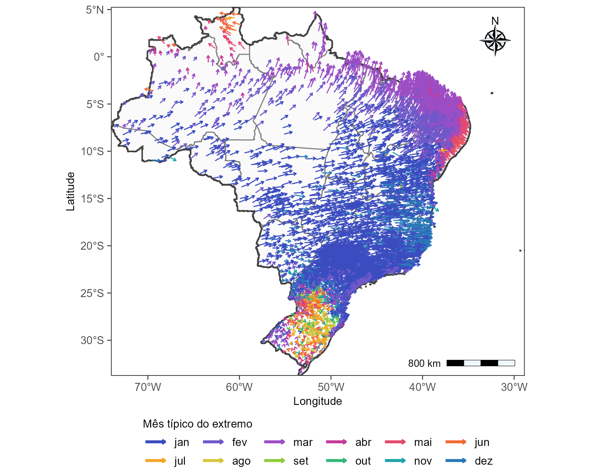
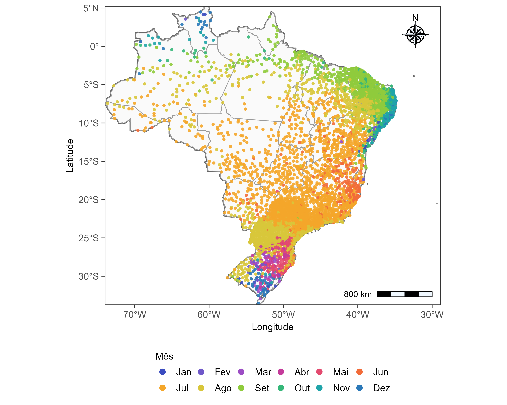
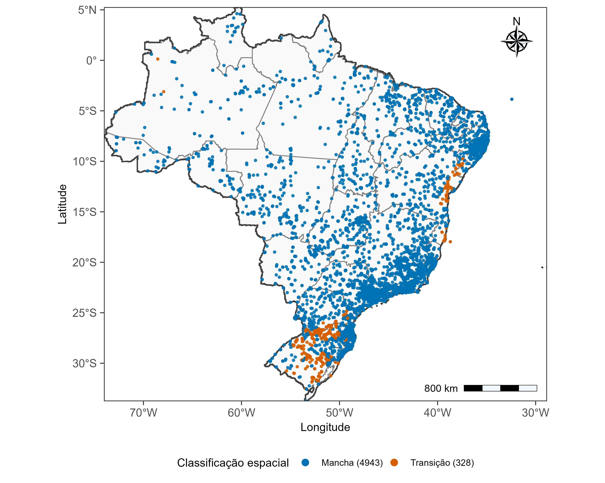
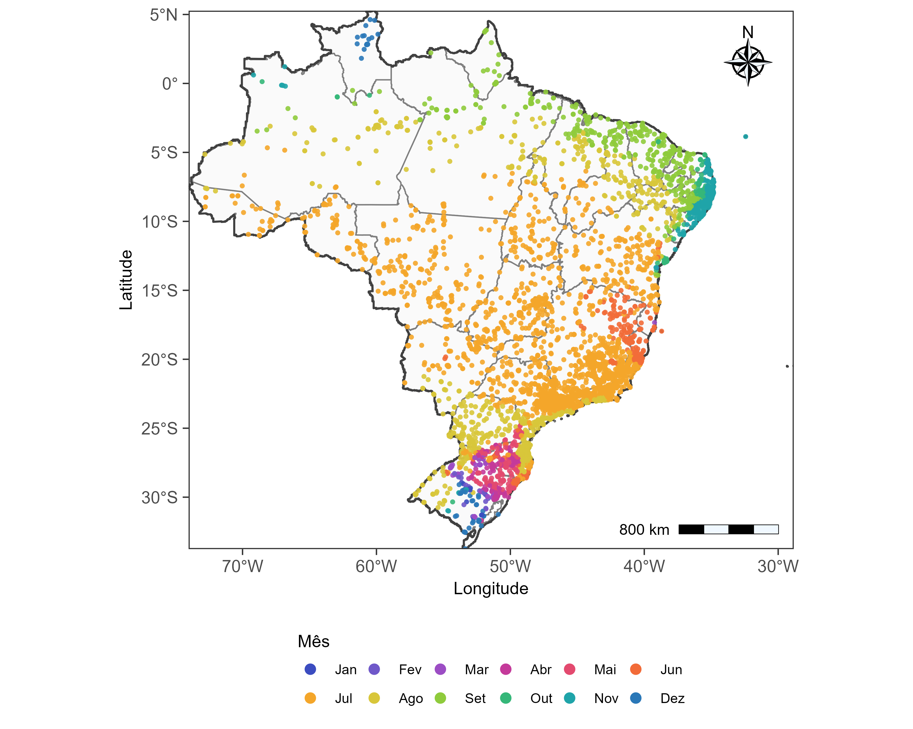

## Resultados e discussão

### Definição do ano hidrológico

#### Sazonalidade circular dos eventos extremos

A análise circular dos eventos extremos de precipitação revelou padrões espaciais distintos na época predominante de sua ocorrência ao longo do território brasileiro (@fig-vetores-rbar). A direção dos vetores representa a época típica dos extremos, enquanto seu comprimento é proporcional ao índice de concentração sazonal, $\bar{r}$. Em grande parte do Brasil Central, Sudeste e interior do país, predominaram eventos associados aos meses de novembro a janeiro. No Nordeste setentrional e na faixa litorânea oriental, destacaram-se ocorrências entre março e maio, enquanto na porção norte do país foram identificadas direções médias associadas principalmente aos meses de março a junho. A Região Sul, por sua vez, apresentou maior heterogeneidade direcional, com menor definição de uma época predominante de ocorrência dos extremos.

::: {#fig-vetores-rbar}

Vetores resultantes médios da análise circular dos eventos extremos de precipitação.
:::

Essa diferenciação regional também foi evidenciada pela distribuição de $\bar{r}$ (@fig-distribuicao-rbar). Nas estações situadas fora da Região Sul, os valores concentraram-se predominantemente entre 0,50 e 0,75, com frequência máxima próxima de 0,65, indicando maior concentração temporal dos eventos extremos. Em contraste, as estações do Rio Grande do Sul, Santa Catarina e Paraná apresentaram, em sua maioria, valores inferiores a 0,30, com maior frequência entre 0,05 e 0,15. Esse comportamento evidencia uma sazonalidade menos definida dos extremos na Região Sul, em comparação com grande parte do restante do território nacional.

{#fig-distribuicao-rbar width="95%" fig-align="center"}

#### Definição do mês inicial nas estações diárias

As diferenças identificadas na concentração sazonal fundamentaram a utilização de um procedimento híbrido para estabelecer o início do ano hidrológico. Nas estações com $\bar{r}\geq0{,}30$, adotou-se a direção oposta à ocorrência média dos extremos ($\bar{\phi}+\pi$), enquanto nos demais casos o mês inicial foi definido a partir da climatologia mensal de precipitação. A distribuição espacial desses critérios (@fig-fonte-ano-hidro) mostrou predominância da primeira abordagem nas regiões Norte, Nordeste, Centro-Oeste e Sudeste. Na Região Sul, especialmente no Rio Grande do Sul e em porções de Santa Catarina e Paraná, prevaleceu o critério baseado no último mês do maior período climatologicamente seco. A distribuição observada evidencia a necessidade de considerar diferentes características de sazonalidade na definição dos limites anuais das séries pluviométricas.

{#fig-fonte-ano-hidro width="95%" fig-align="center"}

A aplicação do procedimento híbrido permitiu determinar o mês de início do ano hidrológico para 5.659 estações pluviométricas diárias (@fig-ano-hidro-diario). Em grande parte do Brasil Central e do interior do Sudeste, predominaram os meses de junho e julho, com ocorrência de agosto em áreas de transição. No Nordeste, observou-se maior diversidade espacial, com meses iniciais entre agosto e setembro em áreas interiores e entre setembro e novembro em porções do norte e do leste da região. Na Região Norte, os meses de início variaram espacialmente, com predomínio de junho a setembro em extensas áreas do território.

{#fig-ano-hidro-diario width="95%" fig-align="center"}

Na Região Sul, a distribuição dos meses iniciais apresentou maior heterogeneidade, com predominância de agosto em partes do Paraná e de Santa Catarina e ocorrência de meses entre março e julho em diferentes áreas do Rio Grande do Sul. Esse padrão reflete a maior participação do critério climatológico na definição do ano hidrológico nessa região. Em conjunto, os resultados permitiram estabelecer uma referência temporal espacialmente diferenciada para a organização das séries de máximos anuais, considerando tanto a época predominante dos eventos extremos quanto a sazonalidade dos totais mensais de precipitação.

#### Transferência do ano hidrológico às estações subdiárias

A partir dos meses de início determinados para as estações diárias de referência, realizou-se sua transferência espacial para as estações subdiárias da base UNIPLU. A aplicação do procedimento permitiu atribuir o mês inicial do ano hidrológico, preservando, em linhas gerais, os padrões regionais identificados na análise das séries diárias.

A classificação espacial indicou predominância de estações situadas em áreas de concordância local, denominadas *manchas*, que compreenderam 4.943 postos (93,8% do total). As demais 328 estações (6,2%) foram classificadas como áreas de transição, caracterizadas por menor concordância entre os meses de início das estações diárias vizinhas (@fig-classificacao-subdiario). A distribuição espacial dessas classes mostrou que as áreas de transição se concentraram principalmente na Região Sul, especialmente no Rio Grande do Sul, além de ocorrências localizadas no litoral oriental do Nordeste e em outras regiões do território nacional.

{#fig-classificacao-subdiario width="95%" fig-align="center"}

A maior concentração de áreas de transição no Sul é coerente com a heterogeneidade dos meses de início identificada anteriormente nas estações diárias, onde a menor concentração sazonal dos extremos favoreceu a utilização do critério climatológico. Nessas regiões, a existência de diferentes meses de início entre postos próximos reduz a predominância de uma única classe na vizinhança, justificando a aplicação da média circular ponderada. Em contrapartida, a predominância de *manchas* em grande parte do país indica maior concordância espacial dos meses atribuídos às estações diárias de referência.

A distribuição espacial dos meses de início transferidos às estações subdiárias apresentou padrões semelhantes aos observados na base diária (@fig-mes-inicio-subdiario). No Brasil Central e em extensas áreas do Sudeste, predominaram meses próximos de junho e julho, enquanto no Nordeste foram observados meses mais tardios, especialmente entre agosto e outubro, com variações nas áreas litorâneas. Na Região Norte, verificou-se maior diversidade de meses, acompanhando as diferenças regionais de sazonalidade. Já na Região Sul, os meses atribuídos apresentaram maior heterogeneidade espacial, sobretudo no Rio Grande do Sul, onde foram identificadas diferentes épocas de início em localidades relativamente próximas.

{#fig-mes-inicio-subdiario width="95%" fig-align="center"}

A correspondência entre os padrões observados nas bases diária e subdiária decorre da própria estrutura de transferência espacial adotada, não constituindo uma validação independente dos meses atribuídos. Entretanto, a predominância de áreas com concordância local indica que, para a maior parte das estações subdiárias, a atribuição do mês inicial foi baseada em informações espacialmente consistentes entre os postos diários vizinhos. Nas áreas de transição, o uso da média circular ponderada permitiu considerar simultaneamente diferentes referências sazonais, evitando a imposição de uma única classe modal em regiões com maior heterogeneidade.

Dessa forma, o procedimento estabeleceu uma referência temporal individualizada para as estações subdiárias, incorporando as diferenças regionais de sazonalidade e permitindo organizar os registros de precipitação segundo anos hidrológicos específicos. Os meses de início obtidos foram utilizados posteriormente na organização dos registros e na extração das séries de máximos anuais de precipitação para as diferentes durações subdiárias.

### Controle de qualidade e seleção das séries subdiárias

O catálogo UNIPLU-BR reuniu 21.395 estações, das quais 8.687 foram identificadas como candidatas à análise subdiária. Desse conjunto, 694 apresentaram impedimentos relacionados à consistência dos metadados, incluindo 435 por alterações de resolução temporal, 248 por inconsistências cadasis, oito por resolução inválida e três por associação a mais de uma unidade federativa. Outras 14 estações não apresentaram registros temporais válidos, resultando em 7.979 estações com processamento concluído.

A análise de sensibilidade dos critérios de completude e extensão das séries evidenciou diferenças na quantidade de estações elegíveis (@fig-sensibilidade-qc). Com tolerância de 10% de falhas, o número de estações diminuiu de 1.687 para 1.302 ao aumentar a exigência de sete para oito anos válidos. Com tolerância de 20%, foram identificadas 1.978 estações com pelo menos sete anos e 1.973 com pelo menos oito anos. O aumento da tolerância para 30% e 40% não ampliou o número de estações com pelo menos oito anos, embora tenha aumentado a quantidade de postos elegíveis para exigências de nove e dez anos. Dessa forma, a combinação de no máximo 20% de falhas anuais e pelo menos oito anos válidos foi adotada para preservar a cobertura espacial sem flexibilizar excessivamente o critério de completude.

{#fig-sensibilidade-qc width="95%" fig-align="center"}

Após a aplicação dos critérios de controle de qualidade e seleção temporal, foram aprovadas 1.973 estações pluviométricas subdiárias, distribuídas entre as redes CEMADEN (1.076), Telemetria (461), INMET subdiário (421) e ICEA (15). A distribuição espacial das estações (@fig-mapa-estacoes-qc) mostrou maior concentração no Sul, Sudeste e em áreas do Nordeste, enquanto as regiões Norte e Centro-Oeste apresentaram uma rede mais dispersa. Observam-se também diferenças na distribuição das redes de monitoramento, com maior presença de estações CEMADEN em áreas próximas ao litoral e em regiões de maior concentração de postos, enquanto as estações de Telemetria e INMET subdiário apresentam distribuição mais ampla pelo território nacional.

{#fig-mapa-estacoes-qc width="95%" fig-align="center"}

A distribuição por unidade federativa (@fig-estacoes-uf-qc) evidenciou maior número de estações aprovadas em São Paulo (278), Minas Gerais (233), Santa Catarina (221), Rio Grande do Sul (158), Paraná (141) e Rio de Janeiro (135). Em contrapartida, estados como Amapá, Acre, Roraima e Amazonas apresentaram menor disponibilidade de estações que atenderam aos critérios estabelecidos. Essa desigualdade espacial reflete a distribuição das redes observacionais e a disponibilidade de séries com completude suficiente, constituindo uma limitação importante para a abrangência territorial das análises subsequentes.

{#fig-estacoes-uf-qc width="95%" fig-align="center"}
### Verificação da invariância de escala

Da @fig-inv-escala-ac até a @fig-inv-escala-to, são apresentados os ajustes de regressão linear dos logaritmos dos momentos não centrais de ordens 1, 2 e 3 em função da duração, acompanhados dos respectivos expoentes de escala $H$ e coeficientes de determinação $R^2$, para as estações com as séries mais longas de cada unidade federativa. Os histogramas associados apresentam a distribuição dos valores de $R^2$ obtidos nas demais estações de cada estado, permitindo avaliar a abrangência do comportamento linear identificado.

Grande parte das estações com séries mais longas pertence às redes INMET e ICEA. Consequentemente, a maioria dos ajustes compreende apenas durações iguais ou superiores a 1 hora, com exceção das estações apresentadas para o Acre (@fig-inv-escala-ac), Amapá (@fig-inv-escala-ap) e Roraima (@fig-inv-escala-rr), que também incluem durações sub-horárias.

De maneira geral, a disposição dos momentos e os coeficientes de determinação indicam relações aproximadamente lineares entre os logaritmos dos momentos e das durações, compatíveis com a hipótese de invariância de escala simples. As distribuições de $R^2$ sugerem que esse comportamento também se verifica em parte expressiva das demais estações analisadas. Entretanto, foram identificadas diferenças entre estações e durações, incluindo desvios da linearidade que indicam limitações na representação dos extremos por uma única relação de escala.

<!-- Tomas escolher os estados -->

### Incorporação de informações regionais nas relações IDF

#### Mínimos quadrados generalizados (GLS)

<!-- Resultados Tomas -->

#### Modelos hierárquicos bayesianos (BHM)

##### Diagnósticos e comparação preditiva dos modelos

Os diagnósticos de amostragem indicaram comportamento geral satisfatório dos cinco modelos bayesianos ajustados às 52 estações do Rio Grande do Sul. Os valores máximos de $\widehat{R}$ variaram entre 1,014 e 1,019, permanecendo inferiores ao limite de 1,05 adotado na avaliação. Quanto às divergências, os modelos com $\xi$ comum, específico por duração e por estação–duração não apresentaram ocorrências, enquanto o modelo com $\xi$ específico por estação registrou duas divergências e o modelo *non-pooled*, 31 distribuídas em 14 estações.

Na avaliação do PSIS-LOO, os modelos regionais apresentaram proporções reduzidas de observações com valores de Pareto-$k$ superiores a 0,7, entre 0,008% e 0,073%. O modelo *non-pooled* apresentou maior frequência de valores elevados, com 118 observações (0,96%) acima desse limite, incluindo três com Pareto-$k>1$. Esses resultados indicam maior necessidade de cautela na interpretação das estimativas preditivas desse modelo, particularmente para as observações mais influentes.

A comparação preditiva dos cinco modelos bayesianos foi realizada por meio do critério PSIS-LOO, considerando as 12.288 observações utilizadas nos ajustes. O modelo com parâmetro de forma específico por estação ($\xi_j$) apresentou o melhor desempenho, com ELPD-LOO de −26.365,1 (@tbl-comparacao-loo). Em relação a esse modelo, as demais estruturas apresentaram diferenças de ELPD-LOO entre −320,1 e −402,5, indicando menor capacidade preditiva sob o critério adotado.

| Modelo | ELPD-LOO | $\Delta$ELPD (± EP) |
|:------------------------------|--------------:|--------------------:|
| $\xi_j$ — Por estação | **−26.365,1** | **0,0** |
| $\xi_d$ — Por duração | −26.685,2 | −320,1 ± 22,2 |
| $\xi$ — Comum | −26.687,1 | −322,0 ± 21,0 |
| $\xi_{j,d}$ — Estação–duração | −26.687,1 | −322,0 ± 20,7 |
| Local (*non-pooled*) | −26.767,5 | −402,5 ± 12,1 |

: Comparação preditiva dos cinco modelos bayesianos no Rio Grande do Sul pelo critério PSIS-LOO. Os valores de $\Delta$ELPD foram calculados em relação ao modelo com maior ELPD-LOO; EP corresponde ao erro-padrão da diferença. Valores mais elevados de ELPD-LOO indicam melhor desempenho preditivo. {#tbl-comparacao-loo}

Os resultados favoreceram a representação de $\xi$ variável entre estações, mas constante entre durações dentro de cada estação, com compartilhamento hierárquico regional. A maior flexibilidade do parâmetro de forma entre durações não proporcionou melhoria preditiva, enquanto o modelo *non-pooled* apresentou o desempenho menos favorável. Esses resultados referem-se às séries de máximos anuais organizadas segundo o ano civil e à avaliação preditiva pontual adotada.

##### Parâmetros estruturais e parâmetros da distribuição GEV

A análise dos parâmetros estruturais revelou comportamento relativamente semelhante do expoente de escala $H$ entre os cinco modelos bayesianos. As medianas espaciais variaram de 0,711, no modelo com parâmetro de forma específico por estação ($\xi_j$), a 0,735, no modelo com parâmetro de forma específico por duração ($\xi_d$). As amplitudes interquartílicas permaneceram entre 0,059 e 0,068, indicando dispersões espaciais comparáveis entre as diferentes especificações. Para o modelo $\xi_j$, que apresentou o melhor desempenho preditivo, a mediana espacial de $H$ foi de 0,711, com valores entre 0,610 e 0,909 nas estações analisadas.

A distribuição das medianas posteriores de $H$ nas 52 estações apresentou comportamento semelhante entre os cinco modelos (@fig-distribuicao-h-rs), com maior concentração de valores entre aproximadamente 0,68 e 0,77. Embora o modelo com $\xi_j$ específico por estação tenha apresentado mediana espacial ligeiramente inferior, as distribuições mostraram ampla sobreposição. Esse resultado sugere que as diferentes estruturas de compartilhamento do parâmetro de forma tiveram influência relativamente pequena sobre a distribuição espacial do expoente de escala, apesar das diferenças observadas no desempenho preditivo.

{#fig-distribuicao-h-rs width="95%" fig-align="center"}

A distribuição espacial de $H$ também apresentou padrões semelhantes entre os modelos (@fig-mapa-h-rs). Os maiores valores concentraram-se principalmente nas porções oeste e noroeste do estado, enquanto estimativas relativamente menores foram observadas em áreas centrais e orientais. As diferenças entre as superfícies foram predominantemente locais, sem alterações expressivas na configuração espacial geral. Como valores mais elevados de $H$ representam maior redução das intensidades estimadas com o aumento da duração, os resultados indicam diferenças regionais na intensidade dessa relação de escala, ainda que os padrões espaciais se mantenham relativamente estáveis entre os modelos.

{#fig-mapa-h-rs width="95%" fig-align="center"}

O parâmetro de deslocamento temporal $\theta$ apresentou maior variabilidade relativa entre estações, com medianas espaciais entre 0,360 e 0,521 h, dependendo do modelo. No modelo $\xi_j$, a mediana foi de 0,360 h, com amplitude interquartílica de 0,315 h e valores entre 0,031 e 1,76 h. As distribuições das medianas posteriores (@fig-distribuicao-theta-rs) apresentaram assimetria positiva nos cinco modelos, com maior concentração de estimativas inferiores a aproximadamente 0,6 h e presença de valores mais elevados em um número reduzido de estações. Embora tenham sido identificadas diferenças na concentração dos valores, o padrão geral de assimetria foi preservado entre as especificações.

{#fig-distribuicao-theta-rs width="95%" fig-align="center"}

Os mapas de $\theta$ (@fig-mapa-theta-rs) mostraram predominância de valores relativamente elevados na porção ocidental do Rio Grande do Sul, especialmente no oeste e sudoeste, enquanto estimativas menores ocorreram com maior frequência em setores centrais, orientais e do nordeste do estado. Embora tenham sido observadas diferenças locais entre os modelos, a configuração espacial geral permaneceu semelhante. Considerando que $\theta$ atua na curvatura da relação entre os parâmetros GEV e a duração, essa variabilidade espacial sugere que o ajuste necessário para representar o comportamento das intensidades nas menores durações não é uniforme entre as estações analisadas.

{#fig-mapa-theta-rs width="95%" fig-align="center"}

Os parâmetros de localização ($\mu$) e escala ($\sigma$) da distribuição GEV também apresentaram resultados próximos entre as especificações avaliadas. Para a duração de 24 horas, as medianas espaciais de $\mu$ variaram entre 4,13 e 4,25 mm/h, enquanto as de $\sigma$ permaneceram entre 0,939 e 0,970 mm/h. No modelo $\xi_j$, foram obtidas medianas de 4,17 mm/h para $\mu$ e 0,939 mm/h para $\sigma$, evidenciando diferenças relativamente pequenas em relação às demais estruturas.

Em contrapartida, o parâmetro de forma $\xi$ apresentou diferenças mais expressivas entre os modelos, refletindo as restrições de compartilhamento adotadas. Para a duração de 24 horas, o modelo com $\xi$ globalmente comum estimou um valor de 0,024, enquanto o modelo com $\xi$ compartilhado por duração apresentou 0,040. O modelo regional com parâmetro específico por estação–duração apresentou mediana espacial de 0,026, com valores concentrados em um intervalo relativamente estreito. Já os modelos $\xi_j$ e *non-pooled* apresentaram maior heterogeneidade espacial, com medianas de 0,004 e 0,058, respectivamente.

A distribuição espacial das estimativas de $\xi$ para 24 horas evidencia essas diferenças (@fig-mapa-xi-rs). Os modelos com parâmetro de forma comum e específico por duração não apresentam variação entre estações, conforme suas respectivas restrições. O modelo regional com $\xi_{j,d}$ apresenta variação espacial bastante reduzida, enquanto os modelos $\xi_j$ e *non-pooled* revelam maior heterogeneidade, com alternância entre estimativas positivas e negativas. Nesses dois últimos modelos, observam-se valores predominantemente negativos em setores do norte e noroeste do estado, enquanto estimativas positivas aparecem de maneira mais localizada nas porções central, oriental e meridional. A semelhança geral entre esses padrões indica que parte da heterogeneidade espacial é preservada mesmo com a regularização regional do parâmetro de forma.

{#fig-mapa-xi-rs width="95%" fig-align="center"}

No modelo $\xi_j$, as estimativas de forma foram negativas em 26 estações e positivas nas outras 26, variando de −0,412 a 0,390. Os percentis espaciais de 5% e 95% foram, respectivamente, −0,339 e 0,331. Essa distribuição evidencia a presença de diferentes comportamentos estimados para as caudas da GEV, que não podem ser representados por modelos que impõem um único parâmetro de forma a todas as estações. O modelo *non-pooled* também apresentou alternância de sinais, com valores de $\xi$ para 24 horas entre −0,306 e 0,338. Entretanto, a estrutura regional $\xi_j$ permitiu representar essa heterogeneidade entre estações com regularização hierárquica compartilhada, tendo apresentado o desempenho preditivo mais favorável.

As diferenças entre os modelos também foram observadas na estação A801, utilizada para exemplificar o comportamento de $\xi$ ao longo das durações (@fig-xi-a801). Nos modelos com parâmetro de forma constante entre durações, as estimativas permaneceram invariáveis, com valores próximos de 0,024 para o modelo global e −0,119 para o modelo $\xi_j$. O modelo regional $\xi_{j,d}$ apresentou valores positivos próximos de zero, com pequenas oscilações ao longo das durações. Em contrapartida, o modelo $\xi_d$ apresentou maior variação nas menores durações, com estimativa positiva em 1 hora, redução até valores negativos entre aproximadamente 3 e 6 horas e posterior recuperação gradual em direção a valores próximos de zero. O modelo *non-pooled* manteve estimativas predominantemente negativas, com variações relativamente pequenas entre as durações e valores mais próximos de zero nas durações intermediárias.

{#fig-xi-a801 width="95%" fig-align="center"}

Apesar das diferenças nas estimativas centrais, os intervalos de credibilidade apresentaram sobreposições expressivas entre várias das especificações, especialmente nas estruturas que permitem variação de $\xi$ entre durações. Na estação A801, os intervalos associados aos modelos $\xi_d$, $\xi_{j,d}$ e *non-pooled* também abrangem valores próximos de zero em diversas durações. Assim, as oscilações das medianas posteriores não constituem, isoladamente, evidência conclusiva de mudanças sistemáticas no comportamento da cauda. Considerando conjuntamente a incerteza posterior e o desempenho preditivo, os resultados favorecem a estrutura regional com parâmetro de forma específico por estação, sem necessidade de impor sua variação entre durações.

##### Curvas intensidade–duração–frequência (IDF)

As curvas intensidade–duração–frequência (IDF) obtidas pelos cinco modelos bayesianos foram analisadas para três estações do Rio Grande do Sul: A801, 430120601A e A828 (@fig-idf-modelos-rs). Em todas as estações e especificações, as intensidades estimadas diminuíram com o aumento da duração e aumentaram com o período de retorno, apresentando comportamento compatível com as relações IDF. Entretanto, observaram-se diferenças entre os modelos na magnitude das intensidades e na forma das curvas, especialmente nas estações A801 e A828.

{#fig-idf-modelos-rs width="95%" fig-align="center"}

Na estação 430120601A, as curvas apresentaram maior proximidade entre os modelos, indicando menor sensibilidade das estimativas IDF às diferentes estruturas adotadas para o parâmetro de forma. Na estação A801, o modelo com $\xi_d$ específico por duração apresentou mudanças de inclinação mais evidentes, principalmente entre aproximadamente 3 e 6 horas, em concordância com a variação de $\xi$ identificada anteriormente. Já na estação A828, os modelos com $\xi_j$ específico por estação e *non-pooled* produziram intensidades mais elevadas para os maiores períodos de retorno, com diferenças expressivas em relação às estruturas com parâmetro de forma comum ou compartilhado por duração. Esse comportamento evidencia que a influência da parametrização de $\xi$ sobre os quantis de retorno depende das características de cada estação.

A análise dos intervalos de credibilidade de 95% para os períodos de retorno de 2, 10 e 25 anos (@fig-idf-ic-menores-rs) mostrou faixas relativamente estreitas na maior parte das combinações de estação, modelo e duração. Em geral, as estimativas apresentaram comportamento próximo entre as especificações, especialmente nas estações A801 e 430120601A. Na estação A828, contudo, o modelo $\xi_j$ apresentou intensidades superiores às dos demais modelos para o período de retorno de 25 anos, acompanhadas de maior amplitude dos intervalos de credibilidade. Esse resultado sugere maior sensibilidade dos quantis estimados ao parâmetro de forma nessa estação, mesmo para períodos de retorno intermediários.

{#fig-idf-ic-menores-rs width="95%" fig-align="center"}

Para os períodos de retorno de 50, 100 e 200 anos (@fig-idf-ic-maiores-rs), observou-se maior afastamento entre as estimativas centrais e ampliação dos intervalos de credibilidade em algumas combinações de estação e modelo. Esse comportamento foi particularmente evidente na estação A828, na qual os modelos $\xi_j$ e *non-pooled* produziram intensidades superiores às estimadas pelas estruturas com parâmetro de forma comum ou compartilhado por duração. Nessas duas especificações, os intervalos de credibilidade também foram mais amplos, sobretudo para os maiores períodos de retorno, refletindo maior incerteza na extrapolação das caudas estimadas. Em contrapartida, na estação 430120601A as curvas permaneceram relativamente próximas e com faixas de incerteza mais estreitas, mesmo para os períodos de retorno elevados.

{#fig-idf-ic-maiores-rs width="95%" fig-align="center"}

Em conjunto, os resultados mostram que as diferentes hipóteses de compartilhamento do parâmetro de forma podem produzir estimativas IDF semelhantes em determinadas estações, mas diferenças expressivas em outras, sobretudo para períodos de retorno elevados. A maior sensibilidade observada na estação A828 evidencia a influência da parametrização das caudas sobre a extrapolação dos quantis extremos, enquanto os resultados da estação 430120601A demonstram que essa influência não é uniforme no conjunto analisado. Essas diferenças complementam a comparação preditiva, que favoreceu o modelo regional com $\xi_j$ específico por estação. Entretanto, a ampliação da incerteza nos maiores períodos de retorno reforça a necessidade de interpretar as estimativas extrapoladas considerando tanto as diferenças entre modelos quanto seus respectivos intervalos de credibilidade.

#### Modelos espaciais max-stable

A hipótese da invariância de escala dos dados utilizados foi analisada e validada conforme apresentado no item X desse relatório Após as 4 fases de análises dos coeficientes de regressão das covariáveis, isoladamente e em conjunto, para cada um dos parâmetros, os resultados indicaram como importantes as covariáveis elevação para parâmetro de posição, elevação e distância para parâmetro de escala, e elevação para expoente de escala. Para todos os pares citados, todo o intervalo de credibilidade de 95% dos coeficientes apresentou-se acima de zero ou abaixo de zero (Tabela 1). Para estimativa do parâmetro de posição, a incorporação de informações sobre elevação apresentou um coeficiente de regressão positivo (loc.b1, Tabela 1), o que indica que, neste modelo, estações de maior altitude tendem a apresentar valores maiores desse parâmetro. Assim, analisando-se exclusivamente o parâmetro de posição, seria possível inferir que, para estações de maior altitude mais elevadas, seriam observadas maiores estimativas de chuvas extremas, e curvas IDF com maiores intensidades. No entanto, ressalta-se que, como os parâmetros são avaliados conjuntamente, esses resultados podem ser ‘compensados’ pelas variações dos outros parâmetros. Comparando-se os conjuntos de parâmetros obtidos para cada um dos modelos, com e sem covariáveis, observa-se que a o modelo MS-COV apresenta uma mediana do parâmetro de posição ligeiramente maior do que a observada em MS (μMS = 3.34 e μMS-COV = 3.43), com valores ligeiramente mais dispersos entre as 80 estações analisadas (Figura 2). Em linhas gerais, isso poderia se traduzir em um conjunto de estimativas maiores de chuva extrema e em curvas IDF de maiores intensidades, no conjunto total das estações da modelo com covariáveis. No entanto, ressalta-se que os parâmetros se relacionam entre si, e que variações em um determinado parâmetro podem induzir alterações nos outros.

| Parâmetro  | MS: 2,5% |  MS: 50% | MS: 97,5% | MS-COV: 2,5% | MS-COV: 50% | MS-COV: 97,5% |
|:-----------|---------:|---------:|----------:|-------------:|------------:|--------------:|
| loc.b0     |    3,191 |    3,344 |     3,510 |        2,844 |       3,206 |         3,561 |
| loc.b1     |        — |        — |         — |        0,412 |       0,826 |         1,281 |
| loc.tau    |    3,192 |    4,936 |     7,580 |        3,086 |       5,215 |         9,048 |
| loc.lam    |    5,068 |   11,071 |    21,912 |        4,735 |      11,564 |        25,048 |
| lscale.b0  |    2,473 |    2,547 |     2,614 |        2,368 |       2,511 |         2,654 |
| lscale.b1  |        — |        — |         — |       -0,718 |      -0,525 |        -0,349 |
| lscale.b2  |        — |        — |         — |        0,227 |       0,328 |         0,437 |
| lscale.tau |   24,575 |   38,391 |    59,445 |       29,282 |      54,434 |        89,370 |
| lscale.lam |   10,301 |   26,741 |    47,246 |        6,219 |      16,865 |        36,762 |
| shape.b0   |    0,167 |    0,214 |     0,262 |        0,155 |       0,203 |         0,254 |
| shape.tau  |   24,769 |   38,086 |    58,297 |       26,202 |      39,530 |        60,812 |
| shape.lam  |    3,267 |    8,626 |    19,331 |        3,359 |       9,248 |        18,566 |
| lkap.b0    |   -1,739 |   -1,517 |    -1,309 |       -1,787 |      -1,547 |        -1,327 |
| lkap.tau   |    0,898 |    1,318 |     1,882 |        0,718 |       1,031 |         1,444 |
| lkap.lam   |    1,641 |    4,345 |     8,434 |        1,922 |       4,004 |         8,211 |
| lteta.b0   |    0,996 |    1,053 |     1,123 |        1,013 |       1,154 |         1,303 |
| lteta.b1   |        — |        — |         — |       -0,547 |      -0,396 |        -0,260 |
| lteta.tau  |   19,975 |   30,627 |    47,108 |       19,430 |      31,826 |        49,686 |
| lteta.lam  |    8,406 |   22,839 |    43,281 |        5,301 |      12,936 |        27,636 |
| alpha      |    0,510 |    0,527 |     0,549 |        0,515 |       0,539 |         0,557 |
| logbw      |    1,590 |    1,609 |     1,628 |        1,590 |       1,609 |         1,628 |
| logpost    | -26923,9 | -26864,8 |  -26813,4 |     -26923,1 |    -26862,0 |      -26807,8 |

: Quantis posteriores de 2,5%, 50% e 97,5% dos parâmetros e do logpost dos modelos MS e MS-COV. {#tbl-parametros}

Legenda: loc: parâmetro de posição, lscale: log parâmetro de escala, shape: parâmetro de forma, lkpa: log de kappa, lteta: logit do expoente de escala, alpha: coef. de dependência espacial, logbw: largura da banda, logpost: logaritmo da distribuição posterior conjunta de todos os parâmetros do modelo

Para o parâmetro de escala, as evidências indicaram associações negativas para elevação (lscale.b1) e positivas para distância em relação à costa (lscale.b2) (Tabela 1). Ou seja, quanto menor a altitude de uma estação e quanto maior a sua distância em relação à costa leste do país, maior o parâmetro de escala. Analisando apenas tais relações, observa-se que as curvas de IDF dessas estações, mais a oeste e de menor altitude, poderiam apresentar uma maior dispersão dos máximos de chuva, em relação à sua mediana, com caimento menos abrupto, indicando uma probabilidade maior de ocorrência de valores mais distantes da mediana. Ressalta-se, no entanto, as possíveis correlações com os outros parâmetros da GEV que podem constrastar esses efeitos.

Quando analisadas todas as estações conjuntamente, comparando-se o modelo com e sem a inclusão de covariáveis, observa-se que o conjunto total de valores obtidos para o parâmetro de escala é aproximadamente semelhante para ambos os modelos, em termos medianos, com o pico de valores do modelo MS-COV apresentando-se ligeiramente mais à esquerda (σ~MS~ = 12.86 e σ~MS-COV~ = 12.53) (Figura 2).

Para os parâmetros de forma, não foi testada a inclusão de covariáveis. No entanto, como a modelagem conjunta da estrutura de dependência espacial afeta as estimativas locais dos parâmetros da GEV, observa-se que o modelo MS-COV apresentou uma distribuição de valores ligeiramente menor do que a observada para MS (medianas ξ ~MS~ = 0,200 e ξ ~MS-COV~ = 0,211). Como a diferença é pequena, considera-se que, em ambos os modelos, o comportamento assintótico da cauda da distribuição dos eventos extremos seja semelhante. Como ambos apresentaram valores positivos, associados a caudas pesadas, os resultados indicam distribuições com maior probabilidade de eventos mais severos.

Para o expoente de escala, a covariável obtida como importante para sua estimativa foi a elevação, para a qual o coeficiente de regressão apresentou-se negativo (lteta.b1) (Tabela 1), o que indica que estações localizadas em maiores altitudes tendem a apresentar uma redução proporcional mais lenta da intensidade da chuva à medida que a duração aumenta, obtendo-se curvas IDF menos inclinadas, caso o efeito do expoente seja considerado isoladamente. Assim, para um mesmo período de retorno, seria observado nessas estações mais elevadas um menor contraste proporcional entre intensidades de curta e longa duração.

Comparando-se o conjunto total de dados gerados para a modelagem completa com e sem covariáveis, o expoente de escala apresentou-se praticamente idêntico entre os modelos MS e MS-COV, indicando um padrão semelhante em seu comportamento geral (medianas η ~MS~ = 0,737 e η ~MS-COV~ = 0,738) (Figura 2).

Para o coeficiente de dependência espacial 𝛼 cabe ressaltar que esse é um parâmetro único para cada modelo, não sendo especializado como os demais apresentados. Os resultados do coeficiente 𝛼 apresentaram valores medianos α ~MS~ = 0,52 e α ~MS-COV~ = 0,54 (Figura 4). Tais valores indicam um grau de dependência espacial intermediário na camada de dados de ambos os modelos. Embora a diferença entre as medianas seja relativamente pequena, a observação das distribuições empíricas das amostras indica uma clara separação entre os conjuntos de dados, indicando valores de menor magnitude de 𝛼 – o que representa maior grau de dependência espacial – no modelo que inclui covariáveis.  

O resultado indica a possibilidade de que, no modelo MS-COV, a dependência espacial esteja sendo explicada em partes pelos outros parâmetros, que se relacionam aos fatores físicos que foram considerados - como elevação e distância para a costa. Embora as covariáveis não tenham sido testadas especificamente para esse parâmetro, já que no método aplicado 𝛼  é um valor único, as interações que ocorrem durante os procedimentos da modelagem podem ser suficientes para resultar em conjuntos diferentes de valores de 𝛼, o que, de certa forma, dificulta a interpretabilidade dos modelos. Resultados análogos, em que a inclusão de covariáveis para estimativa dos parâmetros da IDF resultou uma redução discreta nos valores de 𝛼 encontrados foram observadas por [@Duarte2025IDF].  

Figura 4

Distribuição posterior do parâmetro de dependência espacial α nos modelos MS e MS-COV

A Figura 5 apresenta os resultados da aplicação das métricas para os modelos MS e MS-COV. O primeiro ponto a ser observado é o bom desempenho de ambos os modelos em relação às métricas analisadas, apresentando valores muitos próximos a 1 para NSE, r e KGE, e próximos a 0 para MAE, RMSE e PBIAS. Observa-se também a semelhança entre os resultados obtidos para ambos os modelos, não sendo evidente, em nenhuma das métricas, e para nenhuma das durações analisadas, algum tipo de superioridade de um modelo em relação ou outro. As poucas indicações de *outliers*, e a estreita faixa dos *box-plots*, indicam uma boa consistência entre as estimativas e os dados das estações de monitoramento. Por último, fica evidente a pequena variação nos resultados da métricas ao longo das durações analisadas, já que em apenas algumas delas (MAE, RMSE e KGE) é possível observar uma pequena diferença das medianas dos resultados, sendo as menores durações as que apresentam ligeiramente menor grau de desempenho.

Figura 5

Box-plots das métricas analisadas NSE, r, MAE, RMSE, KGE, Pbias) para o modelo MS (à esquerda) e MS-COV (à direita).

A Figura 6 apresenta as curvas IDF geradas para estações de monitoramento diário (24h) que apresentaram mais de 30 anos de dados. É possível observar que as curvas geradas por ambos os modelos são semelhantes, tanto em sua mediana, quanto nos intervalos de credibilidade, sendo visível uma pequena tendência a apresentação de maiores intensidades por parte do modelo MS-COV. Em todas as estações, observa-se uma tendência das curvas a superestimarem os dados observados, por ambos os modelos.  

Figura 6

Curvas de intensidade em relação ao tempo de retorno para as estações de monitoramento diários de chuvas, considerando uma duração de 24h

Figura 6

A Figura 7 apresenta a diferença proporcional observada entre a intensidade mediana calculado para o modelo MS-COV em relação ao modelo MS, para diferentes períodos de retorno (colunas) e diferentes durações (linhas).

Figura 7

Diferenças entre as intensidades medianas de precipitação calculadas pelo modelo MS-COV em relação ao modelo MS para diferentes durações (linhas) e períodos de retorno (colunas)

Considerando-se as medianas dos valores de intensidade, o modelo MS-COV resultou em intensidades menores na região leste do estado, e maiores na parte oeste, quando comparado ao modelo MS, apresentando uma variação norte-sul que reflete as superfícies observadas no mapa de elevações. Esse padrão é observado para todas as durações e TRs definidos. No entanto, a magnitude das diferenças é maior para os maiores TRs e menores durações: as maiores diferenças entre os modelos são observadas para o TR 100 anos, e para 1h. Na região mais a leste do estado, as intensidades calculadas com MS-COV chegam a ser 20% maiores do que as calculadas com MS. Para o TR de 10 anos e duração de 24h essas variações são mais suaves.

Nos mapas apresentados, a diferença entre as medianas de intensidade de ambos os modelos apresenta um padrão semelhante ao observado na relação entre o parâmetro de escala e as covariáveis analisadas: quanto menor a elevação e maior a distância à costa leste, maior o valor do parâmetro de escala. Tais resultados devem ser analisados considerando-se que existe um importante grau de interação e compensação entre os parâmetros da GEV durante a modelagem. Quando analisado isoladamente, por exemplo, o parâmetro de posição indicou correlação positiva com a elevação, o que poderia levar à uma inferência pontual de que em estações de maior altitude, seriam observadas maiores intensidades de precipitação, se todas as outras condições fossem constantes. No entanto, conforme já analisado em outros trabalhos, os parâmetros de posição e escala podem apresentar alto grau de correlação entre si. [@Gardini2023Selection] encontraram uma alta correlação entre os parâmetros de escala e posição estimados em sua modelagem, e diversos estudos inclusive usam uma adaptação da formulação da GEV, calculando a taxa μ/σ [@DellAira2026Langbein; @Prosdocimi2021Parametrisation]. Como o sinal de correlação entre cada um desses parâmetros e a elevação foram opostos (positiva para posição e negativa para escala) existe a possibilidade de que o aumento em um parâmetro esteja compensando a redução do outro, o que dificulta a interpretabilidade da inclusão de covariáveis nesse tipo de modelagem.

Entre as vantagens dos modelos Bayesianos em comparação às análises frequentistas está a obtenção de uma distribuição de probabilidades para a variável em estudo, e não apenas um valor único. A Figura 7 apresenta um exemplo desse tipo de resultado, em que a intensidade calculada, considerado um período de retorno e uma duração específica, apresenta um valor mediano, em torno do qual os valores mais prováveis de ocorrer estão concentrados (coluna intermediária). Além disso, são apresentados limiares de maior e menor probabilidade estimadas dessas intensidades. As figuras à esquerda representam as intensidades associadas ao quantil 2,5%, e à direita ao quantil de 97,5%, para ambos os modelos. Ou seja, existe uma probabilidade 95% de que a intensidade de chuvas de 1h associada a um período de retorno de 100 anos esteja contida no intervalo formado pelos limites das intensidades apresentadas nas figuras.

Figura 8

Quantis das intensidades de chuva (2,5% à esquerda, 50% meio, 95,5% à direita) associados a 1 hora de duração e TR de 100 anos, para os modelos MS (linha superior) e MS-COV (linha inferior)

# [CONSIDERAÇÕES]{.underline} [FINAIS]{.underline}

A utilização de processos *max-stable* na elaboração de curvas IDF representa um avanço na modelagem estatística de extremos de precipitação, uma vez que permite considerar explicitamente a dependência espacial entre eventos extremos observados em diferentes locais. Assim, essa abordagem fornece uma representação estatística mais coerente com o caráter espacial dos fenômenos meteorológicos extremos. Quando inserida em uma estrutura hierárquica bayesiana, permite representar conjuntamente a dependência espacial dos extremos e a variabilidade espacial dos parâmetros das distribuições marginais. A inclusão de covariáveis capazes de explicar parte dessa variabilidade acrescenta informações relevantes sobre os controles espaciais dos extremos de precipitação e, particularmente, contribui para a inferência dos parâmetros e das curvas IDF em locais não monitorados.

Por outro lado, o desenvolvimento do presente estudo evidencia algumas limitações associadas à aplicação de modelos dessa complexidade. Entre elas, destaca-se a indisponibilidade de séries observadas suficientemente longas e representativas para a avaliação dos eventos mais extremos estimados. Outros pontos a serem aprimorados incluem a consideração de parâmetros que, na prática, deveriam variar em função da duração das precipitações, como o coeficiente de dependência espacial, que no modelo utilizado é considerado um valor único para toda a região e para todas as durações.

Em que pese as necessidades de aprimoramento, a capacidade do modelo max-stable associados a estruturas hierárquicas bayesianas de representar explicitamente a dependência espacial entre extremos constitui importante justificativa para a continuidade dos estudos envolvendo tais processos em outras regiões. No caso específico do Rio Grande do Sul, os resultados obtidos evidenciaram relações importantes entre os parâmetros utilizados na construção das curvas IDF e características fisiográficas do terreno, particularmente a elevação e a distância em relação à costa leste. A incorporação dessas covariáveis permite representar parte da variabilidade espacial dos parâmetros e fornece subsídios para investigar como características fisiográficas associadas aos padrões regionais de precipitação se refletem na distribuição espacial dos extremos. Nesse sentido, a abordagem contribui tanto para a regionalização das estimativas em locais não monitorados quanto para uma melhor compreensão das relações entre os padrões espaciais observados nos extremos de precipitação e sua representação por modelos estatísticos.
