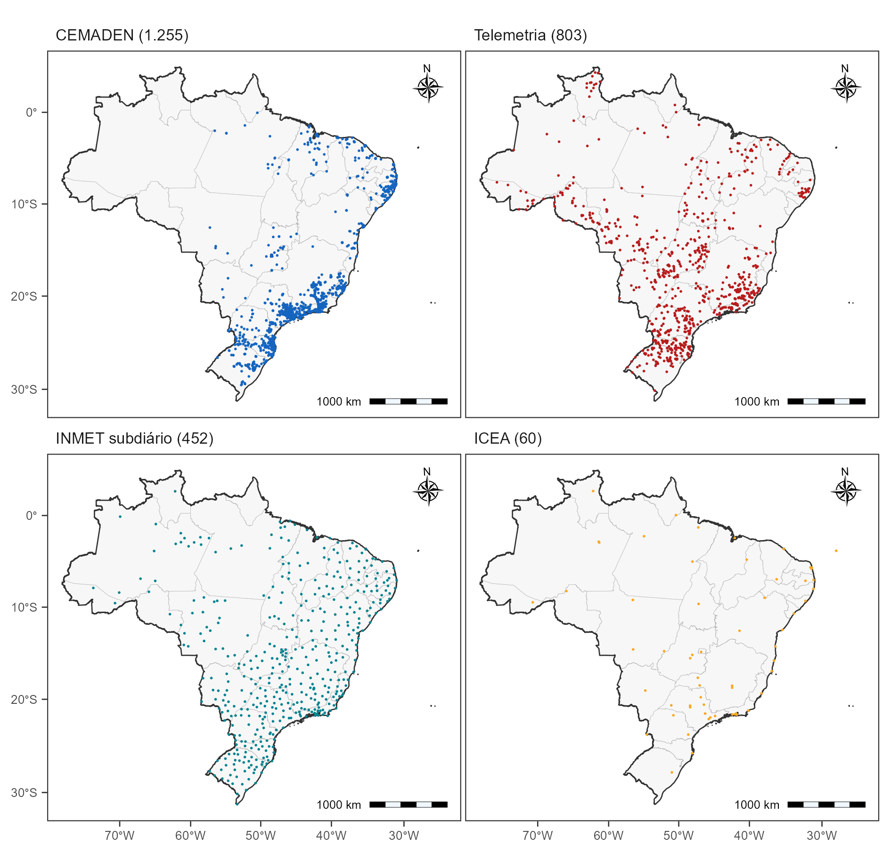

Esta meta reúne a aquisição, organização, padronização e controle de qualidade das bases de precipitação observadas e em grade utilizadas na Componente 1. O objetivo é consolidar uma base nacional de qualidade e consistente, com destaque para dados observados obtidos da base do UNIPLU-BR [@DasNevesAlmeida2025], de responsabilidade da ANA/Hidroweb, Telemetria ANA, INMET, CEMADEN, ICEA, entre outros; e dados em grade obtidos pelo BR-DWGD [@xavier2022] e NEX-GDDP-CMIP6 (NASA) [@thrasher2022].

## Bases de Dados

### UNIPLU-BR

Séries de precipitação observadas por estações de monitoramento foram obtidas junto ao Unified Brazilian Rainfall Dataset (UNIPLU-BR) [https://doi.org/10.5281/zenodo.18883358], que unificou e padronizou uma base de dados nacional a partir de dados brutos provenientes de cinco fontes primárias:

- **CEMADEN**: Centro Nacional de Monitoramento e Alertas de Desastres Naturais.
- **INMET**: Instituto Nacional de Meteorologia.
- **ANA (Hidroweb)**: Agência Nacional de Águas e Saneamento Básico.
- **ANA (Telemetria)**: Agência Nacional de Águas e Saneamento Básico.
- **ICEA**: Instituto de Controle do Espaço Aéreo.

Toda a base do UNIPLU-BR pode ser obtida através do site [@uniplubr_github] (https://github.com/LARHENA/UNIPLU-BR). Os dados são armazenados em arquivos tipo .zip. Cada arquivo .zip contém dois arquivos em formato .parquet: (i) table_info.parquet (metadados das estações); e (ii) table_data.parquet (séries de dados).

Toda a leitura e manuseio dos dados foi realizada usando o software R. A base do UNIPLU-BR cobre o período de 1855 a 2025, consolidando aproximadamente 1 bilhão de registros de precipitação em 21.331 estações. As informações obtidas possuem resolução temporal variada, entre intervalos de 10 minutos até 24 horas e discretização diária. A distribuição desses registros, por fonte é detalhada na @tbl-fontes-uniplu e @fig-mapa-estacoes.

```{r}
#| label: tbl-fontes-uniplu
#| tbl-cap: "Tabela 1. Sumário das estações abrangidas pelo UNIPLU-BR."

library(gt)
library(dplyr)

tabela_fontes <- data.frame(
  Fonte = c("CEMADEN", "Hidroweb", "ICEA", "INMET diário", 
            "INMET sub-diário", "Telemetria", "Total"),
  `Resolução temporal` = c("Sub-diário", "Diário", "Sub-diário", "Diário", 
                           "Sub-diário", "Sub-diário", NA),
  `Número médio de anos com dados` = c(7.99, 32.37, 34.02, 39.30, 15.21, 6.63, NA),
  `Quantidade de estações` = c(5061, 12051, 182, 589, 629, 2819, 21331),
  `Ano Início – Ano Fim` = c("2014 – 2025", "1855 – 2025", "1951 – 2025",
                             "1889 – 2025", "2000 – 2025", "2014 – 2025", NA),
  check.names = FALSE
)

tabela_fontes |> 
  gt() |> 
  cols_align(align = "left", columns = Fonte) |> 
  cols_align(align = "center", columns = c(`Número médio de anos com dados`,
                                           `Resolução temporal`,
                                           `Quantidade de estações`, 
                                           `Ano Início – Ano Fim`)) |> 
  fmt_number(
    columns = `Número médio de anos com dados`,
    decimals = 2,
    dec_mark = ",",
    sep_mark = "."
  ) |> 
  fmt_number(
    columns = `Quantidade de estações`,
    decimals = 0,
    sep_mark = "."
  ) |> 
  sub_missing(columns = everything(), missing_text = "—") |> 
  tab_style(
    style = cell_text(weight = "bold"),
    locations = cells_body(rows = Fonte == "Total")
  ) |> 
  tab_style(
    style = cell_text(weight = "bold", color = "black"),
    locations = cells_column_labels(everything())
  ) |> 
  tab_style(
    style = cell_text(color = "black"),
    locations = cells_body(columns = everything())
  ) |> 
  opt_row_striping()
```

A @fig-mapa-estacoes apresenta a distribuição espacial das estações de precipitação por fonte da informação inserida na base do UNIPLU-BR, cuja densidade geral é apresentada na @fig-densidade. Observa-se uma maior densidade de estações no Estado do Rio de Janeiro e Distrito Federal, seguido de São Paulo, Santa Catarina e Espírito Santo. De maneira geral, as regiões Sul e Sudeste possuem densidade de estações de monitoramento similares. Na região Nordeste, destacam-se os estados do Ceará, Pernambuco e Alagoas. Regiões Centro-Oeste e Norte brasileiro são as mais desproporcionais em número de estações.

{#fig-mapa-estacoes width="100%"}

{#fig-densidade width="100%"}

Na @fig-anos-atividade é apresentado o número de anos em atividade com dados das estações de monitoramento. Observa-se longas séries de dados especialmente nos estados de São Paulo, Paraná e Ceará. No tocante ao número de estações por agência ou instituição responsável, o CEMADEN, Telemetria e SGB-CPRM se destacam com o maior número de estações em operação (@fig-estacoes-instituicao). Essas 3 (três) instituições são de nível federal. CEMADEN e Telemetria, especialmente, tiveram fortes investimentos em número de estações desde o início do monitoramento de precipitação em razão dos desastres de origem natural, em 2014. O DAEE-SP em São Paulo (atualmente SP Águas), é uma instituição estadual e, portanto, possui toda sua rede inserida no território paulista, assim como o IAT (Instituto Água e Terra), no Paraná, e a FUNCEME (Fundação Cearense de Meteorologia e Recursos Hídricos), no Ceará.

{#fig-anos-atividade width="100%"}

{#fig-estacoes-instituicao width="100%"}

A base de dados do UNIPLU-BR possui estações cuja resolução temporal é diária e sub-diária. Na @fig-estacoes-resolucao apresenta-se o número de estações por ano e resolução temporal, a partir da qual se observa densificação da base de dados diária ocorreu em meados da década de 1960, atingindo seu pico em meados de 1983; por outro lado, a atividade das estações de resolução sub-diária se iniciou em 1951, por estações do ICEA, intensificando-se apenas a partir de 2014, com a criação do CEMADEN.

{#fig-estacoes-resolucao width="100%"}

A estrutura dos dados brutos do UNIPLU-BR consiste em 2 (dois) metadados: (i) informação de estações de chuva, incluindo colunas com dados de código da estação, cidade, coordenadas geográficas, elevação topográfica da estação, discretização temporal, rede fonte da informação, agência ou instituição responsável pela operação das estações, e UTC (Tempo Universal Coordenado); e (ii) série de dados, contendo código da estação, data e tempo da leitura e precipitação em mm.

```{r}
#| label: tbl-inventario-uniplu
#| tbl-cap: "Tabela 2. Síntese das informações contidas nos arquivos do inventário do UNIPLU-BR"

library(gt)
library(dplyr)

tabela_inventario <- data.frame(
  grupo = c(rep("Informação das estações de chuva (Rainfall gauge information, table_info.parquet)", 8),
            rep("Informação da série temporal de dados de precipitação (Time Series, table_data.parquet)", 3)),
  Coluna = c("gauge_code", "city / state", "lat / long", "elevation", 
             "time_step", "network", "responsible", "utc",
             "gauge_code", "datetime", "rain_mm"),
  Descricao = c(
    "Identificador da estação (ID)",
    "Localização da estação",
    "Coordenadas geográficas, em graus decimais",
    "Altitude em que a estação se localiza, acima do nível do mar (metros)",
    "Resolução temporal estimada do dado (1.440 minutos = 24 horas/diária)",
    "Fonte da informação (e.g., Hidroweb)",
    "Agência responsável pela operação da estação de monitoramento (e.g., ANA ou SGB-CPRM)",
    "Horário local relativo ao Meridiano de Greenwich (-3 para o horário de Brasília)",
    "Identificador da estação (ID)",
    "Dia e hora da leitura",
    "Volume de precipitação registrado durante o tempo, em milímetros"
  ),
  check.names = FALSE
)

tabela_inventario |> 
  gt(groupname_col = "grupo") |> 
  cols_label(
    Coluna = "Coluna",
    Descricao = "Descrição"
  ) |> 
  cols_align(align = "center", columns = c(Coluna, Descricao)) |> 
  tab_style(
    style = cell_text(weight = "bold", color = "black"),
    locations = cells_column_labels(everything())
  ) |> 
  tab_style(
    style = cell_text(weight = "bold", color = "black", align = "center"),
    locations = cells_row_groups(everything())
  ) |> 
  tab_style(
    style = cell_text(color = "black"),
    locations = cells_body(columns = everything())
  )
```

### BR-DWGD

Séries de precipitação em grade foram obtidas junto à Brazilian Daily Weather Gridded Data (BR-DWGD) (Xavier et al., 2022), que organizou uma base de dados em grade de resolução 0,1° x 0,1° com diferentes variáveis climatológicas, incluindo precipitação, entre 1 de janeiro de 1961 a 31 de julho de 2020.

Os dados de grade foram provenientes de interpolação dos dados observados das estações da ANA e do INMET. Para a precipitação, foram utilizados 11.473 pluviômetros. Os autores aplicaram dois procedimentos de consistência: (i) O primeiro descartou valores fora de limiares pré-estabelecidos, sendo 0 mm \< pr \< 450 mm para a precipitação [@liebmann2005]; e (ii) o segundo consistiu em teste visual de homogeneidade, comparando cada série às das estações vizinhas, conforme [@xavier2016].

Após os procedimentos de consistência foram obtidos por interpolação. A espacialização foi feita por bacia hidrográfica, a partir do uso do método do inverso da distância (IDW), dada sua performance na validação cruzada pela aplicação de métricas de desempenho.

Junto às grades das variáveis, o BR-DWGD disponibiliza duas grades de controle diárias: (i) o número de estações ou pluviômetros existentes dentro da célula (Count); e (ii) a distância da célula à estação mais próxima com dado observado (dist_nearest). Esses controles permitem avaliar, célula a célula e dia a dia, o quanto o valor interpolado se apoia em observação próxima ou em extrapolação. Essa informação é relevante porque a densidade da rede é bastante desproporcional. Nas bacias do Atlântico Central e do Atlântico Sul há ao menos um pluviômetro a cada 50 km, o equivalente a um a cada 580 km². Já na bacia Amazônica, a densidade era de um pluviômetro a cada 150.000 km² entre 1961 e 1980, melhorando para um a cada 7.600 km² entre 1991 e 2020. O número máximo de pluviômetros com dado disponível simultaneamente foi de 5.972, entre as décadas de 1970 e 1980, o que corresponde a um a cada 1.425 km², ainda abaixo da densidade de um a cada 575 km² recomendada pela [@wmo2008] para planícies interiores.

Toda a base do BR-DWGD pode ser obtida através do site [\@brdwgd_github](https://github.com/AlexandreCandidoXavier/BR-DWGD).

## Metodologia de Controle de Qualidade da base do UNIPLU-BR

Os dados disponibilizados via UNIPLU-BR buscaram organizar a base de dados nacional em uma estrutura única, apropriada para diversas análises. No entanto, não possuem qualquer controle de qualidade, consistência física ou filtro de outlier, seguindo originalmente conforme reportados pelas agências. Desta forma, aplicou-se metodologia de controle de qualidade.

A metodologia foi aplicada de maneira diferente considerando os dados de resolução temporal diária e sub-diária.

### Séries Diárias

#### Análise de consistência

O inventário das estações de monitoramento diário foi verificado em termos de mudanças em sua descrição. Inicialmente o inventário completo do UNIPLU-BR foi filtrado para compor somente as estações diárias, cuja fonte de dados seria o Hidroweb diário e o Inmet diário. Esses filtros resultaram em 12.640 estações.

Ao inventário foram aplicadas verificações de consistência dos metadados das estações ao longo do tempo, por exemplo, verificou-se se a estação se mantém com as mesmas informações de descrição ao longo de todos os anos do inventário, como unidade da federação, latitude, longitude, altitude, discretização temporal, entre outras. Das 12.640 estações diárias, 211 (1,7%) apresentaram alteração em ao menos um metadado, sendo 210 dessas concentradas na rede Inmet diário. A discretização temporal manteve-se inalterada em todas as estações.

As alterações observadas referem-se predominantemente às coordenadas geográficas, em termos de número de casas decimais: 156 das 211 estações tiveram redução de precisão, sendo o padrão predominante a passagem de oito para duas casas decimais. Isso resultou em diferenças de até 1 km de distância em 159 das 162 estações com mudança de coordenada. Outras divergências observadas eram no nome do município (123 estações), em razão do uso ou não de acentos, na altitude (5 estações) ou no estado a que a estação pertence (1 estação).

Dentre as 211 estações, apenas uma indicou a necessidade de ajuste. A estação 863011, em Porto Velho, apresentou deslocamento de 742 km entre coordenadas registradas em anos distintos, reunindo no máximo nove anos de dados em uma mesma coordenada. Adotou-se como critério de exclusão o deslocamento superior a 10 km combinado a menos de 30 anos de dados em uma única coordenada, de modo que a estação foi removida da base, resultando em 12.639 estações.

Por fim, aplicou-se a verificação de duplicatas sobre essa série, de modo a identificar pares estação e data repetidos. A análise não indicou duplicatas.

#### Controle de Qualidade

Para as séries diárias, o controle de qualidade (Quality Control - QC) foi aplicado para trazer maior confiabilidade à base de dados. O método considerado neste estudo foi proposto por [@estevez2022], que combina dois passos principais: (a) QC Básico: detecção de dados "errôneos", como valores negativos, registros inválidos e eventos de precipitação muito superior aos valores comumente ocorridos no Brasil. (b) QC Absoluto: quatro processos aplicados às estações individualmente, estimando o Índice de qualidade da série (IQ) e classificando-a por ano.

Em se tratando de análise de eventos extremos, em que são necessárias séries de precipitações longas e representativas, foi aplicado um filtro de disponibilidade, de modo a reter apenas séries longas e contínuas. Considerou-se completo o ano cuja fração de dias com dado fosse igual ou superior a 80%, bem como mantiveram-se as estações que reunissem ao menos 30 anos completos. A série resultante reuniu 5.349 estações, no período de 1888 a 2025, com mediana de 48 anos completos por estação e máximo de 127, para as quais foram aplicados os critérios de controle de qualidade, conforme descrito a seguir.

##### QC Básico

Neste processo foram identificados e eliminados dados considerados "errôneos" ou "inadequados" para a análise das séries de precipitação. Envolveu a verificação de dias em que foram identificados: (i) valores negativos; (ii) registros inválidos; e (iii) eventos muito superiores aos valores comumente ocorridos no Brasil. Bases como a do BR-DWGD adotaram um limiar superior igual a 450 mm/dia. Contudo, nos últimos anos, chuvas na ordem de 600 mm em um dia foram registradas no interior de São Paulo [@carmona2023]. Desse modo, considerou-se como limite superior 700 mm/dia.

A aplicação deste controle de qualidade indicou como problemática: (i) sequência de dias consecutivos repetindo o mesmo valor diário   acima de 1.000 mm, padrão que caracteriza preenchimento automático e não medição. Por exemplo, a estação 2554001, em Foz do Iguaçu, repete 1.555,4 mm por dias seguidos a partir de 02 de abril de 2008; (ii) valores isolados, a exemplo de 6.401 mm em São Gabriel da Cachoeira e 24 de julho de 2013; e (iii) concencentração de ocorrências em poucas estações e poucos anos, uma vez que os registros excluídos se distribuem em apenas 39 estações.

Após aplicação do QC Básico, 247 registros (0,00025% do total) foram excluídos, todos por apresentarem precipitação superior a 700 mm/dia. Não foram identificados registros negativos. O menor valor excluído foi de 701,2 mm e a mediana dos excluídos, de 1.555,4 mm, o que indica não haver acúmulo de valores imediatamente acima do limiar adotado e reforça que o corte não eliminou chuva plausível. Assumiu-se que todos os dados excluídos eram errôneos, e não outliers.

##### QC Absoluto

Neste controle de qualidade cada série de precipitações diárias é utilizada na estimativa do Índice de Qualidade (IQ) por ano de acordo com a @eq-iq abaixo:

$$IQ = \frac{P + Q_1 + Q_2 + Q_3}{4}$$ {#eq-iq}

O IQ compreende 4 (quatro) variáveis que consolida problemas comuns identificados em séries de precipitações. São eles:

- **P**: representa a disponibilidade de dados. Porcentagem de dados válidos em relação ao total de dados em um determinado ano, @eq-p:

$$P = 100 \cdot \frac{k}{n}$$ {#eq-p}

em que $k$ é o número de dias com dado válido no ano; e $n$ é o número de dias do ano (365, ou 366 em anos bissextos). Varia de 0 a 100%.

- **Q1**: representa a distribuição das lacunas nas séries. Avalia a distribuição de lacunas, penalizando a presença de lacunas extensas em detrimento de pequenas lacunas. O cálculo de Q1 é indicado na @eq-q1:

$$Q_1 = 100 - 100 \cdot \frac{2\,n_{lacuna} + L_{lacuna}^{max}}{n}$$ {#eq-q1}

em que $n_{lacuna}$ é o número de dias sem dado no ano; e $L_{lacuna}^{max}$ é a extensão, em dias, da maior sequência contínua de dias sem dado. Varia de −200 a 100%. O valor máximo corresponde ao ano sem nenhuma falha. Em um ano sem registros, $n_{lacuna} = n$ e $L_{lacuna}^{max} = n$. Valores negativos ocorrem quando as falhas superam entre um terço e metade do ano, conforme sua concentração: o limiar é de $n/3$ quando as falhas formam um único bloco contínuo, e de $n/2$ quando se distribuem isoladamente ao longo do ano.

- **Q2**: detecta se há há dias da semana com menos registros de chuva que os demais, o que indicaria falhas sistemáticas de registro. É calculado pelo coeficiente de variação do número de dias chuvosos em cada dia da semana ao longo do ano (@eq-q2).

$$Q_2 = 100 - 100 \cdot CV, \qquad CV = \frac{\sigma_{s}}{\mu_{s}}$$ {#eq-q2}

em que $CV$ é o coeficiente de variação do número de dias chuvosos registrados em cada dia da semana ao longo do ano; $\sigma_{s}$ é o desvio-padrão e $\mu_{s}$ a média das sete contagens (domingos chuvosos, segundas chuvosas, e assim por diante). Considerou-se chuvoso o dia com precipitação igual ou superior a 0,2 mm, de modo a não computar como evento os traços de precipitação. Varia de −164,58 a 100%. O valor mínimo corresponde à concentração de todos os dias chuvosos em um único dia da semana, situação em que $CV = \sqrt{7} = 2{,}6458$. O valor máximo corresponde ao ano em que os dias chuvosos se distribuem igualmente entre os sete dias da semana, situação em que $CV = 0$; por construção, o ano sem nenhum dia chuvoso também resulta em $CV = 0$ e, portanto, em $Q_2 = 100$, caso tratado pela regra de ano falho descrita adiante.

- **Q3**: representa a presença de valores atípicos (*outliers*) na série. É a porcentagem de dias do ano em que a precipitação registrada não ultrapassou o limiar de valor atípico (@eq-q3). O limiar é definido para cada mês do calendário como o terceiro quartil somado a 1,5 vez a amplitude interquartil das precipitações diárias maiores que 0 mm daquele mês (@eq-limiar). Os quartis são calculados considerando toda a série histórica da estação, e não apenas o ano avaliado: um dia de janeiro de 1990, por exemplo, é comparado ao limiar obtido com todos os meses de janeiro disponíveis na estação. Adotou-se o multiplicador 1,5 na amplitude interquartil [@llabres2019; @estevez2022; @vidalbarbosa2024].

$$Q_3 = 100 \cdot \frac{n - n_{out}}{n}$$ {#eq-q3}

em que $n_{out}$ é o número de dias do ano cuja precipitação excedeu o limiar de valor atípico $P_{out}$, definido na @eq-limiar, e $n$ é o número de dias do ano, como definido na @eq-p. Varia de 0 a 100%. O valor máximo corresponde ao ano sem nenhum dia acima do limiar, e o mínimo, à situação hipotética em que todos os dias do ano o excedem. O menor valor observado foi de 67,12%.

$$P_{out,m} = Q_{3,m} + 1{,}5 \cdot IQR_m, \qquad IQR_m = Q_{3,m} - Q_{1,m}$$ {#eq-limiar}

em que $P_{out,m}$ é o limiar de valor atípico do mês $m$; $Q_{1,m}$ e $Q_{3,m}$ são, respectivamente, o primeiro e o terceiro quartis das precipitações diárias maiores que 0 mm registradas no mês $m$; e $IQR_m$ é a amplitude interquartil desse mesmo conjunto. Os quartis são calculados sobre todos os anos da série histórica da estação, e não apenas sobre o ano avaliado.

Obtidas as variáveis, o IQ de cada estação por ano foi dado pela média das variáveis. Os resultados de IQ e P foram então classificados de acordo com as regras da @tbl-classificacao.

```{r}
#| label: tbl-classificacao
#| tbl-cap: "Tabela 3. Regras de classificação qualitativa com base em P (disponibilidade) e Q (índice de qualidade) (adaptado de [@vidalbarbosa2024])."

library(gt)
library(dplyr)

tabela_classificacao <- data.frame(
  Classe    = c("Excelente", "Boa", "Aceitável", "Baixa", "Muito Baixa"),
  P         = c("≥ 95", "≥ 90", "≥ 80", "–", "–"),
  Q         = c("≥ 90", "≥ 85", "≥ 80", "≥ 50", "–"),
  Qualidade = c("Alta Qualidade", "Alta Qualidade", "Alta Qualidade",
                "Baixa Qualidade", "Baixa Qualidade"),
  check.names = FALSE
)

tabela_classificacao |> 
  gt() |> 
  cols_label(
    Classe    = "Classe",
    P         = "P (disponibilidade)",
    Q         = "IQ (índice de qualidade)",
    Qualidade = "Qualidade absoluta"
  ) |> 
  cols_align(align = "center", columns = c(Classe, P, Q, Qualidade)) |> 
  tab_style(
    style = cell_text(weight = "bold", color = "black"),
    locations = cells_column_labels(everything())
  ) |> 
  tab_style(
    style = cell_text(color = "black"),
    locations = cells_body(columns = everything())
  )
```

A @fig-series apresenta a média de cada parâmetro em cada ano-calendário. A base selecionada inicia em 1888 com 2 estações e permanece reduzida até o início do século XX, ultrapassando 100 estações apenas em 1912 e 1.000 em 1940. O número de estações atinge o máximo em 1985, com 4.299, e decresce desde então, chegando a 2.446 em 2024.

Os parâmetros P e Q1 mantêm-se altos e estáveis ao longo de todo o período. Entre 1911 e 2024, o P varia entre 98,0 e 99,7%, e o Q1 entre 94,4 e 99,2 — comportamento esperado, uma vez que ambos dependem dos dias ausentes e que a seleção prévia reteve apenas anos com ao menos 80% de dias registrados. As oscilações mais pronunciadas concentram-se nas primeiras décadas, quando a média nacional é calculada sobre poucas estações.

O Q2 é o parâmetro com maior variabilidade e o único que discrimina de forma relevante entre os anos. No período estabilizado oscila entre 62,5 (1911) e 81,9 (1985), sem tendência de longo prazo: as médias por período são de 76,9 entre 1911 e 1950, 78,0 entre 1951 e 1990, e 78,6 entre 1991 e 2024. O Q3 é o mais estável de todos, variando entre 96,1 e 99,1 em toda a série.

O último ano (2025) apresenta queda em P e Q1 (86,2% e 59,5, respectivamente), decorrente de os registros estarem incompletos: as 305 estações com ano válido em 2025 possuem, em mediana, 304 dias registrados. Trata-se, portanto, de problemas de inventário.

{#fig-series width="100%"}

A @tbl-classificacao-resultado apresenta os resultados gerais do controle de qualidade absoluto. A aplicação do Controle de Qualidade Absoluto classificou 266.969 séries estação-ano (97,7%) como de Alta Qualidade e 6.391 (2,3%) como de Baixa Qualidade. A classe Excelente concentra a maior parte dos casos (85,1%), o que indica que a maioria dos anos-estação apresenta cobertura praticamente integral. Entre os anos de Baixa Qualidade, 6.003 (2,2% do total geral) foram classificados como Baixa e 388 (0,1%) como Muito Baixa, tratando-se de anos reprovados pela concentração das lacunas ou pela distribuição irregular dos dias chuvosos ao longo da semana.

```{r}
#| label: tbl-classificacao-resultado
#| tbl-cap: "Tabela 4. Classificação de qualidade dos anos-estação das séries diárias."

library(gt)
library(dplyr)
library(readxl)

resumo_classificacao <- data.frame(
  Classe             = c("Excelente", "Boa", "Aceitável", "Baixa", "Muito Baixa"),
  qualidade_absoluta = c("Alta Qualidade", "Alta Qualidade", "Alta Qualidade",
                         "Baixa Qualidade", "Baixa Qualidade"),
  estacao_anos       = c(232615, 25369, 8985, 6003, 388),
  pct                = c(85.09, 9.28, 3.29, 2.20, 0.14),
  check.names = FALSE
)


resumo_classificacao |>
  gt() |>
  cols_label(
    Classe             = "Classe",
    qualidade_absoluta = "Qualidade absoluta",
    estacao_anos       = "Anos-estação",
    pct                = "Percentual (%)"
  ) |>
  fmt_number(columns = estacao_anos, decimals = 0, sep_mark = ".", dec_mark = ",") |>
  fmt_number(columns = pct, decimals = 2, sep_mark = ".", dec_mark = ",") |>
  cols_align(align = "center", columns = everything()) |>
  tab_style(
    style = cell_text(weight = "bold", color = "black"),
    locations = cells_column_labels(everything())
  ) |>
  tab_style(
    style = cell_text(color = "black"),
    locations = cells_body(columns = everything())
  )
```

Aplicado o critério final, descritos como estações com, pelo menos, 30 anos de Alta Qualidade, resultaram em 5.146 estações das 5.349 avaliadas (96,2%). A base final reúne 261.263 séries estação-ano e 94.793.233 registros diários, conforme indicado na @fig-estacoes-QC-final.

{#fig-estacoes-QC-final width="100%"}

### Séries Sub-diárias

Conforme apresentado na @tbl-fontes-uniplu, 8.691 estações do UNIPLU-BR se tratam de estações de monitoramento de precipitação sub-diário. Inicialmente, o controle de qualidade dos dados sub-diários do UNIPLU-BR seriam provenientes da metodologia descrita no Relatório "Criação de uma base de dados de pluviometria unificada para o Brasil e Qualificação das redes sub-diárias". Os autores realizaram um procedimento de avaliação qualitativa assistida, estruturado em 5 (cinco) etapas:

Para as séries sub-diárias do UNIPLU não se aplicou o índice de qualidade descrito na seção de séries diárias, tendo em vista que: (i) trata-se de séries majoritariamente curtas, com início em 2014 nas redes CEMADEN e Telemetria, o que inviabiliza critérios baseados na distribuição histórica de cada estação; e (ii) os parâmetros do IQ foram concebidos para a escala diária, sem equivalente consolidado para resoluções de 10 a 60 minutos. Inicialmente, o controle de qualidade dos dados sub-diários do UNIPLU-BR seriam provenientes da metodologia descrita no Relatório "Criação de uma base de dados de pluviometria unificada para o Brasil e Qualificação das redes sub-diárias", estruturado em 5 (cinco) etapas.

(a) Filtragem inicial: foram filtradas as estações cuja fonte de dados fosse o CEMADEN, ANA (Telemetria) e INMET sub-diário. Para o INMET, as séries de resolução diária foram incorporadas à análise no período posterior a 2014, como suporte comparativo para a classificação das estações sub-diárias.

(b) Análise visual comparativa: cada estação foi comparada às cinco estações mais próximas por meio de nove conjuntos de gráficos (precipitações anuais, precipitações mensais, precipitações diárias, precipitações máximas diárias, localização das estações, altitude, correlação das precipitações mensais, correlação das precipitações diárias e soma cumulativa das precipitações diárias). Inconsistências foram identificadas por mudanças repentinas de inclinação nas curvas ou pela permanência em patamar constante enquanto as vizinhas registram precipitação. Cada estação recebeu os rótulos "Boa", "Ruim" ou "Dúvida", atribuídos de forma independente por dois pesquisadores. Nas estações classificadas como "Ruim", o avaliador registrou o tipo de problema, e.g. chuva constante ao longo do tempo, valores sistematicamente acima ou abaixo das vizinhas, ou ausência de dados em dias com chuva registrada nas estações próximas. Os casos de dúvida e as divergências entre os dois avaliadores foram arbitrados por um terceiro pesquisador, com consulta a outras redes pluviométricas. Ao final, as estações foram classificadas, ano a ano, como HQ (*High Quality*) ou PQ (*Poor Quality*).

(c) Separação dos eventos chuvosos: As estações HQ seguiram para análise detalhada, na qual as séries foram segmentadas em eventos chuvosos segundo critérios como o Mínimo Intervalo de Tempo entre eventos (MIT) e a lâmina mínima precipitada. Foram avaliados 3 (três) MITs (30 minutos, 6 horas e 24 horas) e lâmina mínima de 1 mm por evento. Para cada estação, ano e MIT, foram calculadas 14 variáveis, a saber: precipitação, total anual, número de eventos, lâmina média, duração média, intensidade média e tempo seco médio, com seus respectivos desvios-padrão e valores máximos.

(d) Análise espacial dos eventos: as características dos eventos foram analisadas espacialmente no usando o GeoDa (Anselin, 2024), ferramenta de análise de dados espaciais, com apoio de gráficos de coordenadas paralelas. Foram adotadas premissas segundo a primeira Lei de Tobler: postos próximos devem apresentar comportamento semelhante. Nessa etapa, estações cujos valores médios são compatíveis com os vizinhos, mas cuja dispersão ou cujos máximos destoam, foram sinalizadas como duvidosas e devolvidas à análise visual. O procedimento foi conduzido de forma independente para cada MIT, uma vez que anomalias se manifestam, com frequência, em apenas um deles.

(e) Reanálise visual: por fim, todas as redes passaram por uma revalidação. Na primeira análise visual, a seleção de vizinhas baseia-se apenas na distância, de modo que uma estação podia ter sido comparada somente a séries igualmente inconsistentes. Na reanálise, consideraram-se como vizinhas exclusivamente as estações já classificadas como HQ, de qualquer rede. Isso permitiu tanto excluir séries com erros remanescentes quanto reclassificar como HQ estações antes rotuladas como PQ, cujas inconsistências aparentes decorriam da baixa qualidade das vizinhas originais.

A partir da definição desses critérios aos dados previamente avaliados foram identificados somente 122 estações de resolução sub-diária. Isso representa apenas 2% das estações. Dada a limitação de uso das séries avaliadas, definiu-se pela aplicação de critérios de consistência e qualidade a todo o inventário sub-diário.

Para as séries sub-diárias do UNIPLU não se aplicou o índice de qualidade descrito na seção anterior (aplicados às séries diárias), tendo em vista que: (i) trata-se de séries majoritariamente curtas, com início em 2014 nas redes CEMADEN e Telemetria, o que inviabiliza critérios baseados na distribuição histórica de cada estação; e (ii) os parâmetros de controle de qualidade apresentados foram concebidos para a escala diária, sem equivalente consolidado para resoluções de 10 a 60 minutos. O controle de qualidade de dados sub-diários baseia-se em um conjunto de testes sequenciais organizados para detectar anomalias decorrentes de defeitos em sensores, entupimentos e erros de transmissão [@lewis2021;@villalobos2022].

A seguir serão apresentadas as análises de consistência dos metadados e controle de qualidade. Tais análises serão apresentadas por tipo de fonte (rede), tendo em vista a variabilidade entre as informações por rede.

#### Análise de consistência dos metadados
A consistência dos metadados foi verificada comparando-se cada estação-ano, em relação a cinco atributos do cadastro: coordenadas geográficas, altitude, discretização temporal, município e UF. Assumiu-se que mudanças em altitude, município e UF não seriam consideradam inconsistências desde que a coordenada geográfica se mantivesse constante ao longo dos anos de medição.

Adotou-se como critério de exclusão a combinação de deslocamento superior a 10 km com menos de 8 anos de dados em uma mesma coordenada. A primeira condição explica a troca de local de monitoramento, enquanto a segunda preserva a estação que, apesar de deslocada, reúne em um único ponto histórico suficiente para compor série própria. O limiar de 8 anos acompanha o critério de série mínima adotado para a rede subdiária.

A seguir são apresentados os resultados desta verificação, por fonte da informação (rede).

##### CEMADEN
A rede reúne 5.061 estações, 58,2% das sub-diárias do UNIPLU-BR, e cobre o período de 2014 a 2025.

A verificação abrangeu 40.470 pares estação-ano. Apresentaram alteração em ao menos um metadado 668 estações (13,2% da rede), sendo 401 em coordenada. Não houve alteração de timestep. As alterações de coordenada e de altitude ocorreram majoritariamente em conjunto. Em 199 das 401 estações o deslocamento não ultrapassa 1 km, o que sugere refinamento do registro e não mudança de local.

Das 57 estações com deslocamento superior a 10 km, 35 não acumulam 8 anos em coordenada alguma e foram removidas; as 22 restantes foram recortadas na coordenada dominante. O inventário passou a 5.026 estações.

Foram identificados 154.488 pares estação-instante repetidos em 3.150 estações, dos quais 98,4% são duplicatas exatas e 1,6% (2.477 pares) apresentam valores distintos para o mesmo instante. As duplicatas concentram-se entre 2014 e 2017, com 80,3% em 2014. As exatas foram reduzidas a um registro. Nas conflitantes, preservou-se a maior leitura quando a diferença foi de até 0,20 mm, o que ocorreu em mais da metade dos casos, e removeram-se todas as cópias nos demais.

Aplicando-se o filtro de 80% de disponibilidade anual e mínimo de 8 anos, foram aprovados 22.773 dos 39.532 pares mensuráveis (57,6%), resultando em 1.255 estações.

##### Telemetria

A rede reúne 2.819 estações, 32,4% das sub-diárias, e cobre o período de 2014 a 2025.

A verificação abrangeu 18.682 pares estação-ano. Apresentaram alteração 458 estações (16,2% da rede), sendo 362 em timestep, 76 em altitude, 60 em coordenada e 7 em município. Não houve alteração de UF. O timestep é o atributo que mais variou nesta rede, isoladamente responsável por 355 das 458 alterações, sem sentido único de mudança.

Das 5 estações com deslocamento superior a 10 km, 4 foram removidas e 1 foi recortada na coordenada dominante. O inventário passou a 2.815 estações.

Foram identificados 47.080 pares repetidos, envolvendo 307.739 linhas em 800 estações, dos quais 94,8% são exatas e 5,2% (2.444 pares) conflitantes. As duplicatas ocorrem nos doze anos da série, mas 78,7% concentram-se em 2024, ano em que o problema alcança 792 das 800 estações afetadas.

Nas conflitantes observaram-se dois padrões: 96,1% situam-se em exatamente 10:00 UTC, e parte apresenta variação elevada entre as leituras, compatível com valor acumulado em vez de instantâneo. Preservou-se a maior leitura quando a diferença foi de até 0,20 mm, e removeram-se todas as cópias nos demais.

Aplicando-se o filtro de disponibilidade, foram aprovados 14.941 dos 18.642 pares mensuráveis (80,1%), resultando em 803 estações.

##### INMET SUBDIÁRIO

A rede reúne 629 estações, 7,2% das sub-diárias, e cobre o período de 2000 a 2025.

A verificação abrangeu 9.569 pares estação-ano. Apresentaram alteração 497 estações, sendo 481 em altitude e 28 em coordenada. Não houve alteração de timestep, município ou UF. As alterações de altitude ocorreram isoladamente em 469 estações, acompanhando mudança de coordenada em apenas 12. Nenhuma estação apresentou deslocamento superior a 10 km, de modo que o critério de exclusão não foi acionado e o inventário permaneceu com 629 estações.

Não foi identificado nenhum par estação-instante repetido.

Aplicando-se o filtro de disponibilidade, foram aprovados 6.565 dos 9.569 pares (68,6%), resultando em 452 estações.

##### ICEA

A rede reúne 182 estações, 2,1% das sub-diárias, e é a de maior alcance temporal da base, cobrindo o período de 1951 a 2025.

A verificação abrangeu 6.192 pares estação-ano. Apresentaram alteração 152 estações (83,5% da rede), concentradas em altitude e timestep. Nenhuma estação apresentou deslocamento superior a 10 km.

O timestep exigiu tratamento específico, por apresentar transição ao longo dos anos, e optou-se por restringir a rede ao padrão horário. Foram descartados 950 dos 6.192 pares (15,3%), e 4 estações (SBFE, SWAC, SNAS e SWXV) não reúnem nenhum ano declarado com timestep de 60 min, saindo integralmente da base. O inventário passou a 178 estações.

Não foi identificado nenhum par estação-instante repetido.

Aplicando-se o filtro de disponibilidade, foram aprovados 2.258 dos 5.242 pares (43,1%), resultando em 60 estações e 16.947.187 registros.

#### Controle de qualidade

Esta etapa recebe, de cada rede, a série já selecionada por consistência de cadastro, duplicatas e disponibilidade, e aplica sobre ela um controle de qualidade em duas etapas: (i) a primeira chamada Controle Básico, remove registros que não podem representar uma medição; (ii) a segunda chamada de Controle de Suspeitos, registros que permanecem na série mas que são marcados como suspeitos. Vários desses indicadores também foram aplicados às séries diárias, bem como foram considerados por [@estevez2022] e [@Meira2022].

##### Controle Básico

O controle básico foi aplicado de maneira análoga a todos os dados das redes. Nele foram aplicados 5 (cinco) indicadores, individualmente. São eles:

- **CB1**: representa valores de precipitação negativos.

- **CB2**: representa valores de precipitação não finitos.

- **CB3**: representa valores de precipitação acima de um determinado teto.
O teto do CB3 foi obtido de uma envoltória de precipitação máxima observável em função da duração da chuva. A partir dos recordes de precipitação máxima da Organização Mundial de Meteorologia [@bom_records], obteve-se a relação potência conforme a @eq-envoltoria:
- **CB3**: representa valores de precipitação acima de um determinado teto. O teto do CB3 foi obtido de uma envoltória de precipitação máxima observável em função da duração da chuva. A partir dos recordes de precipitação máxima da Organização Mundial de Meteorologia [@bom_records], obteve-se a relação potência conforme a @eq-envoltoria:

$$P_{d} = 41{,}879 \cdot\, d^{\,0{,}5245} $$ {#eq-envoltoria}

onde: $d$ é a duração do passo de tempo, em minutos, e $P$ é a envoltória, em milímetros.

O teto de reprovação aplica um fator de segurança sobre a envoltória (@eq-teto):

$$T_{d} = 1,5 \cdot P_{d} $$ {#eq-teto}

em que $T_{d}$ é o teto correspondente ao passo de tempo. O teto é, portanto, específico de cada estação-ano, e acompanha a mudança de timestep ao longo da série de uma mesma estação. Quando o cadastro não traz timestep utilizável, aplicou-se um teto fixo de 800 mm, similar ao aplicado para as séries diárias.

- **CB4**: representa valores inseridos em um determinado ano mas que o instante não corresponde àquele ano. Tendo em vista os diferentes fusos horários no Brasil, este indicador admitiu possíveis inconsistências de até 2 dias associadas a registros próximos à 1º de janeiro.

- **CB5**: estação fora do catálogo, sem cadastro, apenas com os demais valores.

Das quatro redes sub-diárias, duas indicaram valores de precipitação que ultrapassavam o teto aplicado (CB3), em 262 registros (115 no CEMADEN e 147 em Telemetria). Todos os demais indicadores não retornaram nenhuma reprovação.

##### Controle de Qualidade
O controle de qualidade preserva o dado e o sinaliza como suspeito. Nesta etapa, foram aplicados 7 (sete) indicadores. São eles:

- **QC1**: representa o mesmo valor não nulo repetido em 12 ou mais registros consecutivos.

- **QC2**: representa a estação-ano em que mais de 99% dos registros são nulos.

- **QC3**: representa o pico isolado, isto é, o valor acima do limiar da estação cujos registros imediatamente anterior e posterior são ambos nulos. O limiar é calculado na própria estação, sobre o conjunto de seus valores não nulos, conforme a @eq-limiar2:

$$P_{out,e} = Q_{3,e} + 3 \cdot IQR_e, \qquad IQR_e = Q_{3,e} - Q_{1,e} $$ {#eq-limiar2}

- **QC4**: representa o valor acima da envoltória de precipitação máxima da @eq-envoltoria, sem o fator de segurança. Trata-se da faixa entre $P(\Delta t)$ e o teto $T_{e,a}$ do CB3.

- **QC5**: representa o valor acima do limiar estatístico da própria estação, calculado conforme a @eq-limiar2.

- **QC6**: representa o período seco mais longo que o limiar da própria estação, condição típica de sensor obstruído ou desligado cuja transmissão não cessa. Para o cálculo deste indicador, a série é agregada em totais diários. Um dia é classificado como seco quando a soma de seus registros é exatamente zero. Os períodos secos são sequências de dias secos consecutivos.
Para cada estação, obteve-se o maior período seco de cada ano, e o limiar é obtido sobre a série desses máximos períodos, conforme a @eq-limiar-seco:

$$D_e = Q_{3,e} + 3 \cdot IQR_e, $$ {#eq-limiar-seco}

onde: $D_e$ é a duração, em dias, do maior período seco da estação.

Os indicadores foram calculados de forma independente e podem incidir sobre o mesmo registro.

O controle de qualidade sinalizou 3,71% dos registros no CEMADEN, 1,78% na Telemetria, 1,36% no INMET sub-diário e 0,82% no ICEA. Por fim, o controle de qualidade aplicado não reduziu o número de estações previamente estimado a partir da análise de consistência dos metadados, retornando as 2.570 estações, cuja distribuição é apresentada na @figura-8.

{#figura-8 width="100%"}