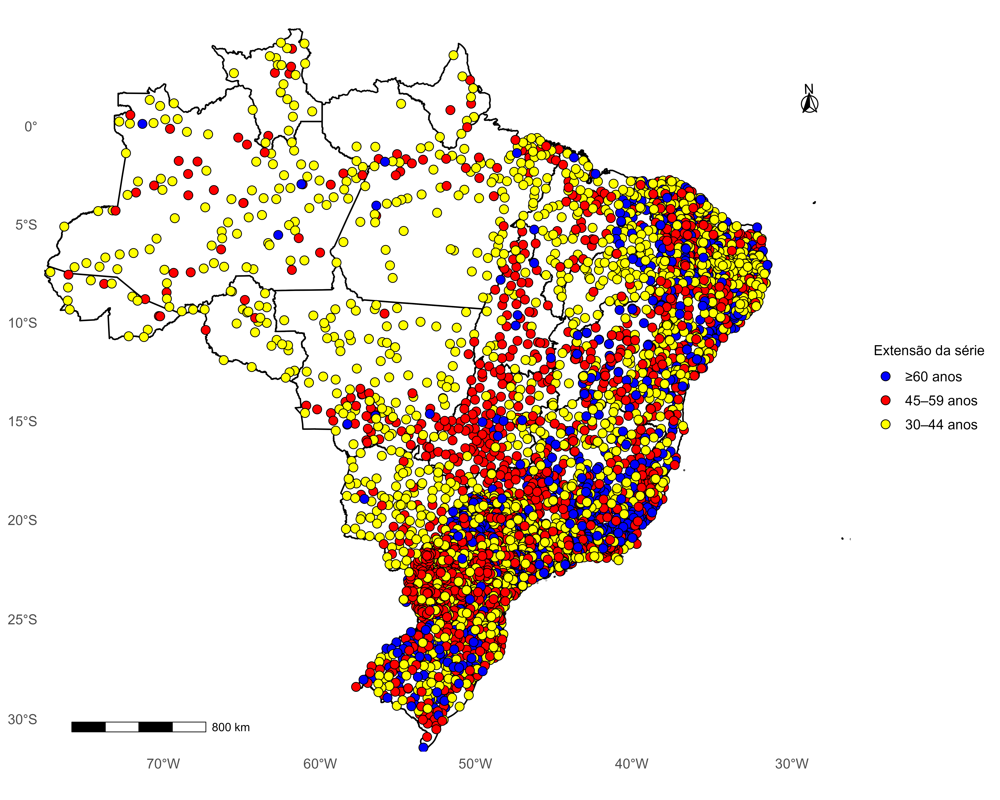
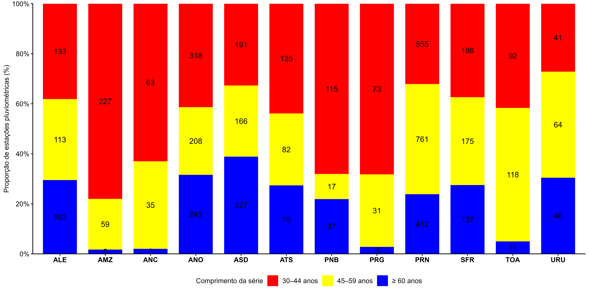
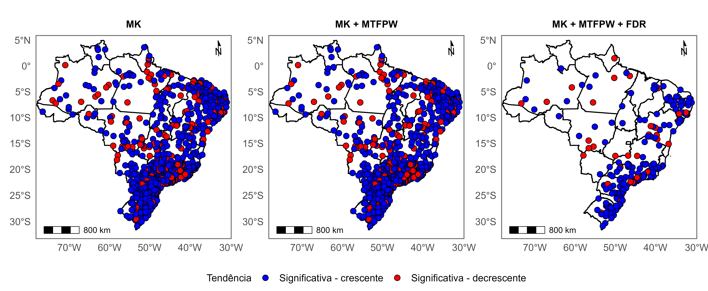
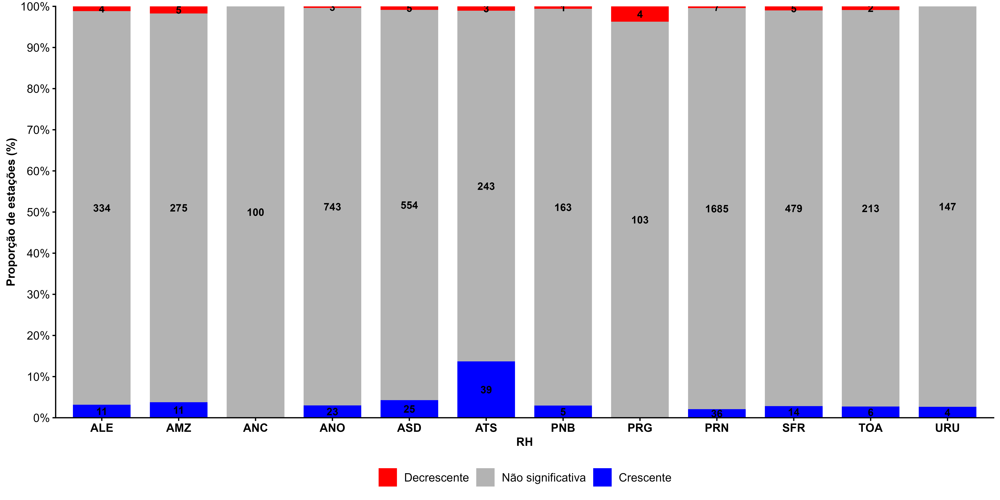
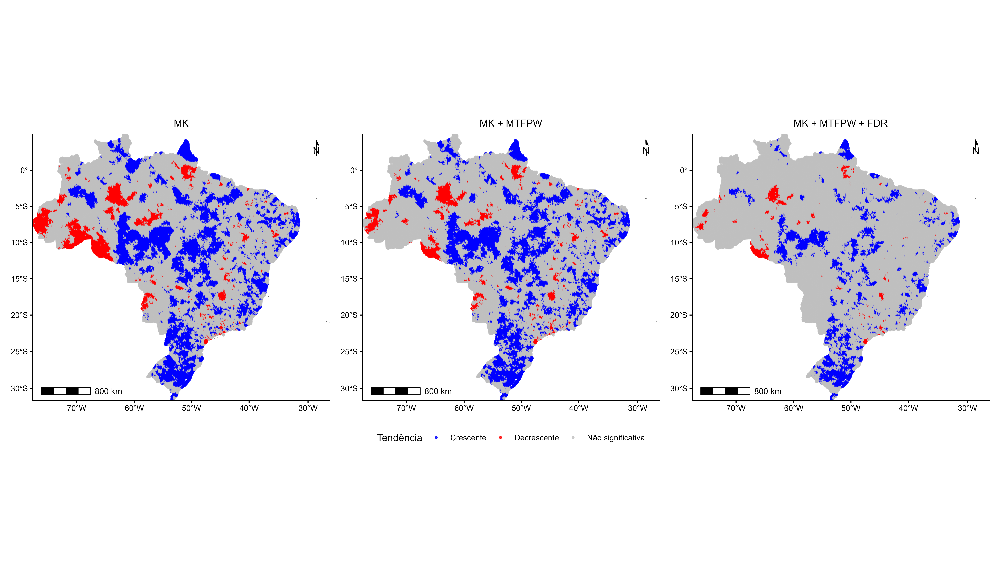
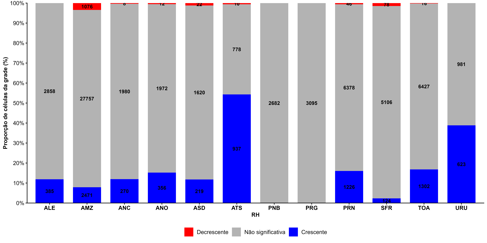
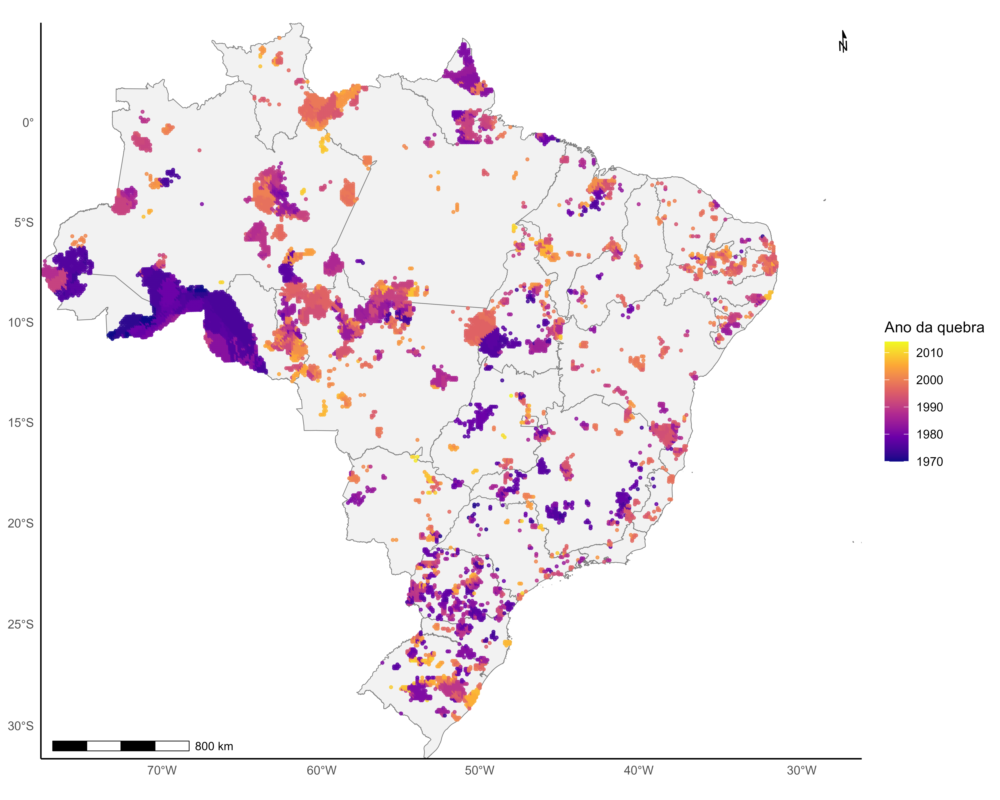
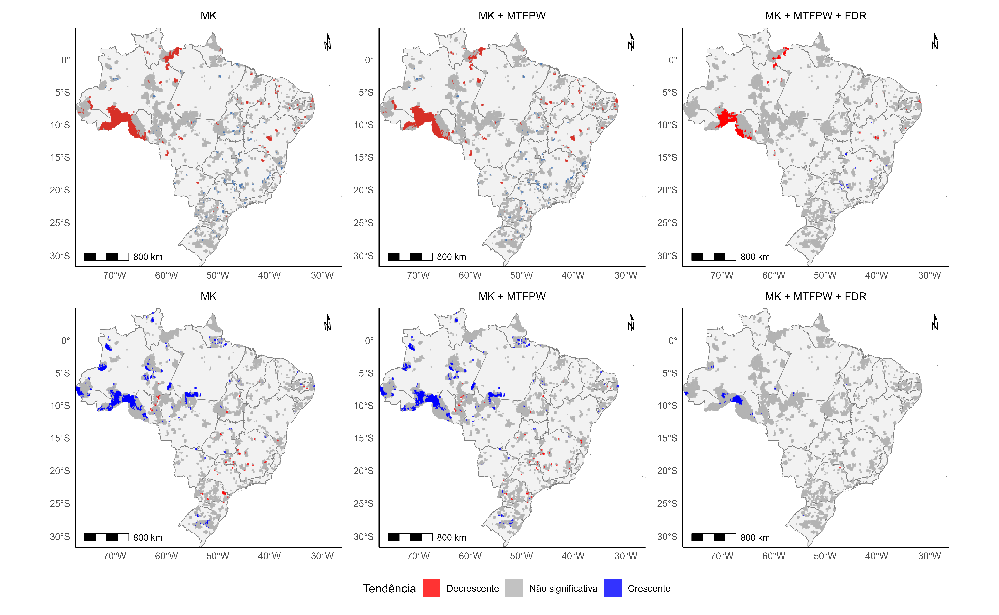
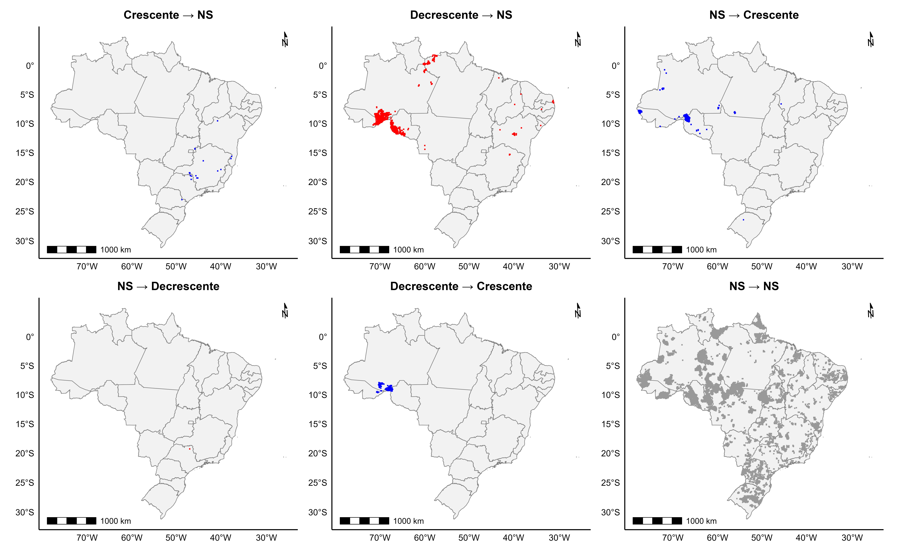

Esta meta avalia a existência de mudanças temporais nas séries de precipitação extrema, incluindo tendências graduais. As análises abrangem pluviômetros e pluviógrafos.

# 8. Não Estacionariedade dos Extremos

## 8.1 Dados utilizados

Para o realização da análise de tendência, foram utilizadas diferentes fontes de dados de precipitação, contemplando informações provenientes de postos pluviométricos e pluviógrafos, bem como dados espacialmente distribuídos em grade.

Foram utilizados os postos pluviométricos e pluviómetros disponíveis na base de dados do UNIPLU (Das Neves Almeida et al., 2025). Na etapa de preparação dos dados, foram selecionados os registros com intervalo temporal de 24 horas (1440 minutos) para os dados diários e de 1hora (60 min) para os dados subdiários.

Também foi utilizada a base de dados em grade do *Brazilian Daily Gridded Weather Dataset* (BR-DWGD), elaborada por @Xavier.2022. e disponibilizada em formato NetCDF. A série temporal utilizada compreende o período de 1961 a 2025, totalizando 65 anos de dados diários. Para cada célula da grade espacial e para cada ano, foi identificado o maior valor de precipitação diária registrado, obtendo-se, assim, a série de precipitação máxima diária anual para cada célula.

Para a organização espacial dos dados e a realização das análises, tanto os postos pluviométricos e pluviógrafos quanto as células da base de dados em grade de @Xavier.2022 foram associadas às respectivas Regiões Hidrográficas (RHs). Essa associação foi realizada por meio da localização espacial de cada posto e de cada célula da grade, permitindo identificar a Região Hidrográfica à qual cada ponto de observação ou célula pertence.

Após essa classificação espacial, os dados foram organizados de acordo com as RHs, de modo que as análises estatísticas e de tendência fossem realizadas individualmente para cada RH. Essa abordagem permitiu avaliar a distribuição espacial dos resultados e identificar possíveis diferenças no comportamento das séries de precipitação entre as diferentes Regiões Hidrográficas.

Após a construção das séries, foi realizada a análise de tendência em três etapas: (i) teste de Mann–Kendall (MK); (ii) teste de Mann–Kendall associado ao *Modified Trend-Free Pre-Whitening* (MK + MTFPW); e (iii) aplicação da correção para múltiplos testes pelo método *False Discovery Rate* (MK + MTFPW + FDR). A análise de tendência foi aplicada individualmente a cada base de dados.

## 8.2 Metodologia

A metodologia foi estruturada em etapas sucessivas, com o objetivo de identificar as tendências nas séries temporais, considerando tanto os dados provenientes dos postos pluviométricos e pluviógrafos do UNIPLU quanto os dados em grade de @Xavier.2022. Inicialmente, foi aplicado o teste não paramétrico de MK para verificar a existência de tendências monotônicas estatisticamente significativas nas séries analisadas. Em seguida, foi avaliada a presença de autocorrelação nas séries temporais e aplicada a técnica MTFPW, com o objetivo de reduzir a influência da autocorrelação sobre a identificação das tendências. Posteriormente, o teste de Mann–Kendall foi aplicado às séries corrigidas pelo procedimento de MTFPW, KM+MTFPW. Por fim, considerando a realização simultânea de testes para diferentes postos e células da grade, foi aplicado o procedimento de controle de FDR, visando controlar a proporção esperada de resultados falsamente significativos.

### 8.2.1 Teste de Mann-Kendall

Inicialmente, foi aplicado o teste não paramétrico de MK às séries anuais de Rx1day e subdiárias. O objetivo foi verificar a existência de uma tendência monotônica estatisticamente significativa ao longo do período analisado.

Para cada série temporal ((X_1,X_2,\ldots,X_n)), as observações foram inicialmente transformadas em postos, considerando os valores empatados pelo método do menor posto. Em seguida, a estatística (S) foi calculada pela comparação entre todos os pares de observações:

$$
S =
\sum_{i=1}^{n-1}
\sum_{j=i+1}^{n}
\operatorname{sgn}(R_j-R_i)
$$ {#eq-mk-s}

em que (R_i) e (R_j) representam os postos das observações (X_i) e (X_j), respectivamente, e:

$$
\operatorname{sgn}(R_j-R_i)=
\begin{cases}
+1, & R_j-R_i>0\\
0, & R_j-R_i=0\\
-1, & R_j-R_i<0
\end{cases}
$${#eq-sgn}

Valores positivos de (S) indicam predominância de aumentos da variável ao longo do tempo, enquanto valores negativos indicam predominância de reduções.

Os empates entre observações foram considerados no cálculo da variância de (S). A variância foi calculada por:

$$
\operatorname{Var}(S)=
\frac{
n(n-1)(2n+5)
-
\displaystyle\sum_{p=1}^{g}
t_p(t_p-1)(2t_p+5)
}{18}
$$ {#eq-km-variavancia}

em que (t_p) representa o número de observações pertencentes ao (p)-ésimo grupo de valores empatados e (g) corresponde ao número de grupos de valores empatados.

A estatística padronizada (Z) foi calculada por:

$$
Z=
\begin{cases}
\dfrac{S-1}{\sqrt{\operatorname{Var}(S)}}, & S>0\\[8pt]
0, & S=0\\[8pt]
\dfrac{S+1}{\sqrt{\operatorname{Var}(S)}}, & S<0
\end{cases}
$$ {#eq-mk-z}

O *p-value* bilateral foi obtido por:

$$
p=2\left[1-\Phi(|Z|)\right]
$${#eq-pvalor}

em que (\Phi) representa a função de distribuição acumulada da distribuição normal padrão.

Foi adotado nível de significância de 5% ((\alpha=0,05)). Assim, uma série foi considerada estatisticamente significativa quando: $$
p<0,05
$$ A direção da tendência foi determinada pelo sinal da estatística (Z). Valores positivos de (Z) foram classificados como tendência crescente e os valores negativos foram classificados como tendência decrescente.

O teste MK foi aplicado individualmente às séries correspondentes às células da grade @Xavier.2022 e às séries correspondentes aos postos pluviométricos e pluviográficos do UNIPLU. Dessa forma, cada unidade espacial de análise apresentou seu próprio valor de (Z), *p-value* e classificação da direção da tendência.

-   finalidade do teste;
-   hipótese nula;
-   estatística Z;
-   p-valor;
-   nível de significância;
-   classificação da tendência em crescente, decrescente ou não significativa.
-   equações

### 8.2.2 Mann-Kendall (MK) + *Modified Trend-Free Pre-Whitening* (MTFPW)

A presença de autocorrelação serial em séries temporais pode influenciar a avaliação de tendências, uma vez que a dependência entre observações sucessivas pode aumentar a probabilidade de identificação de uma tendência como estatisticamente significativa quando, na realidade, ela não existe. Para reduzir esse efeito, foi aplicado o procedimento MTFPW [@Onoz.2012], conforme o procedimento descrito por [@Souza.2022].

O método foi aplicado individualmente a cada série temporal e estruturado em etapas sucessivas:

(i) estimativa da tendência por meio da inclinação de Sen;

(ii) remoção da tendência da série;

(iii) estimativa da autocorrelação de primeira ordem ((r_1));

(iv) correção do viés da estimativa de (r_1);

(v) verificação da significância da autocorrelação; e

(vi) aplicação do procedimento de *pre-whitening* quando a autocorrelação foi considerada estatisticamente significativa.

### Estimativa da tendência

Inicialmente, foi estimada a magnitude da tendência da série por meio da inclinação de Sen [@Sen.1968]. Para uma série temporal com (n) observações, foram calculadas as inclinações entre todos os pares de observações:

$$
\beta_{ij} =
\frac{X_j-X_i}{j-i},
\qquad j>i
$${#eq-sen-inclinacoes}

em que (X_i) e (X_j) representam os valores da série nos instantes (i) e (j), respectivamente. A inclinação de Sen ((\beta)) foi obtida pela mediana de todas as inclinações (\beta\_{ij}):

$$
\beta =
\operatorname{mediana}
\left(
\beta_{ij}
\right)
$$ {#eq-sen-mediana}

Essa estimativa foi utilizada para remover a tendência da série antes da avaliação da autocorrelação.

### Remoção da tendência

Após a estimativa da inclinação de Sen, a tendência foi removida da série original. Para isso, foi utilizada a expressão:

$$
X_t^{d}=X_t-\beta t
$${#eq-removertendencia}

em que (X_t\^{d}) representa o valor da série sem tendência no instante (t), (X_t) corresponde ao valor original da série, (\beta) é a inclinação de Sen e (t) representa a posição temporal da observação.

A série sem tendência foi utilizada exclusivamente para a estimativa da autocorrelação de primeira ordem. A aplicação posterior do procedimento de *pre-whitening*, quando necessária, foi realizada sobre a série original.

### Estimativa da autocorrelação de primeira ordem

A autocorrelação de primeira ordem ((r_1)) foi estimada a partir da série sem tendência. Inicialmente, foi calculada a média da série por:

$$
\overline{X^d}
=
\frac{1}{n}
\sum_{t=1}^{n}X_t^d
$${#eq-media-detrendida}

Em seguida, o coeficiente de autocorrelação de primeira ordem foi obtido por:

$$
r_1=
\frac{
\displaystyle\sum_{t=1}^{n-1}
\left(X_t^d-\overline{X^d}\right)
\left(X_{t+1}^d-\overline{X^d}\right)
}{
\displaystyle\sum_{t=1}^{n}
\left(X_t^d-\overline{X^d}\right)^2
}
$${#eq-autocorr1}

em que (r_1) representa a correlação entre observações consecutivas da série sem tendência.

### Correção do viés da autocorrelação

A estimativa de (r_1) foi posteriormente corrigida para reduzir o viés associado à estimativa da autocorrelação em séries finitas. A autocorrelação corrigida foi calculada por:

$$
r_1^{*}
=
\frac{nr_1+2}{n-4}
$${#eq-autocorrigida}

em que (r_1\^{\*}) representa a autocorrelação de primeira ordem corrigida e (n) corresponde ao número de observações da série.

### Identificação da autocorrelação significativa

Para determinar se a autocorrelação de primeira ordem era estatisticamente significativa, foi utilizado um intervalo de confiança de 95%. Os limites inferior e superior foram calculados por:

$$
\rho_{1,\mathrm{inf}}
=
\frac{-1-1,96\sqrt{n-2}}{n-1}
$${#eq-limiteinferior}

e

$$
\rho_{1,\mathrm{sup}}
=
\frac{-1+1,96\sqrt{n-2}}{n-1}
$${#eq-limitesuperior}

A série foi considerada sem autocorrelação significativa quando o valor de (r_1) permaneceu dentro desse intervalo:

$$
\rho_{1,\mathrm{inf}}
\leq r_1
\leq
\rho_{1,\mathrm{sup}}
$$ {#eq-intervalosemgig}

Quando (r_1) permaneceu dentro dos limites estabelecidos, a série foi considerada independente para fins da análise de tendência, não sendo aplicado o procedimento de *pre-whitening*. Nesse caso, a série original foi mantida para a aplicação do teste de Mann–Kendall.

Por outro lado, quando (r_1) apresentou valor inferior ao limite inferior ou superior ao limite superior, a autocorrelação foi considerada significativa:

$$
r_1 < \rho_{1,\mathrm{inf}}
\quad\text{ou}\quad
r_1 > \rho_{1,\mathrm{sup}}
$$ {#eq-intervalocomsig}

Nessa situação, foi aplicado o procedimento MTFPW.

### Aplicação do *pre-whitening*

Quando identificada autocorrelação significativa, o procedimento de *pre-whitening* foi aplicado à série temporal original, utilizando a autocorrelação corrigida (r_1\^{\*}). A série corrigida foi obtida por:

$$
Y_t=
X_t-r_1^{*}X_{t-1},
\qquad t=2,\ldots,n
$${#eq-pw}

em que (Y_t) representa a série após a aplicação do *pre-whitening*, (X_t) corresponde à série original e (r_1\^{\*}) representa a estimativa corrigida da autocorrelação de primeira ordem.

Dessa forma, a série sem tendência foi utilizada para estimar e avaliar a autocorrelação, enquanto o *pre-whitening* foi aplicado diretamente à série original. Quando a autocorrelação não foi significativa, nenhuma transformação foi aplicada e a série original foi mantida.

Após a aplicação do procedimento MTFPW, quando necessário, o teste de Mann–Kendall foi aplicado à série resultante. Assim, para cada unidade espacial de análise, foram obtidos a estimativa da inclinação de Sen, o coeficiente de autocorrelação de primeira ordem, o coeficiente corrigido, a indicação da presença ou ausência de autocorrelação significativa e a série utilizada na etapa subsequente do teste de tendência.

### 8.2.3 Controle da *False Discovery Rate* – FDR

Considerando que a análise de tendência foi realizada simultaneamente para diversas séries temporais, correspondentes aos postos pluviométricos e pluviógrafos e às células da grade de @Xavier.2022 foi aplicado o procedimento de Benjamini–Hochberg [@Benjamini.1995] para o controle da *False Discovery Rate* . A aplicação desse procedimento teve como objetivo controlar a proporção esperada de resultados falsamente significativos entre as hipóteses rejeitadas, reduzindo a ocorrência de falsos positivos decorrentes da realização simultânea de múltiplos testes estatísticos.

O procedimento foi aplicado ao conjunto de *p-values* obtidos nas análises de tendência. Inicialmente, foram considerados apenas os valores de *p* válidos, ou seja, aqueles que não apresentavam valores ausentes ou infinitos. Em seguida, os *p-values* foram ordenados em ordem crescente:

$$
p_{(1)} \leq p_{(2)} \leq \ldots \leq p_{(m)}
$${#eq-fdrordenar}

em que (p\_{(j)}) representa o (j)-ésimo menor *p-value* e (m) corresponde ao número total de *p-values* válidos considerados na análise.

Para cada posição (j), foi calculado um valor crítico de acordo com:

$$
d_{(j)} =
\frac{j\alpha}{m}
$${#eq-fdrcritico}

em que (j) representa a posição do *p-value* ordenado, (\alpha) corresponde ao nível de significância adotado e (m) representa o número total de testes considerados.

Foi então identificado o maior valor de (j) que satisfazia a condição:

$$
p_{(j)} < \frac{j\alpha}{m}
$${#eq-fdrcriterio}

O maior índice que atende a essa condição foi denominado (j\^*). Quando não houve nenhum* p-value\* que satisfizesse a condição estabelecida, nenhuma hipótese foi considerada significativa após o controle da FDR. Quando (j\^*) foi identificado, todas as hipóteses correspondentes aos* p-values\* ordenados de (p\_{(1)}) até (p\_{(j\^\*)}) foram consideradas estatisticamente significativas.

Assim, a regra de decisão do procedimento pode ser expressa por:

$$
p_{(j)} < \frac{j\alpha}{m},
\qquad j=j^*
$$ {#eq-fdrdecisão}

sendo (j\^\*) o maior índice que satisfaz essa condição.

Foi adotado nível de significância de 5% ((\alpha=0,05)). Após a identificação das hipóteses significativas na ordem crescente dos *p-values*, os resultados foram novamente associados às respectivas unidades espaciais, preservando a correspondência original entre cada *p-value* e sua estação ou célula da grade.

Dessa forma, o procedimento permitiu obter a significância estatística final das tendências considerando simultaneamente os múltiplos testes realizados. Para cada unidade espacial, o resultado após o controle da FDR foi classificado como significativo ou não significativo, permitindo a representação e a avaliação da distribuição espacial das tendências.

### 8.2.4 Teste de Pettit

A identificação de possíveis mudanças nas séries temporais de precipitação máxima diária, provenientes dos dados em grade de @Xavier.2022, foi realizada por meio do teste não paramétrico de Pettitt. Esse procedimento permite identificar um ponto de mudança na distribuição de uma série temporal, dividindo-a em dois períodos com possíveis comportamentos distintos. A análise foi conduzida individualmente para cada célula da grade.

ara cada série elegível, foi construída uma matriz de comparações pareadas entre os valores de precipitação, utilizando a função sinal da diferença entre as observações. A partir dessas comparações, calculou-se a estatística $(U_k)$ para cada possível posição de mudança $(k)$, definida pela soma dos sinais das diferenças entre as observações situadas antes e depois de cada posição candidata. A estatística do teste de Pettitt foi obtida pelo maior valor absoluto de $(U_k)$, conforme a expressão:

$$
K = \max_{1 \leq k < n} |U_k|
$$ {#eq-K}

em que $(K)$ representa a estatística do teste e $(n)$ corresponde ao número de observações válidas da série temporal. O ponto de quebra foi associado à posição em que o valor absoluto de $(U_k)$ atingiu seu máximo, sendo o respectivo ano registrado como o ano estimado da quebra.

A significância estatística foi inicialmente avaliada por meio de uma aproximação do valor-p, calculada pela expressão:

$$
p \approx 2\exp\left(-\frac{6K^2}{n^3+n^2}\right)
$$ {#eq-pettitpvalor}

com os valores limitados ao intervalo máximo de 1. Nessa etapa, adotou-se o nível de significância de 5%, considerando-se evidência de quebra quando $(p < 0{,}05)$. Entretanto, como o procedimento foi aplicado simultaneamente a milhares de células da grade, os valores-p foram submetidos posteriormente à correção para múltiplos testes pelo método FDR, com nível de significância de 5%. Assim, foram classificadas como células com quebra estatisticamente significativa aquelas que permaneceram significativas após a correção FDR e apresentaram um ano de quebra identificado. As demais células foram classificadas como sem quebra significativa.

Para as células com quebras significativas após o procedimento FDR, realizou-se uma análise complementar das tendências temporais, com o objetivo de investigar possíveis diferenças no comportamento da precipitação entre os períodos anterior e posterior à quebra. O período anterior foi definido pelas observações com ano menor ou igual ao ano estimado da quebra, enquanto o período posterior compreendeu as observações com ano estritamente maior que esse ano. Dessa forma, o ano da quebra foi incluído no segmento anterior, e os dois períodos foram analisados separadamente.

Em cada segmento, aplicou-se a mesma metodologia da análise de tendência descrita nos itens 8.2.1; 8.2.2 e 8.2.3.

## 8.3 Resultados

### 8.3.1 Resultados Pluviómetros e pluviógrafos

A análise de tendência foi aplicada a 5.258 postos pluviométricos distribuídos pelo território brasileiro, conforme apresentado na Figura 1. Quanto à extensão das séries históricas, 1.308 postos (24,9%) possuem registros com duração igual ou superior a 60 anos; 1.829 (34,8%) apresentam séries entre 45 e 59 anos; e 2.121 (40,3%) possuem séries entre 30 e 44 anos

 Figura 1. Distribuição espacial das estações pluviométricas no território brasileiro segundo a extensão das séries históricas

A análise por Região Hidrográfica (RH) evidencia que a Região Hidrográfica do Paraná (PRN) concentra o maior número de postos pluviométricos, totalizando 1.728 estações, o que corresponde a 32,9% do total analisado. Desse conjunto, 761 postos possuem séries históricas entre 45 e 59 anos, enquanto 412 apresentam registros com duração igual ou superior a 60 anos.

 Figura 2. Distribuição percentual das estações pluviométricas segundo a extensão das séries históricas, por região hidrográfica

Por outro lado, a RH do Atlântico Nordeste Ocidental (ANC) apresenta a menor concentração, com 100 postos pluviométricos, dos quais apenas 2 possuem séries históricas com duração igual ou superior a 60 anos.

### 8.3.2 MK; MK+MTFPW; MK+MTFPW+FDR

A aplicação do teste de Mann-Kendall identificou 973 postos com tendências estatisticamente significativas. Após a correção da autocorrelação temporal pelo método MTFPW, seguida da reaplicação do teste MK, esse número foi reduzido para 925 postos, indicando uma diminuição no total de séries com tendências significativas. Posteriormente, com a aplicação da correção para múltiplos testes pelo procedimento de FDR, foram identificados 213 postos com tendências estatisticamente significativas. Esse resultado evidencia uma redução expressiva no número de tendências consideradas significativas após o controle da multiplicidade dos testes. Além disso, 4.777 postos não apresentaram autocorrelação temporal estatisticamente significativa, indicando ausência de evidências de dependência temporal significativa nessas séries, segundo o critério adotado.

 Figura 3.

Dos postos que mantiveram tendências estatisticamente significativas após a aplicação do procedimento FDR, 174 apresentaram tendência crescente, enquanto 39 apresentaram tendência decrescente, distribuídas entre 11 RH. A Região Hidrográfica do Paraná (PRN) concentrou o maior número de estações significativas, com 43 (20,2%), seguida pelas regiões do Atlântico Sul (ATS), com 42 (19,7%), e do Atlântico Sudeste (ASD), com 30 (14,1%). Em conjunto, essas três regiões reuniram 54,0% das estações com tendências significativas. Na sequência, destacaram-se o Atlântico Nordeste Oriental (ANO), com 26 estações (12,2%), e o São Francisco (SFR), com 19 (8,9%). As demais regiões apresentaram menores proporções, variando de 1,9% no Paraguai (PRG) e no Uruguai (URU) a 7,5% na região Amazônica (AMZ). Por outro lado, não houve posto com tendência significativa na Região do Atlântico Nordeste Ocidental (ANC).

 Figura 4.

Em relação à direção das tendências, observou-se predominância de tendências crescentes na maioria das RHs. Esse padrão foi particularmente evidente no ATS, onde 39 das 42 estações significativas apresentaram tendência crescente, e no ANO, com 23 das 26 estações. No PRN, foram identificadas 36 tendências crescentes e 7 decrescentes, enquanto no ASD foram registradas 25 crescentes e 5 decrescentes. A região AMZ apresentou 11 tendências crescentes e 5 decrescentes, e o SFR, 14 crescentes e 5 decrescentes. Também predominaram tendências crescentes no Atlântico Leste (ALE), no Parnaíba (PNB) e no Tocantins-Araguaia (TOA). Em contraste, na Região Hidrográfica do PRG, as quatro estações significativas apresentaram tendências decrescentes, enquanto no URU todas as quatro apresentaram tendências crescentes.

### 8.3.3 Resultados Xavier

A análise das séries de precipitação máximas diária dos dados em grade do @Xavier.2022, abrangendo 70.815 pontos, permitiu avaliar a distribuição espacial das tendências estatisticamente significativas nas 12 RHs. Inicialmente, a aplicação do teste de Mann-Kendall identificou tendências significativas em diferentes proporções de células entre as regiões. Após a correção da autocorrelação temporal pelo método MTFPW, observou-se, de modo geral, uma redução no número de células com tendências significativas, embora tenham ocorrido pequenas variações em algumas regiões, como no Parnaíba e no São Francisco. Posteriormente, a aplicação do procedimento de controle da taxa de falsas descobertas (FDR) reduziu ainda mais o número de células consideradas significativas, evidenciando a influência da correção para múltiplos testes na identificação das tendências, ver Figura 5.

 Figura 5

A RH Amazônica apresentou o maior número de células analisadas, com 31.304 pontos, dos quais 10.114 apresentaram tendências significativas pelo teste MK. Após a aplicação do MTFPW, esse número foi reduzido para 8.079 células e, após o FDR, para 3.547. Apesar de concentrar o maior número absoluto de células com tendências significativas após a correção, a proporção correspondente foi de aproximadamente 11,3% das células analisadas na região. A Região Hidrográfica do Paraná também apresentou quantidade expressiva de células significativas após o FDR, totalizando 1.272, seguida pelas regiões Tocantins-Araguaia, com 1.318 células, e Atlântico Sul, com 947 células. Considerando a proporção em relação ao número de células analisadas em cada região, o Atlântico Sul destacou-se, com aproximadamente 54,9% de células significativas após o FDR, seguido pelo Uruguai, com 38,8%. Esses resultados indicam que a distribuição das tendências significativas não depende apenas da extensão espacial representada pela grade, mas também da proporção de células que apresentam tendências estatisticamente significativas em cada região.

Por outro lado, as regiões do Paraguai e do Parnaíba não apresentaram células com tendências significativas após a aplicação do FDR, embora tenham sido identificadas, respectivamente, 422 e 388 células significativas após a correção pelo MTFPW. No São Francisco, o número de células significativas passou de 990 após o MTFPW para 202 após o FDR. O Atlântico Nordeste Ocidental apresentou 278 células significativas, enquanto o Atlântico Nordeste Oriental contabilizou 368. Nas regiões do Atlântico Leste e do Atlântico Sudeste, foram identificadas, respectivamente, 385 e 241 células significativas após a correção para múltiplos testes.

 Figura 6

A análise da direção das tendências nas séries, considerando as células que permaneceram estatisticamente significativas após a aplicação do procedimento FDR, revelou o predomínio de tendências crescentes na maioria das RHs. A Região Hidrográfica AMZ apresentou 2.471 células com tendências crescentes e 1.076 com tendências decrescentes, correspondendo a aproximadamente 69,7% e 30,3% das células significativas da região, respectivamente. Esse resultado evidencia que, embora predominem tendências positivas, há uma parcela expressiva de células com tendências negativas na região.

O predomínio de tendências crescentes foi ainda mais evidente nas regiões do ATS e do ALE. No ATS, das 947 células significativas após o FDR, 937 apresentaram tendências crescentes e apenas 10 apresentaram tendências decrescentes. No ALE, todas as 385 células significativas apresentaram tendência crescente. Padrão semelhante foi observado nas regiões do PRN e TOA, que registraram, respectivamente, 1.226 e 1.302 células com tendências crescentes, em comparação com 46 e 16 células com tendências decrescentes. No URU, todas as 623 células significativas também apresentaram tendências crescentes.

Nas regiões do ANC e do ANO, as tendências crescentes também predominaram, com 270 e 356 células, respectivamente, enquanto as tendências decrescentes foram identificadas em apenas 8 e 12 células. No ASD, foram registradas 219 células com tendências crescentes e 22 com tendências decrescentes. Esses resultados indicam uma predominância espacial de tendências positivas nessas regiões, considerando exclusivamente as células que mantiveram significância estatística após a correção para múltiplos testes.

Em contraste, a Região Hidrográfica do SFR apresentou uma distribuição relativamente mais equilibrada entre as direções das tendências, com 124 células crescentes e 78 decrescentes. Embora as tendências crescentes ainda predominem, a proporção de tendências decrescentes nessa região foi superior à observada na maioria das demais regiões analisadas.

### 8.3.4 Teste de Pettit nos dados de Xavier

Além da análise de tendências temporais, aplicou-se o teste de Pettitt às séries de precipitação máxima diária dos dados em grade de @Xavier.2022, com o objetivo de identificar possíveis pontos de mudança abrupta na distribuição temporal. Esse teste permite detectar mudanças estatisticamente significativas no comportamento da série, indicando o momento em que pode ter ocorrido uma alteração em seu regime. Dessa forma, sua aplicação complementa os resultados obtidos pelos testes de tendência.

A aplicação do teste de Pettitt às 71.007 séries de precipitação identificou 9.330 pontos com quebra estatisticamente significativa, enquanto 61.677 séries não apresentaram quebras significativas. Esses valores correspondem, respectivamente, a aproximadamente 13,1% e 86,9% do total analisado. Os resultados indicam que a maioria das séries não apresentou evidências estatísticas de mudanças abruptas ao longo do período analisado. Entretanto, a identificação de quebras significativas em cerca de 13,2% das séries evidencia a ocorrência de possíveis alterações no comportamento temporal da precipitação em parte da área de estudo. A figura abaixo mostra as células onde foram identificadas quebras significativa.

 Figura 7

Posteriormente, nas séries com quebra significativa identificada pelo teste de Pettitt, o teste de tendência foi reaplicado separadamente aos períodos anterior e posterior à quebra, a fim de avaliar possíveis diferenças na direção e na significância das tendências de precipitação entre esses dois intervalos.

O teste de Pettitt evidenciou uma redução no número de séries com significância estatística após a quebra, tanto para o teste de MK quanto para o método MTFPW. Antes da quebra, o teste MK identificou 1.904 séries com tendências significativas, enquanto 7.426 não apresentaram significância. Após a quebra, o número de séries significativas diminuiu para 1.498, ao passo que 7.832 séries não apresentaram tendências estatisticamente significativas, correspondendo a uma redução de aproximadamente 21,3% no número de resultados significativos.

Considerando a correção da autocorrelação temporal pelo método MTFPW, foram identificadas 1.779 séries significativas antes da quebra e 7.551 não significativas. Após a quebra, esses números passaram para 1.415 e 7.915, respectivamente, representando uma redução de aproximadamente 20,5% no número de séries significativas. A diminuição observada em ambos os procedimentos indica que as tendências estatisticamente significativas foram menos frequentes no período posterior à quebra.

Após a correção pelo procedimento FDR no período anterior à quebra, foram identificadas 817 séries com tendências estatisticamente significativas, enquanto 8.513 não apresentaram significância. Após a quebra, o número de séries significativas foi reduzido para 276, ao passo que 9.054 séries permaneceram sem tendências significativas. Esses resultados correspondem a uma redução de aproximadamente 66,2% no número de séries com tendências significativas entre os dois períodos. Essa diminuição sugere que, nas séries analisadas, as tendências identificadas antes dos pontos de quebra foram menos frequentes após a ruptura.

Na Figura 8 pode-se observar as diferenças na distribuição das categorias de tendência entre os dois períodos. Antes da quebra, figura superior, foram identificadas 19 séries com tendência crescente e 798 com tendência decrescente. Após a quebra, figura inferior, o número de séries com tendência crescente aumentou para 275, ao passo que apenas uma série apresentou tendência decrescente.

 Figura 8

Esses resultados apresentam uma mudança na distribuição das tendências entre os períodos analisados, caracterizada pelo predomínio de tendências decrescentes antes da quebra e de tendências crescentes após a quebra. Entretanto, a maior parte das séries permaneceu sem tendência estatisticamente significativa em ambos os períodos.

Ainda pós a aplicação do FDR observou-se as mudanças na direção da tendência antes e depois da quebra. A transição mais frequente foi a manutenção da condição de ausência de tendência estatisticamente significativa (NS → NS), observada em 8.362 séries. Esse resultado indica que, para a maioria das séries analisadas, não foram identificadas tendências significativas em nenhum dos dois períodos, considerando o critério estatístico adotado.

 Figura 9

Entre as séries que apresentaram mudanças na direção das tendências, destacou-se a transição de decrescente para não significativa (Decrescente → NS), registrada em 673 casos. Esse resultado foi seguido pelas transições de não significativa para crescente (NS → Crescente), observada em 150 séries, e de decrescente para crescente (Decrescente → Crescente), identificada em 125 séries. Em menor número, 19 séries passaram de uma tendência crescente para não significativa (Crescente → NS), enquanto apenas uma apresentou transição de não significativa para decrescente (NS → Decrescente).

De modo geral, os resultados evidenciam que a principal mudança após os pontos de quebra foi a ausência de significância estatística das tendências, especialmente em séries que anteriormente apresentavam tendência decrescente. Também foram observadas transições para tendências crescentes, embora em menor quantidade

#8.4 Considerações Finais

A análise das tendênciasda precipitação máxima diária, realizada com dados de postos pluviométricos do UNIPLU e com dados em grade de @Xavier.2022 permitiu identificar diferenças espaciais no comportamento das precipitações extremas nas Regiões Hidrográficas do Brasil. A aplicação sequencial dos testes de Mann–Kendall, MTFPW e da correção para múltiplos testes pelo procedimento FDR demonstrou a importância de considerar tanto a autocorrelação temporal quanto a multiplicidade das análises na identificação de tendências estatisticamente significativas. Nos dados observacionais, foram identificados 213 postos com tendências significativas após a aplicação do FDR, com predominância de tendências crescentes. Nos dados em grade, embora tenham sido observadas diferenças entre as regiões, também predominou a ocorrência de tendências crescentes entre as células que permaneceram significativas após as correções estatísticas. Destacaram-se, nesse contexto, as regiões do Atlântico Sul, Uruguai e do Atlântico Leste que apresentaram elevadas proporções de células com tendências significativas.

A aplicação do teste de Pettitt às séries em grade complementou a análise ao permitir a identificação de possíveis mudanças abruptas no comportamento temporal da precipitação máxima diária. Entre as células analisadas, foram identificadas 9.330 séries com quebras estatisticamente significativas após a correção FDR. A análise segmentada dessas séries evidenciou diferenças importantes entre os períodos anterior e posterior à quebra: antes dela, predominaram as tendências decrescentes entre as séries significativas, enquanto, depois dela, houve forte predominância de tendências crescentes. Também foi observada uma redução expressiva no número de tendências significativas após a quebra, especialmente após a aplicação do FDR, passando de 817 séries antes da quebra para 276 depois dela.

Em conjunto, esses resultados indicam que a avaliação das tendências em toda a série histórica pode não representar integralmente as mudanças temporais ocorridas em determinadas regiões. Como passos futuros, recomenda-se aprofundar a investigação das diferenças regionais identificadas, comparando sistematicamente os resultados dos postos pluviométricos e pluviógrafos com os dados em grade de @Xavier.2022 de modo a avaliar a consistência espacial e temporal dos padrões observados. Também será importante investigar a distribuição dos anos de quebra e sua possível associação com variabilidades climáticas de grande escala.
