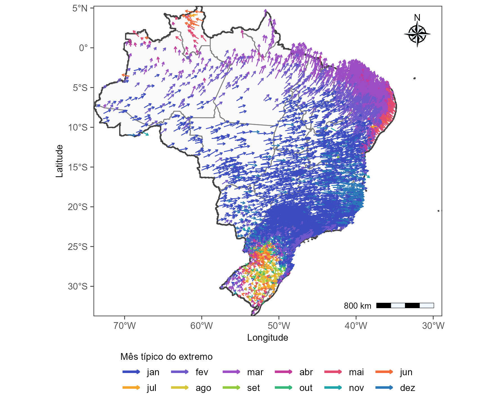
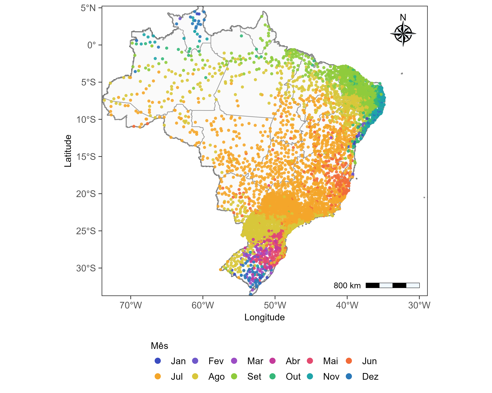
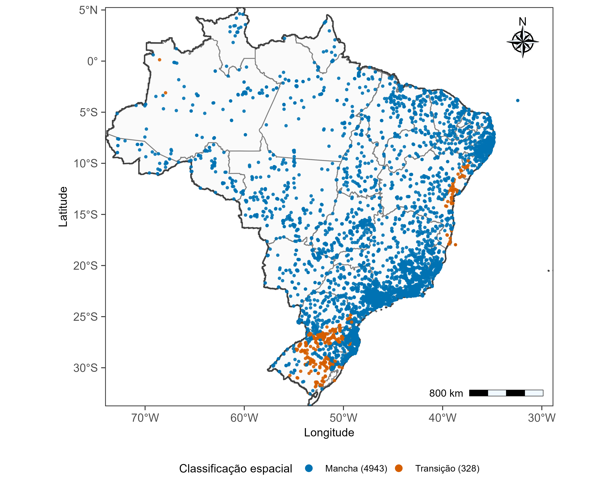
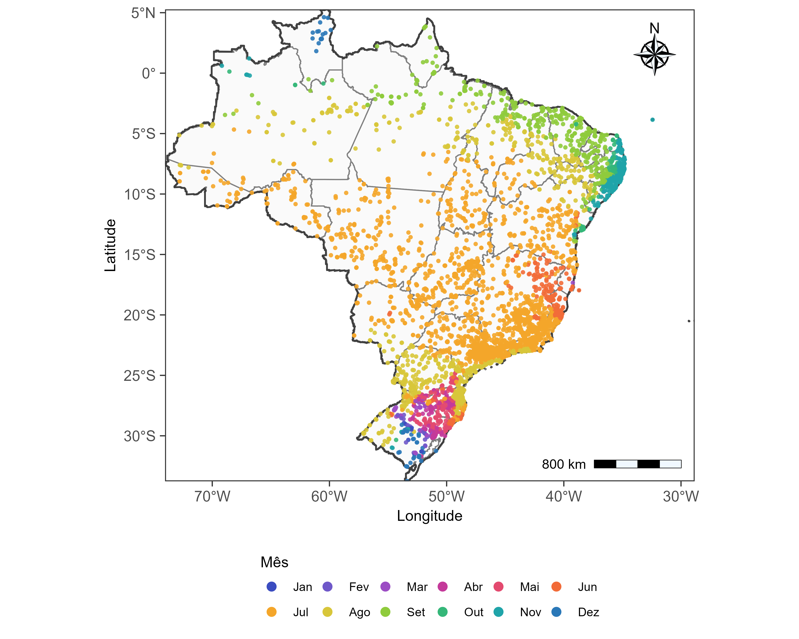

### Definição do ano hidrológico

#### Sazonalidade circular dos eventos extremos

A análise circular dos eventos extremos de precipitação revelou padrões espaciais distintos na época predominante de sua ocorrência ao longo do território brasileiro (@fig-vetores-rbar). A direção dos vetores representa a época típica dos extremos, enquanto seu comprimento é proporcional ao índice de concentração sazonal, $\bar{r}$. Em grande parte do Brasil Central, Sudeste e interior do país, predominaram eventos associados aos meses de novembro a janeiro. No Nordeste setentrional e na faixa litorânea oriental, destacaram-se ocorrências entre março e maio, enquanto na porção norte do país foram identificadas direções médias associadas principalmente aos meses de março a junho. A Região Sul, por sua vez, apresentou maior heterogeneidade direcional, com menor definição de uma época predominante de ocorrência dos extremos.

::: {#fig-vetores-rbar}

Vetores resultantes médios da análise circular dos eventos extremos de precipitação.
:::

Essa diferenciação regional também foi evidenciada pela distribuição de $\bar{r}$ (@fig-distribuicao-rbar). Nas estações situadas fora da Região Sul, os valores concentraram-se predominantemente entre 0,50 e 0,75, com frequência máxima próxima de 0,65, indicando maior concentração temporal dos eventos extremos. Em contraste, as estações do Rio Grande do Sul, Santa Catarina e Paraná apresentaram, em sua maioria, valores inferiores a 0,30, com maior frequência entre 0,05 e 0,15. Esse comportamento evidencia uma sazonalidade menos definida dos extremos na Região Sul, em comparação com grande parte do restante do território nacional.

{#fig-distribuicao-rbar width="95%" fig-align="center"}

#### Definição do mês inicial nas estações diárias

As diferenças identificadas na concentração sazonal fundamentaram a utilização de um procedimento híbrido para estabelecer o início do ano hidrológico. Nas estações com $\bar{r}\geq0{,}30$, adotou-se a direção oposta à ocorrência média dos extremos ($\bar{\phi}+\pi$), enquanto nos demais casos o mês inicial foi definido a partir da climatologia mensal de precipitação. A distribuição espacial desses critérios (@fig-fonte-ano-hidro) mostrou predominância da primeira abordagem nas regiões Norte, Nordeste, Centro-Oeste e Sudeste. Na Região Sul, especialmente no Rio Grande do Sul e em porções de Santa Catarina e Paraná, prevaleceu o critério baseado no último mês do maior período climatologicamente seco. A distribuição observada evidencia a necessidade de considerar diferentes características de sazonalidade na definição dos limites anuais das séries pluviométricas.

{#fig-fonte-ano-hidro width="95%" fig-align="center"}

A aplicação do procedimento híbrido permitiu determinar o mês de início do ano hidrológico para 5.659 estações pluviométricas diárias (@fig-ano-hidro-diario). Em grande parte do Brasil Central e do interior do Sudeste, predominaram os meses de junho e julho, com ocorrência de agosto em áreas de transição. No Nordeste, observou-se maior diversidade espacial, com meses iniciais entre agosto e setembro em áreas interiores e entre setembro e novembro em porções do norte e do leste da região. Na Região Norte, os meses de início variaram espacialmente, com predomínio de junho a setembro em extensas áreas do território.

{#fig-ano-hidro-diario width="95%" fig-align="center"}

Na Região Sul, a distribuição dos meses iniciais apresentou maior heterogeneidade, com predominância de agosto em partes do Paraná e de Santa Catarina e ocorrência de meses entre março e julho em diferentes áreas do Rio Grande do Sul. Esse padrão reflete a maior participação do critério climatológico na definição do ano hidrológico nessa região. Em conjunto, os resultados permitiram estabelecer uma referência temporal espacialmente diferenciada para a organização das séries de máximos anuais, considerando tanto a época predominante dos eventos extremos quanto a sazonalidade dos totais mensais de precipitação.

#### Transferência do ano hidrológico às estações subdiárias

A partir dos meses de início determinados para as estações diárias de referência, realizou-se sua transferência espacial para as estações subdiárias da base UNIPLU. A aplicação do procedimento permitiu atribuir o mês inicial do ano hidrológico, preservando, em linhas gerais, os padrões regionais identificados na análise das séries diárias.

A classificação espacial indicou predominância de estações situadas em áreas de concordância local, denominadas *manchas*, que compreenderam 4.943 postos (93,8% do total). As demais 328 estações (6,2%) foram classificadas como áreas de transição, caracterizadas por menor concordância entre os meses de início das estações diárias vizinhas (@fig-classificacao-subdiario). A distribuição espacial dessas classes mostrou que as áreas de transição se concentraram principalmente na Região Sul, especialmente no Rio Grande do Sul, além de ocorrências localizadas no litoral oriental do Nordeste e em outras regiões do território nacional.

{#fig-classificacao-subdiario width="95%" fig-align="center"}

A maior concentração de áreas de transição no Sul é coerente com a heterogeneidade dos meses de início identificada anteriormente nas estações diárias, onde a menor concentração sazonal dos extremos favoreceu a utilização do critério climatológico. Nessas regiões, a existência de diferentes meses de início entre postos próximos reduz a predominância de uma única classe na vizinhança, justificando a aplicação da média circular ponderada. Em contrapartida, a predominância de *manchas* em grande parte do país indica maior concordância espacial dos meses atribuídos às estações diárias de referência.

A distribuição espacial dos meses de início transferidos às estações subdiárias apresentou padrões semelhantes aos observados na base diária (@fig-mes-inicio-subdiario). No Brasil Central e em extensas áreas do Sudeste, predominaram meses próximos de junho e julho, enquanto no Nordeste foram observados meses mais tardios, especialmente entre agosto e outubro, com variações nas áreas litorâneas. Na Região Sul, os meses atribuídos apresentaram maior heterogeneidade espacial, sobretudo no Rio Grande do Sul, onde foram identificadas diferentes épocas de início em localidades relativamente próximas.

{#fig-mes-inicio-subdiario width="95%" fig-align="center"}

A correspondência entre os padrões observados nas bases diária e subdiária decorre da própria estrutura de transferência espacial adotada, não constituindo uma validação independente dos meses atribuídos. Entretanto, a predominância de áreas com concordância local indica que, para a maior parte das estações subdiárias, a atribuição do mês inicial foi baseada em informações espacialmente consistentes entre os postos diários vizinhos. Nas áreas de transição, o uso da média circular ponderada permitiu considerar simultaneamente diferentes referências sazonais, evitando a imposição de uma única classe modal em regiões com maior heterogeneidade. Os meses de início obtidos foram utilizados posteriormente na organização dos registros e na extração das séries de máximos anuais de precipitação para as diferentes durações subdiárias.
