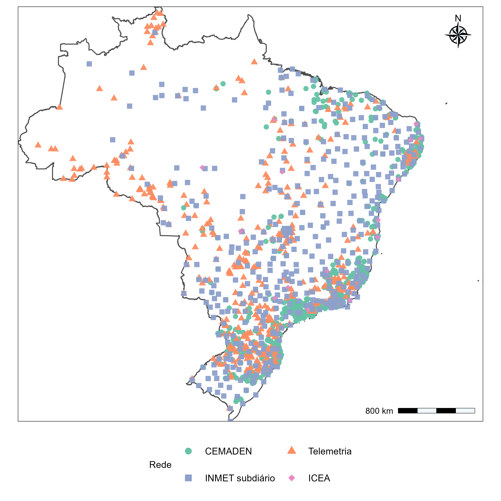
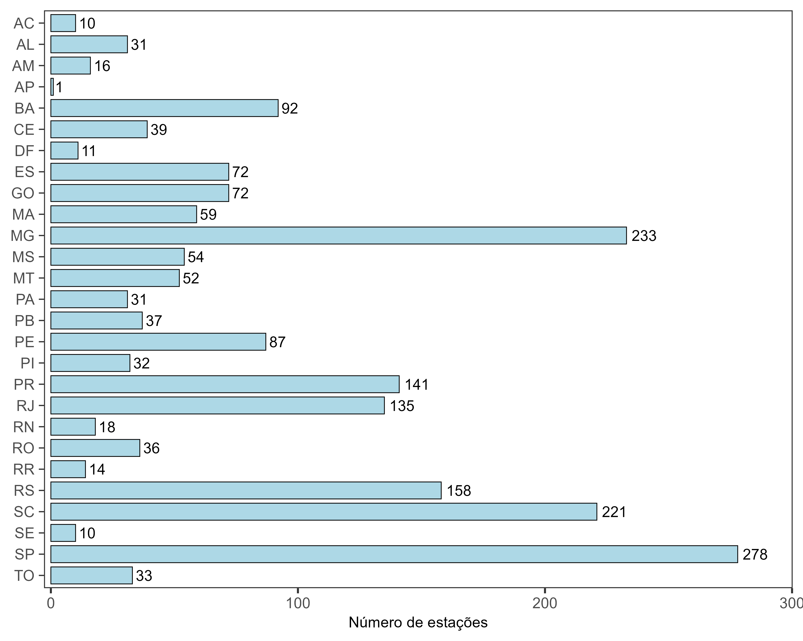

### Controle de qualidade e seleção das séries subdiárias

O catálogo UNIPLU-BR reuniu 21.395 estações, das quais 8.687 foram identificadas como candidatas à análise subdiária. Desse conjunto, 694 apresentaram impedimentos relacionados à consistência dos metadados, incluindo 435 por alterações de resolução temporal, 248 por inconsistências cadasis, oito por resolução inválida e três por associação a mais de uma unidade federativa. Outras 14 estações não apresentaram registros temporais válidos, resultando em 7.979 estações com processamento concluído.

A análise de sensibilidade dos critérios de completude e extensão das séries evidenciou diferenças na quantidade de estações elegíveis (@fig-sensibilidade-qc). Com tolerância de 10% de falhas, o número de estações diminuiu de 1.687 para 1.302 ao aumentar a exigência de sete para oito anos válidos. Com tolerância de 20%, foram identificadas 1.978 estações com pelo menos sete anos e 1.973 com pelo menos oito anos. A combinação de no máximo 20% de falhas anuais e pelo menos oito anos válidos foi adotada para preservar a cobertura espacial sem flexibilizar excessivamente o critério de completude.

{#fig-sensibilidade-qc width="95%" fig-align="center"}

Após a aplicação dos critérios de controle de qualidade e seleção temporal, foram aprovadas 1.973 estações pluviométricas subdiárias, distribuídas entre as redes CEMADEN (1.076), Telemetria (461), INMET subdiário (421) e ICEA (15). A distribuição espacial das estações (@fig-mapa-estacoes-qc) mostrou maior concentração no Sul, Sudeste e em áreas do Nordeste, enquanto as regiões Norte e Centro-Oeste apresentaram uma rede mais dispersa. Observam-se também diferenças na distribuição das redes de monitoramento, com maior presença de estações CEMADEN em áreas próximas ao litoral e em regiões de maior concentração de postos, enquanto as estações de Telemetria e INMET subdiário apresentam distribuição mais ampla pelo território nacional.

{#fig-mapa-estacoes-qc width="95%" fig-align="center"}

A distribuição por unidade federativa (@fig-estacoes-uf-qc) evidenciou maior número de estações aprovadas em São Paulo (278), Minas Gerais (233), Santa Catarina (221), Rio Grande do Sul (158), Paraná (141) e Rio de Janeiro (135). Em contrapartida, estados como Amapá, Acre, Roraima e Amazonas apresentaram menor disponibilidade de estações que atenderam aos critérios estabelecidos. Essa desigualdade espacial reflete a distribuição das redes observacionais e a disponibilidade de séries com completude suficiente, constituindo uma limitação importante para a abrangência territorial das análises subsequentes.

::: {#fig-estacoes-uf-qc}

Número de estações pluviométricas subdiárias aprovadas após o controle de qualidade por unidade federativa, considerando o limite máximo de 20% de falhas anuais e o mínimo de oito anos válidos.
:::